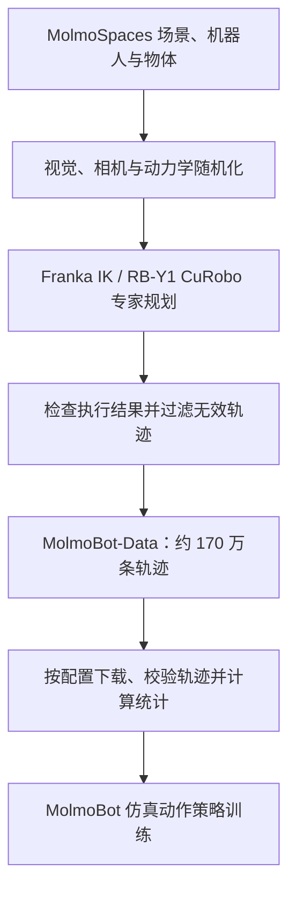
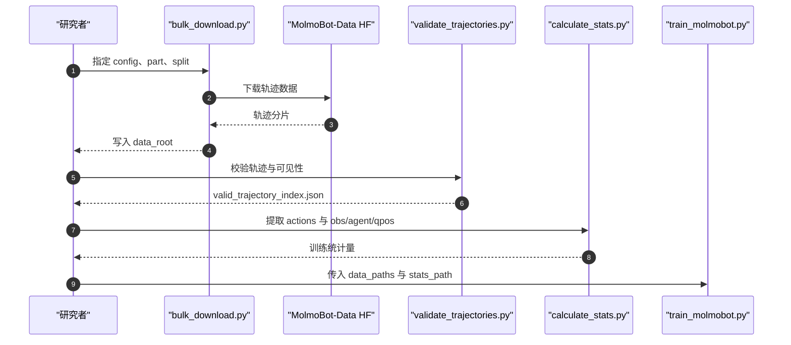

# MolmoBot-Data

## 一句话定义

**MolmoBot-Data**：Ai2 在 MolmoSpaces 中程序化生成的 **约 170 万条仿真专家轨迹（5,704 小时、94.2k 场景）**，用于 Franka FR3 与 Rainbow RB-Y1 的操作策略训练。请区分：**机器人策略未使用真机示教，但 MolmoBot 的 Molmo2-4B VLM 基座已在真实图像、视频等数据上预训练**（[主论文](./paper-molmobot.md)）。

## 英文缩写速查

| 缩写 | 英文全称 | 简要说明 |
|------|----------|----------|
| Sim2Real | Simulation to Real | 仿真到真实迁移 |
| RB-Y1 | Rainbow Robotics RB-Y1 | 论文中的移动双臂机器人 |
| VLM | Vision-Language Model | Molmo2-4B 视觉语言预训练基座 |
| zero-shot | 零样本 | 未经真机微调的迁移 |

## 数据集速查

| 维度 | 速查 |
|------|------|
| 机构 | Allen Institute for AI（Ai2） |
| 时间 | 2026-03 |
| 许可证 | 以官方数据集卡及构成资产许可为准 |
| 重定向就绪度 | 未评估：需按目标机器人形态核对动作与观测空间 |
| 规模 | **约 170 万条专家轨迹、5,704 小时、94.2k 场景**（论文 v3 附录 Table 3/4） |
| 平台 | Franka FR3 桌面操作；Rainbow Robotics RB-Y1 移动操作 |
| 任务 | 六种语义任务（Pick、PnP Into/Next-To/Color、Open、Open-door），数据发布为八种机器人/任务配置；不能混算 |

## 为什么重要

- 论文展示大规模仿真机器人动作监督结合既有视觉预训练表征可实现部分刚体操作的零样本真机迁移。
- 将机器人操作数据来源与 VLM 基座预训练来源分开，避免对“完全不用真实数据”的错误理解。

## 核心原理

MolmoBot-Engine 使用 MolmoSpaces 任务和资产随机化、相机与物理参数变化，基于 Franka IK / RB-Y1 CuRobo 规划专家操作并过滤无效轨迹；官方数据在 Hugging Face 按 config、part、split 分块发布。八种配置不代表八个独立技能。

### 流程总览

流程按[MolmoB0T 原论文](../../sources/papers/molmobot_arxiv_2603_16861.md)方法和官方 [MolmoSpaces](https://github.com/allenai/molmospaces) README 归纳，非推断单一代码入口。

## 工程实践

| 项 | 说明 |
|----|------|
| 获取 | [官方数据集](https://huggingface.co/datasets/allenai/molmobot-data)，使用 `bulk_download.py` 按配置、分片和 split 下载 |
| 处理 | 官方 `validate_trajectories.py` 生成有效轨迹索引，`calculate_stats.py` 计算 `actions` 与 `obs/agent/qpos` 统计量 |
| 训练 | 官方 `launch_scripts/train_molmobot.py` 读取处理后的轨迹及统计数据，模型训练细节见[论文节点](./paper-molmobot.md) |

## 源码运行时序图

官方仓 README 明确了下载、校验、统计、训练的顺序，下面仅映射可核实 CLI 步骤：

## 局限与风险

- 论文的抓放及开门场景不足以覆盖柔性物体、高接触复杂操作和长期可靠部署。
- 旧二手综述称“180 万条”，现据论文 v3 附录 Table 3/4 更正为“约 170 万条”；八种数据配置并非八种互不相同的语义技能。
- 模型使用了真实视觉数据预训练的 Molmo2 基座，不应称整套权重只接触仿真数据。

## 关联页面

- [MolmoB0T 独立论文详情：零样本仿真到真机的条件与边界](./paper-molmobot.md)

- [具身数据集全景（85 项去重映射）](../overview/embodied-dataset-panorama-2026-10.md)
- [embodied-scaling-laws](../concepts/embodied-scaling-laws.md)
- [vla](../methods/vla.md)
- [imitation-learning](../methods/imitation-learning.md)

## 参考来源

- [MolmoBot-Data 官方数据集原文核查](../../sources/datasets/allenai-molmobot-data.md)
- [MolmoB0T 论文 v3 通读归档](../../sources/papers/molmobot_arxiv_2603_16861.md)
- [MolmoBot 官方源码核查](../../sources/repos/allenai-molmobot.md)
- [2026-10-19 公众号综述：全球 85 个具身智能数据集全景](../../sources/datasets/wechat-embodied-dataset-panorama-2026-10-19.md)

## 推荐继续阅读

- [MolmoB0T 原论文全文](https://arxiv.org/html/2603.16861v3)
- [MolmoBot/MolmoSpaces 官方训练与数据处理文档](https://github.com/allenai/MolmoBot/blob/main/MolmoBot/README.md)
- [官方数据页](https://huggingface.co/datasets/allenai/MolmoBot-Data)
