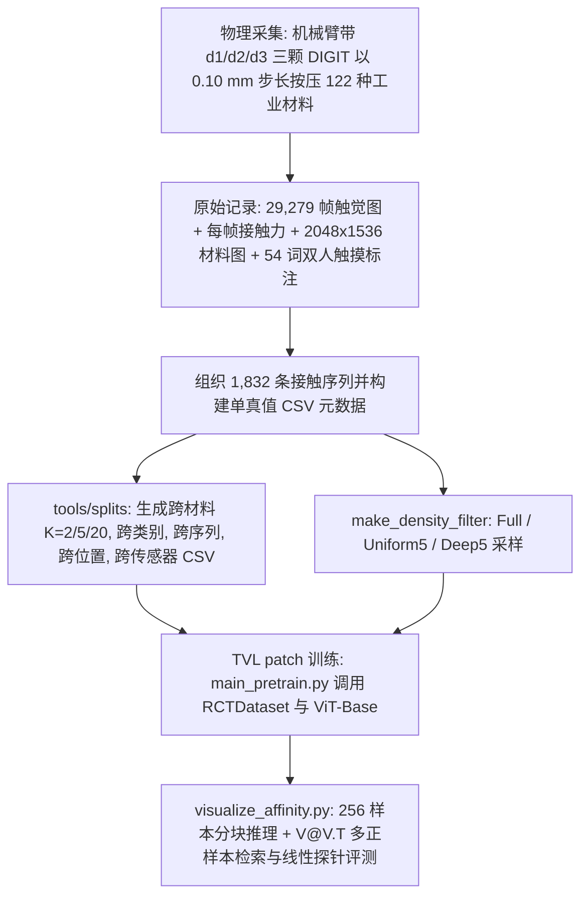
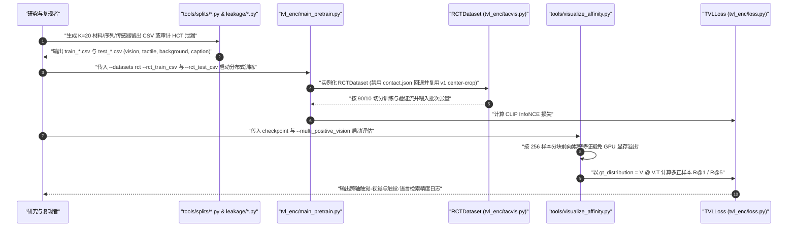

# RCT（Robotic Contact Tactile）

## 一句话定义

**英文全称 / 原始题目**：*RCT: A Robot-Collected Touch-Vision-Language Dataset for Tactile Generalization*（`arXiv:2606.31694v1`，ScaDS.AI / LASR Lab, TU Dresden，2026）。

**RCT** 是由机械臂搭载三颗并行 DIGIT 传感器对 **122 种**工业标准材料进行自动化垂直按压采集的“触觉-视觉-语言（Touch-Vision-Language）”数据集与受控泛化评测基准，共包含 **29,279 帧**触觉图像与 **1,832 条**按按压深度递增记录的**接触序列（contact sequences）**，旨在剥离同序列邻近帧泄漏（trajectory leakage）、定量衡量触觉表征在未见材料与未见传感器上的真实泛化能力。

## 英文缩写速查

| 缩写 | 英文全称 | 简要说明 |
|---|---|---|
| **RCT** | Robotic Contact Tactile | 本文提出的数据集与跨轴泛化评测基准 |
| **TVL** | Touch-Vision-Language | 上游三模态对比学习框架与基线代码库 |
| **HCT** | Human Collected Tactile | TVL 中人工手持采集的在野触觉子集（被审计存在序列级泄漏） |
| **DIGIT** | DIGIT Optical Tactile Sensor | 基于内嵌 LED 照明与弹性体凝胶的高分辨率视觉触觉传感器 |
| **VLM** | Vision-Language Model | 视觉语言模型（文中以 Gemma-3-27B 对照人工触摸语义标注） |

## 为什么重要

1. **戳破“帧级随机切分”造成的触觉模型虚高指标**：论文审计上游 TVL/HCT 发布的标准划分后发现，**100%（279/279）** 的测试集接触序列均同时存在于训练集中，且与训练集最近帧中位仅隔 1 个时间步；免训练的原始像素 L2 最近邻就能在 **350/356（98.3%）** 的测试帧上召回所属原序列（跨/同序列距离中位比 `2.6×`）。在 RCT 上仅将划分从帧级随机切换为**接触序列不重叠**，TVL 的触觉→文本 R@1 即从 `80.01%` 暴跌 **17.7 个百分点**至 `62.33%`。
2. **揭示“跨材料泛化”仍是触觉表示的核心短板**：当进一步要求模型在 **20 种完全未见过的材料（K=20 held-out）** 上检索时，TVL 基线 R@1 再度下滑 **42.0 个百分点**至 `20.35%`（3 种子多样划分均值 `25.13 ± 6.14%`），且跨传感器留出（留出第三颗 DIGIT `d3`）准确率低至 `21.51%`（触觉→视觉仅 `13.00%`），逼近未见材料的难度上限。
3. **分离视觉外观与真实触摸语义**：高分辨率外观照片与触觉感受并不等价——仅靠表面照片生成触觉词的 Gemma-3-27B 与人类“实际触摸后标注”的 Jaccard 重合度仅 `0.110` / `0.108`（远低于两位人类标注员之间的 `0.294`），且 **38%** 材料出现零词重合。

## 核心原理

### 数据集速查

| 维度 | 核心内容（核对自论文全文 `arXiv:2606.31694v1` 与 `faerber-lab/RCT`） |
|---|---|
| **规模** | **29,279 帧** DIGIT 触觉 RGB 图像 + **1,832 条**有序接触序列（典型每序列 15–17 帧，随材料形变以 `0.10 mm` 步长加压）+ 122 张工作室参考照片 |
| **模态** | 触觉 RGB（3 颗 DIGIT `d1/d2/d3` + 每序列空载背景帧）、每帧同步接触力、材料级 `2048×1536` 高分辨率参考图、54 词受控触觉语义词表标注（双人触摸并集） |
| **材料覆盖** | **122 种**工业标准样品（Modulor GmbH *Musterkiste*，7 类：Plastic/Rubber 33、Paper/Cardboard 45、Metal 20、Textiles/Leather 10、Wood/Bamboo/Cork 7、Crafts 4、Small Items 3） |
| **许可证** | 代码（TVL patch + 工具脚本）：**Apache-2.0**；数据集（Figshare）：**CC BY 4.0** |
| **适配形态** | 工业机械臂末端旋转三传感器转接夹具（3 颗平行安装 DIGIT），采集位置 p1–p4 密集（约 5,800 帧/位）、p5 覆盖 75 材料、p6–p18 稀疏分布 |
| **重定向就绪度** | **面向表征评测开箱即用**：基于 CSV 单一真值表与 TVL `RCTDataset` 加载器支持跨材料/类别/序列/位置/传感器 5 轴留出；因无机械手动作标签，不直接面向策略动作重定向 |

### 核心机制与评测设计

- **接触序列级元数据结构**：不同于把触觉图像打散成独立帧的做法，RCT 为每一帧显式绑定 `(material_id, category, sensor_id, position_id, sequence_id, indentation_step, contact_force)`，使下游可严格隔离任意维度的训练集-测试集交集。
- **多正样本触觉→视觉评估**：因为同一种材料下数百帧触觉样本共享同一张 `2048×1536` 工作室参考图，传统视觉-触觉检索使用的严格对角正样本判定会把同材料其他接触帧误判为负样本。RCT 在 `TVLLoss` 中新增 `use_vision_gt_distribution=True`，以 `V @ V.T` 识别共享视觉嵌入的等效正样本。
- **触觉-语言软标签对比学习**：沿用 ViT-Base（`vit_base_patch16_224`）作为触觉编码器与 OpenCLIP ViT-L/14 作为冻结视觉/文本特征底座，使用 InfoNCE 对比损失与文本嵌入余弦相似度软阈值（`0.6356`）计算检索准确率。

### 流程总览

## 实验与评测

### 五维泛化落差与轨迹泄漏审计

- **泄漏剥离曲线（TVL 基线触觉→文本 R@1）**：
  - 帧级随机划分：`80.01%`
  - 转至序列不重叠评测池：`62.33%`（**−17.7 pp** 泄漏水分；直接在序列留出划分训练测试：`62.44%`）
  - 转至 K=20 未见材料（seed 42 diverse）：`20.35%`（继续下跌 **−42.0 pp**；3 种子 diverse 均值 `25.13 ± 6.14%`，类别均衡划分 `29.79 ± 2.93%`）
- **序列内帧冗余检验（序列留出池）**：
  - 全量训练 `Full`（22,576 帧）：tac→text `62.44%`，tac→vis `70.95%`；
  - 仅保留最深 5 帧 `Deep5`（7,055 帧）：`59.52%` / `65.96%`；
  - 跨深度均匀采样 5 帧 `Uniform5`（7,055 帧，仅约 1/3 数据量）：反而达到 **`68.18%` / `78.29%`**（减少同接触深度的冗余过拟合后泛化更优）。
- **传感器与位置轴外推**：
  - 跨位置留出（`p5` 测试，`p1–p4` 训练）：tac→text `65.46%`，tac→vis `74.16%`；
  - 跨传感器留出（留出 `d3`，仅在 `d1+d2` 训练）：tac→text 骤降至 `21.51%`，tac→vis 仅 `13.00%`，揭示传感器个体胶垫/照明出厂偏差足以击穿未校准模型。

### 下游线性探针与核心结论

- **材料可分性**：在 K=20 留出材料上冻结触觉编码器，RCT 训练模型的类间-类内余弦间隔 `m = d_inter - d_intra` 达 **`0.297 ± 0.020`**，显著优于上游 TVL 预训练权重（`0.048 ± 0.010`）与随机初始化（`0.004 ± 0.001`）；7 类材质线性分类准确率 **49.8%**（vs TVL `34.2%`，Random `37.8%`）。
- **触觉力学信息瓶颈**：在二分类软/硬（soft/hard）探测上准确率仅为 `52.2%`（多数类基线为 `59%`），说明以共享照片和离散材质词为监督的对比学习仍主要提取微观表面纹理而非物理刚度。

### 与其他工作对比

| 数据集/基准 | 传感器与主体 | 数据规模与序列组织 | 跨实例/传感器切分支持 | 核心聚焦 |
|---|---|---|---|---|
| **RCT（2026）** | 机械臂 + **3 颗并行 DIGIT** | 29,279 帧 / 1,832 序列 / 122 材料 | 原生支持材料、类别、序列、位置、传感器 5 轴留出 | 审计泄漏、测试跨材料与跨传感器表示泛化 |
| **TVL / HCT** | 人工手持 DIGIT | ~39k 帧 / 无独立标准材料锁 | 原划分测试集 100% 序列与训练集交叠 | 大规模开放词汇触觉-视觉-语言预训练 |
| **VisGel（2019）** | KUKA + **1 颗 GelSight** | 300 万帧 / 12,000 次触碰 / 195 物体 | Seen (30) / Unseen (30) 物体划分 | 视觉↔触觉跨模态像素级生成 |

## 源码运行时序图

[`faerber-lab/RCT`](https://github.com/faerber-lab/RCT) 以补丁包 `tvl_modifications.patch` 叠加于 `Max-Fu/tvl`（commit `f489503`），配套 `tools/splits/` 与 `tools/leakage/` 提供完整划分生成、审计及分块评估链路：

## 工程实践

1. **上游依赖与补丁应用**：官方代码并非独立仓库，必须克隆 `Max-Fu/tvl` 并锁定 `git checkout f489503`，随后执行 `git apply tvl_modifications.patch` 并将 `tools/*/*.py` 拷贝至 `tvl_enc/tools/`。
2. **CSV 即唯一真值**：不同于上游 HCT 依赖目录隐式推导 `contact.json` / `synonyms.json`，`RCTDataset` 强制关闭近义词替换（`replace_synonyms=False`）且严格读取 `--rct_train_csv` 与 `--rct_test_csv`，便于任意组合消融对比实验。
3. **采样密度工程建议**：在算力受限或需要快速迭代触觉表示时，优先采用 `make_density_filter.py` 生成的 `Uniform5`（每条按压序列均匀抽 5 帧，约 7,055 帧）而非全量帧或仅取最大按压深度 `Deep5`——既节省约 2/3 训练开销又消除深压静态冗余，精度反而更高。
4. **评估显存保护**：在较大测试池（如全量 `test.csv`）上评估时，务必保留补丁版的 256 样本分块前向推理逻辑与 `--multi_positive_vision` 开关，否则原版 TVL 全量单次前向会消耗超过 70 GB 显存导致 OOM 且严重低估触觉→视觉召回。

## 常见误区与局限

- **不要使用帧级随机划分替代接触序列留出**：同一次压入过程相邻 `0.10 mm` 步长之间的弹性体表面背景纹路几乎完全一致，随机划分只能测出模型对传感器背景和瞬态微变的过拟合记忆，而非跨材料语义理解。
- **跨传感器脆弱性未内置消除**：尽管硬件上使用三颗同型号 DIGIT `d1/d2/d3`，当模型只在 `d1/d2` 上训练时对 `d3` 泛化仍会退化至与未见材料相当的水平（`21.51%`），跨硬件部署前必须做实例标定、多传感混合训练或背景差分对齐。
- **物理刚度/力估计监督缺失**：论文未在模型训练阶段将同步采集的每帧接触力纳入多任务监督，也未将 122 种样本拓展至异形曲面（均为平整参考片）。
- **seed=42 多样化划分的历史微瑕**：早期实验生成 K=20 diverse seed=42 切分时曾因 1 条标签编号不一致而基于 121/122 材料生成；官方已在随库发布的元数据与 `tools/results/` 说明中予以修正与记录。

## 关联页面

- [embodied-eval-benchmark-selection-loop.md](../queries/embodied-eval-benchmark-selection-loop.md) — 数据切分防泄漏、评测闭环与基准挑选原则
- [dataset-visgel.md](./dataset-visgel.md) — 跨模态视觉-触觉生成配对基准（Seen/Unseen 物体验证范式）
- [dataset-ycb-slide.md](./dataset-ycb-slide.md) — DIGIT 多传感器实例标定与在物滑动数据集
- [tactile-sensing.md](../concepts/tactile-sensing.md) — 视觉触觉传感基础原理
- [visuo-tactile-fusion.md](../concepts/visuo-tactile-fusion.md) — 视觉-触觉-语言多模态表征融合
- [embodied-dataset-panorama-2026-10.md](../overview/embodied-dataset-panorama-2026-10.md) — 具身数据与触觉子集全景图

## 参考来源

- [rct_arxiv_2606_31694_reading.md](../../sources/papers/rct_arxiv_2606_31694_reading.md) — 论文全文与仓库代码精读核对档案（`arXiv:2606.31694v1`）
- [wechat-embodied-dataset-panorama-2026-10-19.md](../../sources/datasets/wechat-embodied-dataset-panorama-2026-10-19.md) — 具身数据集梳理线索归档
- [RCT 官方项目页](https://faerber-lab.github.io/RCT/) · [GitHub: faerber-lab/RCT](https://github.com/faerber-lab/RCT) · [Figshare 数据集](https://figshare.com/s/a5ed417ba6602ccad0f6)

## 推荐继续阅读

- 先读 [embodied-eval-benchmark-selection-loop.md](../queries/embodied-eval-benchmark-selection-loop.md) 对照审查自建触觉数据集是否存在序列/轨迹级数据泄漏；
- 若关注传感器硬件层如何原生缓解“跨实例/跨传感器换装掉点”，继续阅读 [painode-146-anyskin.md](./painode-146-anyskin.md)；
- 若希望扩展至高分辨率三维局部形状与滑动定位，对比 [dataset-ycb-sight.md](./dataset-ycb-sight.md) 与 [dataset-ycb-slide.md](./dataset-ycb-slide.md)。
