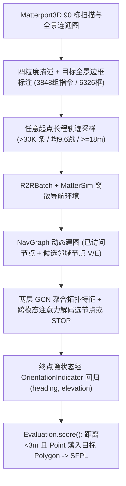
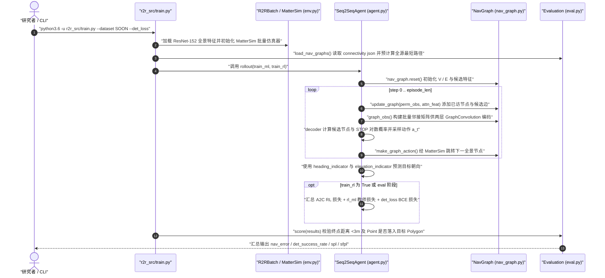

# SOON（FAO 数据集）

## 一句话定义

**SOON**（Zhu et al., CVPR 2021 [arXiv:2103.17138](https://arxiv.org/abs/2103.17138)）定义了**不依赖固定起点、只给出目标外观与多层环境语境描述**的场景导向目标导航任务，并发布配套 Matterport3D 大规模数据集 **FAO（From Anywhere to Object）**：含 **3,848 组指令**（均值 38.6 词）、**3,923 个目标物体的 6,326 个全景边界框**与 **30,000+ 条长程轨迹**，同时提出动态拓扑图探索方法 **GBE**。

## 英文缩写速查

| 缩写 | 英文全称 | 简要说明 |
|---|---|---|
| SOON | Scenario Oriented Object Navigation | 本文提出的场景导向目标导航任务（任意起点 + 全景方向定位目标） |
| FAO | From Anywhere to Object | SOON 任务配套构建的大规模真实室内场景数据集名称 |
| GBE | Graph-based Exploration | 本文提出的导航基线：动态拓扑图 `(V, E)` + GCN + 跨模态注意力 |
| SPL | Success weighted by Path Length | 最短路径长度加权成功率，衡量导航成功与路径效率 |
| SFPL | Success Rate of Finding weighted by Path Length | SOON 核心联合指标：`det_success_num * spl`，要求既走到目标附近（`<3 m`）又准确指向目标框内 |

## 为什么重要

1. **填补逐句路径指示（R2R）与零语境类别导航（ObjectNav）之间的空白：** 传统 R2R 假设从固定起点出发并跟随逐步路书（如「左转穿门」），而 ObjectNav 只给单一词类别名（如 `chair`）；SOON 贴近「去客厅挨着壁炉、带靠垫的米色扶手椅处」这类真实人类自然语言请求，要求智能体从房屋**任意位置**自主探索并最终在全景视角精准指认具体实例。
2. **显著拉长航程并暴露长程探索的巨大鸿沟：** FAO 轨迹长度跨越 15 m 至 >60 m（均值 9.6 跳），远超早年 4–6 跳的 VLN 基准；在未见房屋测试集（Test Unseen House）上人类取得 **SR 90.4% / SFPL 51.1**，而经典 GBE 基线仅获 **SR 11.9% / SFPL 1.4**，证明长程语义搜索、记忆建图与多步回溯探索极具挑战。

## 核心原理

### FAO 数据集速查与划分

- **底层环境与样本规模：** 基于 Matterport3D 90 栋建筑扫描连通图构建，总计 **3,848 组指令**（词表 1,649 词，**平均长度 38.6 词**），覆盖 **3,923 个目标物体**与 **6,326 个全景球面多边形边界框**，采样 **30,000+ 条轨迹**（最短路径要求 ≥18 m，若图上不可满足按 0.8 折减）。
- **四粒度场景描述（每组 3 条标注员改写）：** 同时描述目标自身外观属性、局部物体空间关系、所在房间区域特性及相邻房间的上下文线索。
- **数据集划分：**
  - **Train：** 3,085 组指令 / 28,015 条轨迹 / 38 栋房屋；
  - **Val Seen Instruction：** 245 组指令 / 1,225 条轨迹；
  - **Val Seen House：** 195 组指令 / 1,950 条轨迹；
  - **Val Unseen House：** 205 组指令 / 2,040 条轨迹；
  - **Test Unseen House：** 留出盲测集（约 218 组指令）。
- **许可证与具身适配：** `ZhuFengdaaa/SOON` 仓库代码采用 **MIT License**（底层 Matterport3D 扫描受其原始非商用条款约束）；动作基于离散全景节点跳转而非连续控制，迁移至实体机器人的底层导航需经运动学与局部避障**适配**，不可直接作连续物理**训练输入**。

### FAO 构建与 GBE 图探索流程

## 实验与评测

1. **Test Unseen House 人类与基线对比：** 在完全未见建筑测试集上，**人类表现**达到 **NE 1.46 m / OSR 94.3% / SR 90.4% / SPL 59.2 / SFPL 51.1**；而论文提出的 **GBE** 最佳变体（结合 IL + A2C + 次优探索监督）在同一测试集仅为 **NE 10.72 m / OSR 18.6% / SR 11.9% / SPL 10.2 / SFPL 1.4**（Val Unseen House 上随机/停止基线 SR ≤ 2–3%，验证了长程探索无法靠启发式盲走得分）。
2. **次优探索监督与图记忆作用：** 在 `agent.py` 中，通过 `rl_ml_weight` 控制只在偏差不超过 `rl_ml_th` 的自由探索路径上施加基于图 Dijkstra 最短路的模仿监督，相比纯 A2C RL 或纯 Teacher Forcing 均能显著缓解长程探索中的策略崩溃与分布偏移。

## 源码运行时序图

基于官方仓 [ZhuFengdaaa/SOON](https://github.com/ZhuFengdaaa/SOON) 中的 `run/eval.sh`、`r2r_src/train.py`、`r2r_src/env.py`、`r2r_src/agent.py`、`r2r_src/nav_graph.py`、`r2r_src/model.py` 与 `r2r_src/eval.py`：

## 工程实践

- **运行环境与依赖隔离：** 官方代码强依赖自编译的 C++ MatterSim（EGL/OSMesa 渲染）以及 Python 3.6 + 早期 `polyaxon_client` / `tensorboardX` 接口；在现代 Python 3.10+ 环境中迁移阅读或二次开发时，通常需剥离 Polyaxon 日志依赖并将 `r2r_src/eval.py` 中的 `Shapely` 评测逻辑独立导出。
- **区分两套目标定位评估模式：** `r2r_src/eval.py` 同时支持默认全景球面方向角判定（`!args.compute_bbox`：检查预测 `(heading, elevation)` 点是否落入四顶点球面 `Polygon`）与离散视角框判定（`args.compute_bbox`：校验视口角索引一致且 2D 框 IoU `> 0.5`），复现论文表数据时应确保 `--compute_bbox` 关闭以对齐原论文 SFPL 定义。
- **利用「多起点共享目标」特性：** 同一目标节点集合在 `FAO` 中对应多个远距离出发点；做大语言模型 / VLM 导航器或认知地图记忆研究时，可将已建图语义拓扑跨同场景多回合复用（参阅 [具身语义认知地图](../concepts/embodied-semantic-cognitive-map.md)）。

## 常见误区与局限

- **混淆 `SR`（导航成功率）与 `SFPL`（找寻加权成功率）：** 即使智能体恰好停在距目标 `< 3 m` 范围内（记入 `nav_success_rate`），若停止时没有在全景中把 `(heading, elevation)` 准确指向描述对应的目标实体多边形（如室内同时存在多张椅子但指错了哪一张），**SFPL 仍记为 0**。
- **离散拓扑全景跳转假设：** 依赖 Matterport3D 预设连通图节点之间的离散视点瞬间移动，不包含连续轮式运动学、低矮障碍物理碰撞、开门交互或动态行人避障。
- **静态离线特征限制细粒度视觉感知：** 原基线使用固定裁剪提取的 `ResNet-152-imagenet` 36 视角特征，缺少端到端原始像素级微小物感知与开放词汇多模态大模型的细粒度属性辨识能力。

## 关联页面

- [视觉语言导航（VLN）](../tasks/vision-language-navigation.md)
- [具身数据集全景对比（2026-10）](../overview/embodied-dataset-panorama-2026-10.md)
- [Matterport3D 仿真器](../entities/matterport3d-simulator.md)
- [Habitat-Sim](../entities/habitat-sim.md)
- [CVDN](./dataset-cvdn.md)
- [图神经网络（GNN）](../concepts/graph-neural-network.md)
- [具身语义认知地图](../concepts/embodied-semantic-cognitive-map.md)

## 参考来源

- [SOON / FAO 论文与源码归档（arXiv:2103.17138 / CVPR 2021）](../../sources/papers/soon_arxiv_2103_17138.md) — 本文 FAO 统计、四粒度定义、人类与 GBE 实验数值及 `r2r_src/` 时序均核对自此一次来源。
- [具身数据集全景综述（2026-10-19）](../../sources/datasets/wechat-embodied-dataset-panorama-2026-10-19.md) — 初始收录线索。

## 推荐继续阅读

- [视觉语言导航（VLN）](../tasks/vision-language-navigation.md)：系统梳理 R2R、REVERIE、CVDN 与 SOON 等代表性任务设定演变。
- [具身语义认知地图](../concepts/embodied-semantic-cognitive-map.md)：了解现代 VLM / 拓扑图记忆如何在任意起点长程寻物任务上突破低 SR 瓶颈。
