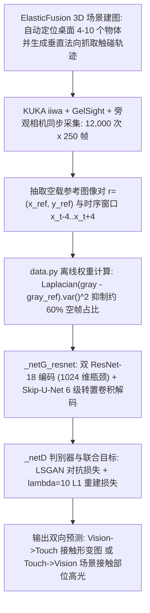
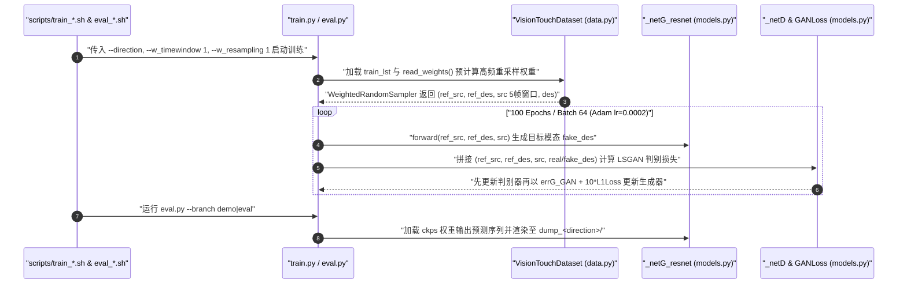

# VisGel（Connecting Touch and Vision via Cross-Modal Prediction）

## 一句话定义

**英文全称 / 原始题目**：*Connecting Touch and Vision via Cross-Modal Prediction*（CVPR 2019，`arXiv:1906.06322v1`，MIT CSAIL）。

**VisGel** 是 MIT CSAIL 构建的大规模自动化视觉-触觉配对数据集与双向跨模态条件生成（Vision↔Touch）框架，由 **KUKA LBR iiwa** 机械臂搭载 **GelSight** 光学触觉传感器及三脚架网络摄像头对 **195 个日常物体**执行 **12,000 次触碰**，形成 **300 万对同步视觉-触觉帧**，并通过引入未接触背景参考图与拉普拉斯方差重采样攻克了尺度落差与零接触模式坍塌难题。

## 英文缩写速查

| 缩写 | 英文全称 | 简要说明 |
|---|---|---|
| **VisGel** | Vision and GelSight | 本文发布的视觉-触觉配对数据集与生成方法 |
| **cGAN** | Conditional Generative Adversarial Network | 条件生成对抗网络（融合 LSGAN 与 L1 重建损失） |
| **LSGAN** | Least Squares Generative Adversarial Network | 最小二乘对抗损失，稳定双向图像生成训练 |
| **SLAM** | Simultaneous Localization and Mapping | 即时定位与建图（文中调用 ElasticFusion 规划触碰位置） |
| **AMT** | Amazon Mechanical Turk | 众包真实性评测平台（Real vs. Fake 与触觉相似度评估） |

## 为什么重要

1. **首个百万帧级、跨物体泛化的双向视觉-触觉基准**：以往工作受限于人工单点遥操规模有限或固定单物体假设，VisGel 利用 RGB-D 场景三维重构自动化采样接触轨迹，把真实世界配对图像推进到 **300 万帧 / 195 物体**量级，并严格验证对 **30 个未见物体**的泛化生成能力。
2. **精准诊断并解决了跨模态转换的两大底层障碍**：论文首次系统揭示了“全局旁观视角 vs 1.5 cm 局部凝胶视场”造成的**尺度与位置落差（Scale & Location Gap）**，以及采集序列中 **~60% 帧处于未接触悬空状态**引发的**模式坍塌（Mode Collapse）**，提出无需额外人工标注的纯数据驱动解法。
3. **验证无标注触觉预测作为表征抓手的可行性**：在 Touch→Vision（给定局部按压指纹反推物体与机械臂交互区域视觉影像）任务中，完全自监督的 VisGel 模型在“Feels Similar”一致性评估中对未见物体取得 **85.29%** 认可率，反超使用 1,000 张人工标注点微调的监督学习基线（`83.44%`）。

## 核心原理

### 数据集速查

| 维度 | 核心内容（核对自论文 `arXiv:1906.06322v1` 与 `YunzhuLi/VisGel` 仓库） |
|---|---|
| **规模** | **3,000,000 对**同步视觉-触觉帧（**12,000 次**触碰 × **250 帧/次**；Train 10,000 次 / 250 万对 / 165 物体；Test 2,000 次 / 50 万对，均分于 30 已见与 30 未见物体） |
| **模态** | 旁观 RGB 视频流（三脚架固定相机，272→256 裁剪）+ GelSight 表面法向/形变彩图与黑色标记点（输出 `128×128`）+ 每场景空载背景参考对 `(x_ref, y_ref)` |
| **物体集合** | **195 个**实体物体（45 个 YCB + 150 个食品/工具/厨具/织物/文具日常品，每场景随机摆 4–10 个） |
| **许可证** | 仓库根目录 **未附带独立 LICENSE 文件**（学术开源释放，商用或二次分发需联系作者团队确认） |
| **适配形态** | **KUKA LBR iiwa** 机械臂 + 末端 `1.5 cm × 1.5 cm` GelSight（红/绿/蓝/白 LED 照明）+ 后方独立固定 RGB 摄像头 |
| **重定向就绪度** | **仅适用跨模态感知与表征预训练**：数据提供图像对列表及重采样权重文件，不含关节力矩/策略控制指令与 URDF 动作重映射标签 |

### 双编码器 Skip-U-Net 与重采样机制

- **空间对齐参考机制（参考编码器 `resnet_ref`）**：在生成模型 `_netG_resnet` 中并行接入未接触基准图像对 `(x_ref, y_ref)`（6 通道拼接），与源时序窗口共同编码至 1024 维瓶颈特征并在上采样解码器每一尺度通过跳连接融合。参考图明确告知网络“机械臂位于桌面前何处”及“空载时的凝胶微结构底噪”。
- **时序窗口消融（`w_timewindow`）**：面对单一静止照片无法分辨“刚贴近物体”还是“已经压紧接触”的歧义，模型截取 `{t-4, t-2, t, t+2, t+4}` 共 5 帧灰度差值作为源输入，迫使卷积层捕捉接近速度与接触发生时刻。
- **高频梯度的样本重采样（`w_resampling`）**：在 `data.py`（`calc_weight`）中计算目标图像与参考帧差值的拉普拉斯方差平方（`cv2.Laplacian(gray - gray_ref).var() ** 2`），配合 PyTorch `WeightedRandomSampler` 显著提高实质接触瞬间的采样概率，避免生成器只学会输出平滑“无触碰平均脸”。

### 流程总览

## 实验与评测

- **Vision → Touch（看图猜触感）**：
  - AMT 真假判别通过率（理想不可分辨上限 `50%`）：VisGel 在 Seen 物体达到 **46.63%**（标准 pix2pix 仅 `28.09%`），Unseen 未见物体达到 **38.22%**（pix2pix 为 `21.74%`）。
  - 仓库官方参考指标（接触点/标志点变形误差）：Seen 物体平均 L2 误差 **`0.6439`**，Unseen 物体 **`0.7573`**。消融实验证明同时移除参考图或时间窗口都会导致触碰瞬间判断偏移与标记点形变模糊。
- **Touch → Vision（凭触感定交互情景）**：
  - 人类一致性评价（"Feels Similar"，400 张对比图）：Unseen 物体 **85.29%**，Seen 物体 **90.37%**，不仅大幅领先 pix2pix（`25.21%` / `44.52%`），且微弱超越使用 1,000 帧人工标注坐标微调的全监督 Stacked Hourglass 网络（`83.44%` / `89.20%`）。
  - AMT 真假判别通过率：Seen **30.50%**，Unseen **24.22%**。

### 与其他工作对比

| 维度 | VisGel（CVPR 2019） | YCB-Sight（ICRA 2022） | RCT（2026） |
|---|---|---|---|
| **核心任务** | 双向视觉-触觉像素级跨模态预测 | 稀疏视觉+稠密触觉三维 SDF 几何重建 | 三模态对比表征与多轴泛化防泄漏基准 |
| **视觉视角** | 桌面全局旁观 RGB Webcam | 标定固定 Azure Kinect RGB-D | 每类材料单张无接触工作室照片 |
| **数据规模** | 300 万帧 / 195 物体 | Sim 30 物体 + Real 6 物体 | 29,279 帧 / 1,832 序列 / 122 工业材料 |

## 源码运行时序图

[`YunzhuLi/VisGel`](https://github.com/YunzhuLi/VisGel) 开源了完整的双方向训练、评估与重采样链路，通过 `scripts/*.sh` 调用 `train.py` 与 `eval.py`：

## 工程实践

1. **存储与环境适配代价**：完整训练集 `data_seen`（328 GB）与 `data_unseen`（83.2 GB）体量极其庞大，仅跑通 Demo 可优先执行 `scripts/download_ckps.sh`（~500 MB）与 `scripts/download_demo.sh`（~570 MB）。此外原代码基于较老的 **PyTorch 0.3.1 / Python 3.7** 编写（内含 `torch.autograd.Variable(volatile=...)` 与 `xrange`），在现代 PyTorch 2.x 环境复现需迁移为 `torch.no_grad()` 与 `range` 并调整 `transforms.Scale` 为 `Resize`。
2. **背景锚点与静态相机假设**：在自建产线复用 `_netG_resnet` 时，务必在每次场景重置或光照大幅变化后同步刷新空载参考帧 `(x_ref, y_ref)`，且旁观相机不能随手眼大幅晃动（若相机位姿不固定，请改用随动腕部相机并将机器人自身运动学投影入参考特征）。
3. **重采样权重计算策略**：若自有触觉数据同样存在长时间悬空帧，建议直接复用 `data.py` 中的 `variance_of_laplacian(gray - gray_ref) ** 2` 作为离线采样概率权重，通常比手动设置接触阈值阈值更鲁棒且保留接触瞬间的动态过渡帧。

## 常见误区与局限

- **物理力与绝对深度的缺失**：GelSight 图像中的 RGB 值与标记点位置受不同传感器个体凝胶厚度、LED 老化的影响显著；VisGel 模型仅生成外观层面符合分布的视觉-触觉像素，并不能像 YCB-Sight 那样输出可微米级积分的真实局部接触深度或三维力场。
- **Touch → Vision 的空间反演多解性**：仅依靠单指 `1.5 cm` 局部触觉贴片在面对大片纹理单调（如平板桌面）或重复结构物体时存在天然空间歧义，生成器在无强背景参考约束下往往回退到平均手臂姿态。
- **许可证风险提醒**：仓库中未随附标准开源许可证（LICENSE 文件缺失），商业产品直接打包其源码或 300 万对图像前必须先联系 MIT CSAIL 原作者获得正式授权。

## 关联页面

- [dataset-rct-robotic-contact-tactile.md](./dataset-rct-robotic-contact-tactile.md) — 跨材料/跨传感器触觉-语言泛化防泄漏基准
- [dataset-ycb-sight.md](./dataset-ycb-sight.md) — 同用 GelSight 与 RGB-D 但聚焦三维 SDF 形状重建的数据集
- [painode-151-gelsight.md](./painode-151-gelsight.md) — GelSight 传感器原理与硬件节点
- [tactile-sensing.md](../concepts/tactile-sensing.md) — 视觉触觉传感机理
- [visuo-tactile-fusion.md](../concepts/visuo-tactile-fusion.md) — 视觉-触觉跨模态融合表征与生成路线
- [embodied-dataset-panorama-2026-10.md](../overview/embodied-dataset-panorama-2026-10.md) — 具身学习数据集全景索引

## 参考来源

- [visgel_arxiv_1906_06322_reading.md](../../sources/papers/visgel_arxiv_1906_06322_reading.md) — CVPR 2019 原文全文与 `YunzhuLi/VisGel` 仓库脚本核对档案
- [wechat-embodied-dataset-panorama-2026-10-19.md](../../sources/datasets/wechat-embodied-dataset-panorama-2026-10-19.md) — 具身数据集梳理线索归档
- [VisGel 项目页](http://visgel.csail.mit.edu/) · [arXiv:1906.06322](https://arxiv.org/abs/1906.06322) · [GitHub: YunzhuLi/VisGel](https://github.com/YunzhuLi/VisGel)

## 推荐继续阅读

- 若你正在构建视觉-触觉策略模型且面临“触觉信号稀疏”问题，重点借鉴 [data.py](https://github.com/YunzhuLi/VisGel/blob/master/data.py) 中的拉普拉斯方差重采样，再衔接 [visuo-tactile-fusion.md](../concepts/visuo-tactile-fusion.md)；
- 若目标不是图像翻译而是高精度几何轮廓重建，继续阅读 [dataset-ycb-sight.md](./dataset-ycb-sight.md) 与 [dataset-ycb-slide.md](./dataset-ycb-slide.md)。
