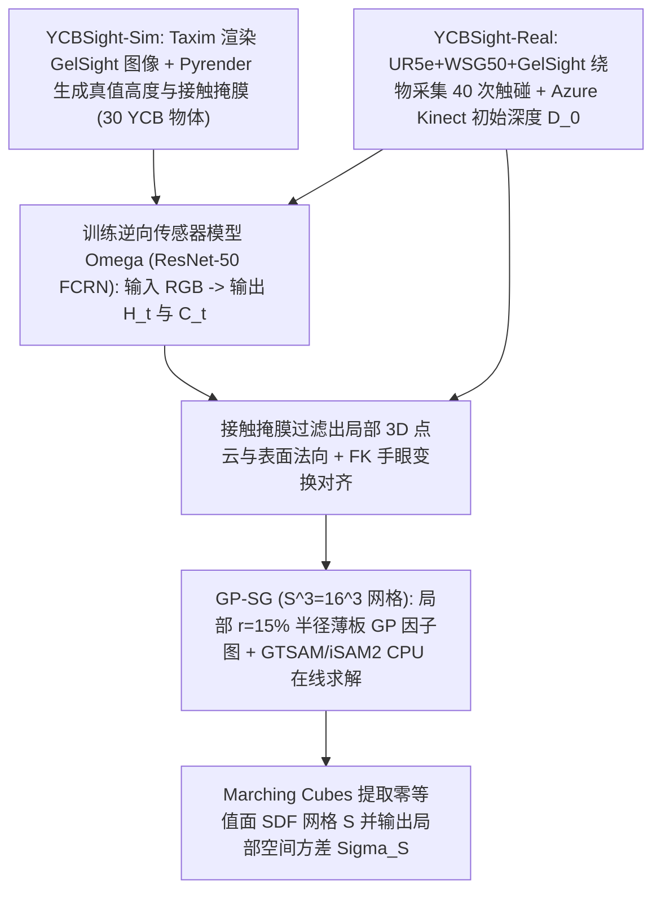
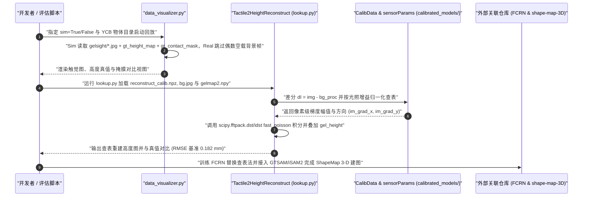

# YCB-Sight（ShapeMap 3-D 视觉-触觉形状建图数据集）

## 一句话定义

**英文全称 / 原始题目**：*Efficient shape mapping through dense touch and vision*（ICRA 2022，`arXiv:2109.09884v3`，CMU / BYU）。

**YCB-Sight** 是为**稀疏视觉与局部稠密触觉联合三维重建（ShapeMap 3-D）**构建的“仿真 + 真机”双轨基准数据集，涵盖 **30 个 YCB 物体**的 **Taxim/Pyrender** 仿真配对高度图与 **6 个 YCB 物体**在 **UR5e + GelSight + Azure Kinect** 平台上实测的全局深度图、FK 接触位姿与高分辨率触觉图像。

## 英文缩写速查

| 缩写 | 英文全称 | 简要说明 |
|---|---|---|
| **FCRN** | Fully Convolutional Residual Network | ResNet-50 结构的全卷积残差网络，从单张触觉图反演局部高度图与接触掩膜 |
| **GP-SG** | Gaussian Process Spatial Graph | 高斯过程空间因子图，将全球隐式场拆解为局部因子以高效增量求解 |
| **SDF** | Signed Distance Function | 符号距离场，用于统一表达全局视觉点云与局部触觉点云并提取等值面 |
| **iSAM2** | Incremental Smoothing and Mapping 2 | 基于 GTSAM 的实时增量因子图 MAP 优化求解器 |
| **FK** | Forward Kinematics | 机器人正运动学，用于提供真实每次按压时的 GelSight 传感器 3D 位姿 |

## 为什么重要

1. **填补从“2D 触觉纹理”到“3D 度量级几何形状重建”的数据断层**：相较主要服务图像翻译或分类的数据集（如 VisGel），YCB-Sight 在仿真子集中提供了高精度真值局部高度图 `gt_height_map`、二值接触掩膜 `gt_contact_mask` 与俯视深度 `depthCam.npy`，支持直接训练无需逐物体标定参数的神经网络逆向传感器模型。
2. **兼顾仿真大规模预训练与真机跨视角融合验证**：`YCBSight-Sim` 覆盖 **30 个 YCB 物体**（660 帧/物体随机位姿训练 + 6 物体评测），`YCBSight-Real` 则提供真机手眼标定 `tf.json`、Kinect 初始单帧深度与机械臂 40 次绕物盲区按压，直观验证触觉对视觉自遮挡与背面盲区的增量补全作用。
3. **验证 CPU 实时局部高斯过程因子图架构可行性**：配合论文提出的 **ShapeMap 3-D**，证明将全图 O(N³) 的 GP 隐式建图拆分为局部 `15%` 半径的一元因子图并在 **iSAM2** 中增量求解，可在普通笔记本 CPU（`i7-7820HQ`）上以交互速度收敛到 `18.3 mm^2` 平均 Chamfer Distance。

## 核心原理

### 数据集速查

| 维度 | 核心内容（核对自论文 `arXiv:2109.09884v3` 与 `Robo-Touch/YCB-Sight` 仓库） |
|---|---|
| **规模** | **Sim**：30 个 YCB 物体（用于 FCRN 训练与验证的 660 帧/物体，含 6 个留出评测物体；另 6 物体各 60 次均匀法向按压评测）。**Real**：同款 6 个评估物体各 **40 次**真实按压（~20 分钟/物体）+ 初始单帧 Kinect 深度 |
| **模态** | GelSight RGB（真机 `640×480`，有效面积 `2.66 cm^2`）、Azure Kinect 深度与点云（约 1 m 固定视角）、传感器 6D 位姿、`gt_height_map` 与 `gt_contact_mask`（仅仿真）、手眼变换 `tf.json` 与标定查表模型 |
| **许可证** | 数据集：**CC BY-SA 4.0**；仓库内可视化与查找表代码：**MIT License** |
| **适配形态** | **UR5e** 6 轴机械臂 + **WSG50** 夹爪末端挂载 **GelSight** + 外部固定 **Azure Kinect**（物体用台钳固定） |
| **重定向就绪度** | **适用于三维重建、手眼融合与逆传感器模型训练**：直接提供标定参数与标准文件格式；仅提供单臂定点按压 FK 位姿，不直接提供灵巧手连续遥操轨迹 |

### ShapeMap 3-D 与逆向传感器建模机制

- **神经网络逆向传感 `Ω: I_t → (H_t, C_t)`**：在 `YCBSight-Sim` 上通过 Taxim 仿真合成渲染与 Pyrender 深度真值配对，使用基于 ResNet-50 的 **FCRN** 同时端到端预测接触高度图 `H_t` 与有效接触掩膜 `C_t`，相比依赖单传感器离线标定的物理查表法+快速泊松积分（仓库内 `lookup.py`），对光强不均、标定漂移及复杂压痕边缘具有更强抗噪性。
- **高斯过程空间图（GP-SG）增量更新**：在边长 `S=16`（`16×16×16`）的三维查询网格上构建薄板样条（thin-plate）GP 隐式 SDF；将来自 Kinect 与每次 GelSight 接触掩膜裁剪出的点云与表面法向作为观测因子加入半径 `r`（物体特征尺寸的 `15%`）内的局部一元节点，利用 **GTSAM / iSAM2** 只重解受新触碰影响的局部查询网格变量，最后经 Marching Cubes 并剪除距离观测超 `r` 的伪影面提取封闭网格 `S` 与局部方差不确定性 `Σ_S`。

### 流程总览

## 实验与评测

- **局部形状反演精度（FCRN vs 物理查表基线，6 个留出未见物体）**：
  - 高度图重建 RMSE：FCRN 达到 **`0.094 mm`**，显著优于经典查表+快速泊松积分（`0.182 mm`）；
  - 接触区域分割 IoU：FCRN 达到 **`0.752`**，大幅领先固定阈值分割（`0.379`）。
- **三维全局形状重构收敛速度与真机精度**：
  - **Sim 环境**：在融合单视角初始深度后，ShapeMap 3-D 在 **35–40 次**局部触碰按压内收敛出完整、低噪声的物体表面网格；
  - **Real 环境（6 个约 20 cm 尺度 YCB 物体）**：约 **30 次**接触即趋于稳定收敛，平均对称 **Chamfer Distance 达 `18.3 mm^2`**；在台钳夹持底部导致机械臂无法物理触及底面时，借助基座虚拟辅助接触观测成功避免重构网格向下方无限发散。

### 与其他工作对比

| 维度 | YCB-Sight（ICRA 2022） | YCB-Slide（CoRL 2022） | VisGel（CVPR 2019） |
|---|---|---|---|
| **传感器与接触方式** | **GelSight** 离散法向按压（40 次/物体） | **DIGIT** 连续在物表面滑行（60 s @ 30 Hz） | **GelSight** 随机桌面接触点采样 |
| **主要任务** | 视觉+触觉联合 **3D 物体几何建图**（物体形状未知/部分已知） | 已知物体 CAD 下的 **SE(3) 触觉全局定位** | 视觉↔触觉跨模态像素生成 |
| **真机定位基准** | 机械臂 FK + 手眼标定 `tf.json` | 8 相机 **OptiTrack** 动捕追踪 | KUKA 机械臂 FK + ElasticFusion |

## 源码运行时序图

[`Robo-Touch/YCB-Sight`](https://github.com/Robo-Touch/YCB-Sight) 仓库聚焦数据集分发、标定表查表法（`lookup.py`）与 Sim/Real 同步可视化（`data_visualizer.py`）；端到端 ShapeMap 3-D 求解器则配套于同作者 `rpl-cmu/shape-map-3D` 与独立 FCRN 仓库：

## 工程实践

1. **真实目录背景帧交叉规则**：读取 `YCBSight-Real` 原始 `gelsight/` 文件夹时需注意，代码约定按图像文件名索引排列后**偶数序号（`i % 2 == 0`）对应每次按压前的空载背景帧**（参见 `data_visualizer.py`），直接当作前景输入会被零接触图像污染，必须成对提取前景-背景或过滤偶数帧。
2. **查表法 vs FCRN 的工程取舍**：若只需在固定光照、恒定按压传感器上快速验证高度场直觉，可直接运行 `scripts/lookup_mapping/lookup.py` 复用仓库内置的 `reconstruct_calib.npz`；但跨传感或涉及非平整边界（需同步输出接触区域掩膜 `C_t`）时，FCRN 在高度图与有效接触分割上的精度均有成倍跃升。
3. **传感器尺寸与遮挡处理**：由于 GelSight 单次触碰仅覆盖 `2.66 cm^2`（`640×480`）局部补丁且桌面夹具（如台钳）会阻碍底面探触，在真实部署三维重建时可结合支撑平面已知几何假设，对不可达支撑面施加少量虚拟先验点以闭合底面轮廓。

## 常见误区与局限

- **主建图代码分仓存放**：`Robo-Touch/YCB-Sight` 仓库本身仅包含数据集索引、查表重建基线（`lookup.py`）和可视化代码，并不内含 FCRN 训练代码与 GTSAM/iSAM2 因子图求解源码（需跳转其 README 链接的 FCRN 与 `shape-map-3D` 仓库）。
- **静态刚体与单侧按压假设**：`YCBSight-Real` 的 6 个评估物体均被重型台钳刚性锁定且由单臂以近似准静态方式按压，不包含动态抓取滑移、物体随外力位移或可形变物体的场景。
- **传感器形变模型绑定**：仿真子集由 Taxim 针对特定 GelSight 硅胶垫片与标定参数生成，且查表脚本中的 `bg.jpg` 与 `gelmap2.npy` 绑定原实验传感器个体，迁移至其他视觉触觉传感器（如 DIGIT 或 GelSlim）需重新采集空载背景并训练/校准逆向传感器模型。

## 关联页面

- [dataset-ycb-slide.md](./dataset-ycb-slide.md) — 同一作者团队面向滑动触觉全局定位的 DIGIT 数据集与 MidasTouch
- [dataset-visgel.md](./dataset-visgel.md) — 同样基于 GelSight 但侧重跨模态视觉-触觉预测的 300 万帧数据集
- [painode-151-gelsight.md](./painode-151-gelsight.md) — GelSight 传感器机制与标定技术节点
- [tactile-sensing.md](../concepts/tactile-sensing.md) — 光学触觉传感器的逆向建模原理
- [visuo-tactile-fusion.md](../concepts/visuo-tactile-fusion.md) — 稀疏视觉与稠密局部触觉几何融合路线
- [embodied-dataset-panorama-2026-10.md](../overview/embodied-dataset-panorama-2026-10.md) — 具身数据全景清单

## 参考来源

- [ycb_sight_arxiv_2109_09884_reading.md](../../sources/papers/ycb_sight_arxiv_2109_09884_reading.md) — ICRA 2022 原文全文与 `Robo-Touch/YCB-Sight` 代码核对档案
- [wechat-embodied-dataset-panorama-2026-10-19.md](../../sources/datasets/wechat-embodied-dataset-panorama-2026-10-19.md) — 具身数据集梳理线索归档
- [arXiv:2109.09884](https://arxiv.org/abs/2109.09884) · [GitHub: Robo-Touch/YCB-Sight](https://github.com/Robo-Touch/YCB-Sight)

## 推荐继续阅读

- 若你的需求从“静态按压建图”转向“在物表面连续滑动时的 6-DoF 触觉定位”，直接衔接 [dataset-ycb-slide.md](./dataset-ycb-slide.md)；
- 若希望先了解 GelSight 硬件和光度立体标定机理，参考 [painode-151-gelsight.md](./painode-151-gelsight.md)。
