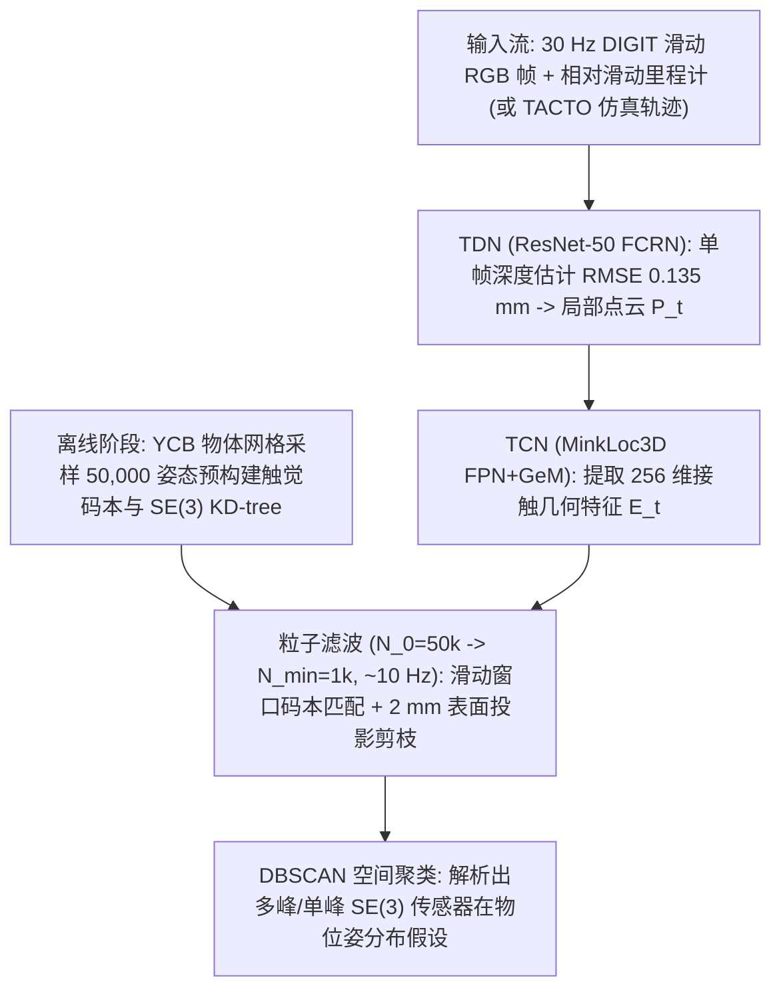
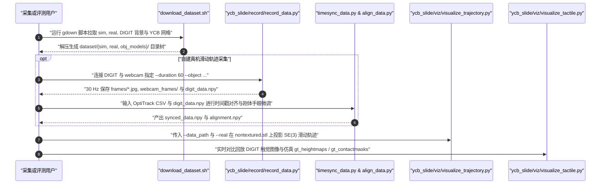

# YCB-Slide（MidasTouch 滑动触觉定位数据集）

## 一句话定义

**英文全称 / 原始题目**：*MidasTouch: Monte-Carlo inference over distributions across sliding touch*（CoRL 2022，`arXiv:2210.14210v1`，CMU & Meta AI Research）。

**YCB-Slide** 是配套 **MidasTouch** 算法发布的连续滑动交互触觉数据集，涵盖 **10 个几何特征各异的 YCB 物体**，各包含 **50 条 TACTO 仿真测地线滑动轨迹**与 **50 条真机手持 DIGIT 传感器连续滑动（60 s @ 30 Hz，OptiTrack 追踪）**记录，专门用于在无视觉输入与无初始位姿先验条件下的 `SE(3)` 触觉定位与分布推断。

## 英文缩写速查

| 缩写 | 英文全称 | 简要说明 |
|---|---|---|
| **TDN** | Tactile Depth Network | ResNet-50 FCRN 逆向传感网络，从单帧 DIGIT 图像预测局部高度图与接触点云 |
| **TCN** | Tactile Code Network | 基于 MinkLoc3D 稀疏 3D 卷积的网络，将局部接触几何编码为 256 维旋转特征码 |
| **TACTO** | Tactile Simulator (Facebook/Meta) | 物理光线渲染与弹性形变近似的视觉触觉仿真器，用于生成 Sim 滑动序列与预计算码本 |
| **PF** | Particle Filter | 蒙特卡洛粒子滤波（从 50k 个全局假设动态重采样收敛至多峰位姿分布） |
| **DBSCAN** | Density-Based Spatial Clustering of Applications with Noise | 密度空间聚类算法，用于从收敛后的粒子云中抽取可解释的离散多峰位姿假设 |

## 为什么重要

1. **从“局部静态按压”迈向“全局无先验滑动定位”**：单次 DIGIT 接触面积仅约 `6 cm^2`，相比目标物体表面积（`109–643 cm^2`）微不足道，单帧触觉在物理上存在极强对称与局部几何重名歧义。YCB-Slide 提供了标准化的连续长距离滑动轨迹（Sim `0.5 m`、Real `60 s`），迫使算法必须沿时间轴维护**多峰位姿分布（multimodal posterior）**并在滑过棱角/特征区域时逐步坍缩歧义。
2. **确立“稀疏三维几何特征 + 触觉码本 + 粒子滤波”高效定位范式**：MidasTouch 将图像端映射到局部三维点云几何后使用 **MinkLoc3D** 压缩成仅 **256 维**紧凑特征码，离线为每个已知物体构建 5 万个网格位姿码本（占用体积比全图像特征检索小约 300 倍），从而实现约 **10 Hz** 的全表面无初值蒙特卡洛定位追踪。
3. **提供即插即用的多传感真机校准对齐链路**：真实子集跨越 **3 颗不同的 DIGIT 传感器**（各自配备 10 帧空载背景校准图）并结合 8 相机 **OptiTrack** 动捕与刚体配准微调（`alignment.npy`），为视觉触觉的跨传感器实例对齐提供了宝贵真机基线。

## 核心原理

### 数据集速查

| 维度 | 核心内容（核对自论文 `arXiv:2210.14210v1` 与 `rpl-cmu/YCB-Slide` 仓库） |
|---|---|
| **规模** | 精选 **10 个 YCB 物体**（`sugar_box`, `tomato_soup_can`, `mustard_bottle`, `bleach_cleanser`, `mug`, `power_drill`, `scissors`, `adjustable_wrench`, `hammer`, `baseball`），每物体 5 条 Sim + 5 条 Real = **100 条滑动序列** |
| **模态** | **Sim**：TACTO 渲染 DIGIT RGB（`240×320`）、`0.5 m` 测地线位姿（含 `σ_trans=0.5 mm, σ_rot=1°` 高斯噪声）、`gt_heightmaps`、`gt_contactmasks`、真值网格；**Real**：30 Hz DIGIT RGB 图像、`synced_data.npy`（OptiTrack 同步 `SE(3)` 位姿 + `alignment.npy` 配准矩阵）、旁观 webcam 视频；**注：真值高度图与接触掩膜仅 Sim 子集提供** |
| **许可证** | **MIT License**（`rpl-cmu/YCB-Slide` 仓库显式声明代码与数据集均遵循 MIT 许可） |
| **适配形态** | 人工手持 **DIGIT** 贴合表面滑动（传感器贴 6 枚 OptiTrack 反光标记点，台钳固定物体贴 4 枚标记点） |
| **重定向就绪度** | **面向纯触觉位姿估计与世界模型建图就绪**：完整覆盖轨迹/背景/真值网格下载及录制同步工具链；不含机器人手臂或灵巧手驱动动作空间 |

### MidasTouch 两阶段感知与粒子滤波架构

- **TDN（触觉深度网）**：在 40 个未参与测试的 YCB 物体 × 5,000 次 TACTO 随机压入共 20 万张合成图像上训练 ResNet-50 FCRN，实时将单帧 DIGIT RGB 解码为毫米级局部高度图并筛选接触区域点云 `P_t`（测试集高度 RMSE 达 **0.135 mm**）。
- **TCN（触觉特征码网）**：将本地三维点云送入 LiDAR 预训练、三元组损失微调的 **MinkLoc3D** 稀疏三维卷积网络，映射为 256 维嵌入 `E_t ∈ R^256`。
- **码本检索与动态粒子滤波**：离线在对象表面采样 `M = 50,000` 个传感器法向姿态并预计算码本及带旋转缩放因子（`α = 0.01`）的 `SE(3)` KD-tree。在线追踪阶段，由 `N_0 = 50,000` 个全表面均匀分布粒子起步，依据近期 `w` 步滑动窗口码本特征相似度加权，辅以基于相对里程计不确定性的低方差重采样（动态裁减至最少 `1,000` 粒子）、2 mm 表面距离剪枝及 DBSCAN 聚类。

### 流程总览

## 实验与评测

- **全局滑行定位误差（各设定 500 次随机起点评测）**：
  - **Sim 仿真集（10 物体）**：最终全部粒子平均 RMSE 为位置 **`0.74 cm`**、姿态 **`9.43°`**；最接近真值的高置信簇中位误差低至 **`0.28 cm`、`2.03°`**。
  - **Real 真机集（启用局部先验 `β = 0.5`、高度图指数平滑与每 5 步重采样）**：全部粒子平均 RMSE **`1.97 cm`**、姿态 **`21.48°`**；最接近簇中位误差为 **`1.11 cm`、`10.76°`**。
- **对称性边界现象**：对于无明显几何棱角的球体（`baseball`），任意表面补丁高度场全同，算法持续维持全表面高熵分布而不盲目坍缩至伪单解；对于矩形盒或马克杯（`sugar_box`、`mustard_bottle`、`mug`），则保留与物体物理对称面数量一致的合理多峰聚簇。

### 与其他工作对比

| 维度 | YCB-Slide / MidasTouch（CoRL 2022） | YCB-Sight / ShapeMap 3-D（ICRA 2022） | VisGel（CVPR 2019） |
|---|---|---|---|
| **任务定位** | 已知网格、**无视觉全局触觉定位** | 已知初值下的**视觉+触觉三维几何建图** | 视觉与触觉**双向像素生成** |
| **接触模式** | 连续滑行（`0.5 m` / `60 s @ 30 Hz`） | 离散单点法向压入（40–60 次） | 机器人自动试探离散接触 |
| **空间覆盖特征** | 256 维局部稀疏三维编码 + 50k 码本 | `16×16×16` 稀疏 GP-SG 局部 SDF | 全图端到端条件 U-Net |

## 源码运行时序图

[`rpl-cmu/YCB-Slide`](https://github.com/rpl-cmu/YCB-Slide) 提供完整的数据下载、真机采集同步、手动标定微调与 Sim/Real 可视化回放管线（以下节点名称按仓库包内实际 `.py` 文件名标注）：

## 工程实践

1. **修正 README 文档内的脚本文件名笔误**：`YCB-Slide` 仓库根目录 `README.md` 示例命令中写为 `record_data_expt.py` 与 `timesync_digit.py`，但实际打包在 `ycb_slide/record/` 目录下的真实 Python 文件名为 **`record_data.py`** 与 **`timesync_data.py`**（此外 README 第 2 节命令行演示漏写了 `ycb_slide/...` 子路径，直接按顶层命令执行会报错）。
2. **Sim vs Real 真值字段差异**：加载代码切记区分 `--real` 标志——只有 `sim/` 目录提供 `gt_heightmaps`、`gt_contactmasks` 与 `tactile_data.pkl`，而 `real/` 目录只有 DIGIT 原图、`synced_data.npy` 和旁观相机照片，任何依赖像素级真值深度图做回归监督的训练都必须使用 `sim` 子集或迁移 TDN 伪标签。
3. **跨传感器与滑行擦痕管理**：DIGIT 表面聚氨酯弹性体长时连续在粗糙金属（如 `power_drill`、`adjustable_wrench`）上滑行易出现表面磨损划痕与光照零漂，采集时务必每换一颗传感器留存 10 帧空载参考图，并在真实部署粒子滤波时开启高度图时间指数平滑与降权先验（`β = 0.5`）。

## 常见误区与局限

- **强依赖目标物体精确先验网格**：MidasTouch 的 50,000 位姿触觉码本与 `2 mm` 表面距离剪枝均离线构建于已知的 YCB 精确 3D CAD 模型之上，无法直接泛化到几何形状未知的新物体（几何未知场景应参考同团队的 `YCB-Sight` / ShapeMap 3-D 或结合神经场的方法）。
- **人工手持滑行引入的动力学盲区**：真机 50 条轨迹为人工手持 DIGIT 沿台钳夹紧的静止物体滑行采集，虽通过 OptiTrack 记录了高质量位姿，但未包含真实灵巧手手指与自由未固定物体之间的耦合滑动摩擦、指节受限避障或手内滚转扰动。
- **MidasTouch 推理仓库分离**：`rpl-cmu/YCB-Slide` 主要承担数据集载体、采集同步工具与 3D 轨迹可视化，完整的 TDN、MinkLoc3D 训练与粒子滤波推理引擎托管在 MidasTouch 主项目地址。

## 关联页面

- [dataset-ycb-sight.md](./dataset-ycb-sight.md) — 同作者团队构建、聚焦未知三维形状重建的 GelSight + Kinect 数据集
- [dataset-rct-robotic-contact-tactile.md](./dataset-rct-robotic-contact-tactile.md) — 面向跨材料/跨 DIGIT 实例泛化审计的按压数据集
- [tactile-sensing.md](../concepts/tactile-sensing.md) — DIGIT 与高分辨率光学触觉传感器基础
- [visuo-tactile-fusion.md](../concepts/visuo-tactile-fusion.md) — 局部触觉几何编码与三维位姿融合
- [manipulation.md](../tasks/manipulation.md) — 灵巧操作与接触状态感知任务
- [embodied-dataset-panorama-2026-10.md](../overview/embodied-dataset-panorama-2026-10.md) — 具身操作数据集全景图

## 参考来源

- [ycb_slide_midastouch_arxiv_2210_14210_reading.md](../../sources/papers/ycb_slide_midastouch_arxiv_2210_14210_reading.md) — CoRL 2022 原文全文与 `rpl-cmu/YCB-Slide` 仓库源码核对档案
- [wechat-embodied-dataset-panorama-2026-10-19.md](../../sources/datasets/wechat-embodied-dataset-panorama-2026-10-19.md) — 具身数据集梳理线索归档
- [MidasTouch 项目页](https://suddhu.github.io/midastouch-tactile) · [arXiv:2210.14210](https://arxiv.org/abs/2210.14210) · [GitHub: rpl-cmu/YCB-Slide](https://github.com/rpl-cmu/YCB-Slide)

## 推荐继续阅读

- 如果你在实际项目中需要在“已知物体滑行定位”和“未知物体形状补全”之间做选型，优先对照阅读 [dataset-ycb-sight.md](./dataset-ycb-sight.md)；
- 如果在多颗 DIGIT 之间切换传感器导致高度图模型掉点，结合 [dataset-rct-robotic-contact-tactile.md](./dataset-rct-robotic-contact-tactile.md) 的跨传感器评测结论与 [painode-146-anyskin.md](./painode-146-anyskin.md) 的跨实例一致性设计。
