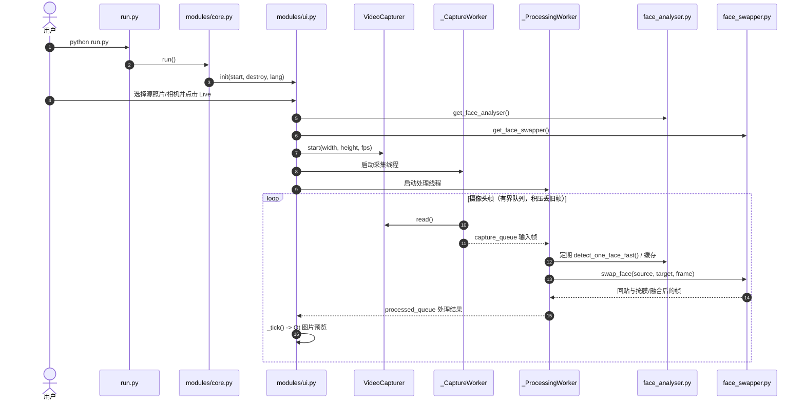

# Deep-Live-Cam：单图实时换脸 / Single-Image Real-Time Face Swapping

## 一句话定义

**Deep-Live-Cam** 是 [hacksider/Deep-Live-Cam](https://github.com/hacksider/Deep-Live-Cam) 提供的本地人脸替换工具：输入**一张源人脸照片**和目标图像、视频或实时摄像头帧，使用人脸检测/特征与 Inswapper 模型替换目标身份，再按需做口部掩膜、融合和人脸增强；它**不是**从一张照片重建可驱动的完整 3D 数字人，也没有已验证的任意角度、表情与口型保真保证。

## 英文缩写速查

| 缩写 | 英文全称 | 简要说明 |
|------|----------|----------|
| ONNX | Open Neural Network Exchange | Inswapper 等模型的推理格式 |
| ORT | ONNX Runtime | 本地 CPU / CUDA / CoreML / DirectML / OpenVINO 推理运行时 |
| OBS | Open Broadcaster Software | 可用窗口采集接入换脸预览的直播/虚拟摄像头软件 |
| GUI | Graphical User Interface | PySide6 图形界面，负责选择来源与预览 |
| FPS | Frames Per Second | 实时预览帧率；必须实测，不由“一张图”保证 |
| GPU | Graphics Processing Unit | 加速人脸检测、替换及可选增强 |

## 为什么重要

- **维护者归属：** 公开代码位于 GitHub 用户账号 [hacksider](https://github.com/hacksider) 下，本知识库按已有“独立维护者（Independent Maintainer）”类目归档；该分类不代表项目只有一位贡献者。

- **数字人/演示链路的轻量入口**：无需为每个身份重新训练一个模型，适合在得到当事人授权时制作角色演示、直播特效与 HRI（人机交互）视觉化身。
- **有明确的运行时结构**：把摄像头采集、目标人脸检测、身份替换、后处理与 UI 分离，便于学习真实视频推理系统中的缓存、有界队列与延迟权衡。
- **必须区分工具和机器人能力**：该工具输出的是合成视频帧，不产生可直接用于机器人控制的 3D 头姿、人体动作或策略信号；可与 [FaceBuilder](./keentools-facebuilder.md) 的几何建模，以及 [ARGUS 鉴伪](./paper-argus-deepfake-forensics.md) 的真实性检测进行对照。

## 核心原理

1. **身份来源**：`modules/face_analyser.py::get_one_face` 从静态源图提取人脸及供交换器使用的表征；不依赖逐人训练。
2. **逐帧目标检测**：`modules/ui.py::_ProcessingWorker` 从摄像头队列取帧，调用快速人脸检测，按相机 FPS 调整检测间隔并缓存结果。
3. **身份替换**：`modules/processors/frame/face_swapper.py::swap_face` 调用 `get_face_swapper().get(target_frame, target_face, source_face, paste_back=False)`，并根据变换矩阵将结果回贴目标帧。
4. **保真后处理**：可选 Mouth Mask 将**目标原嘴部区域**保留在换脸结果上；Poisson 融合、透明度混合或可选增强改善边缘/细节。这里的嘴部一致性主要来自目标原始运动和掩膜，不是独立的高精度语音驱动唇形生成模型。
5. **呈现与输出**：Live 模式经 Qt 预览窗口显示处理结果；离线图像/视频路径由 `modules/core.py::start` 处理，视频优先 FFmpeg 内存管道，失败后磁盘抽帧回退。

## 流程总览

下图只描述在 GitHub `main` 源码中实际核实的 Live 管线；OBS 为**外部窗口采集**路径，非软件内部已证实的虚拟摄像头写入模块。

## 源码运行时序图

按 2026-11-08 所见官方主分支 `0bae1a549014d86457548b05a01a3f7682cdda65` 的 `run.py`、`modules/core.py`、`modules/ui.py`、`modules/video_capture.py` 与 `modules/processors/frame/face_swapper.py` 校对：

以上是**源码结构验证**，并非实际执行与测速；多脸映射及视频文件走不同分支，详见 [源码归档](../../sources/repos/deep-live-cam.md)。

## 工程实践

| 决策点 | 已核实实现 / 注意事项 |
|--------|-----------------------|
| 快速运行 | GitHub README：安装 Python、ffmpeg、requirements；下载 `inswapper_128_fp16.onnx` 与 `gfpgan-1024.onnx` 后执行 `python run.py` |
| GPU 加速 | NVIDIA 可选 `--execution-provider cuda`；README 列明 CUDA/cuDNN/ORT 组合；依赖冲突与显存限制需自行测 |
| 实时模式 | UI `Live` → `WebcamPreviewWindow`；采集队列与结果队列最大各 2 帧、溢出丢旧帧 |
| OBS 对接 | **已核实开源主分支**：通过 OBS Window Capture 捕获 Live Preview；官方 **2.6d Release 宣布虚拟摄像头**，但不能由此证明当前公开 `main` 已提供内建虚拟设备输出 |
| 多人处理 | 多脸/人脸映射可选，计算量与检测成本变化；性能未做本地基准 |
| 付费版本 | 官网上有 Lite / Ultimate **订阅**，并标明部分 Ultimate-only 功能；公开仓库 ≠ 官网全部版本 |
| 成本 | 本地运行免云端每帧 API 调用不代表零成本：GPU、部署、调试、模型权利及可选云 API 另计 |

## 局限与风险

- **Star 夸大**：截至 **2026-11-08**，GitHub Repository API 返回 **97,780 Stars**，不能写作“10 万+”；数字为动态快照。
- **口型/表情与转头**：并非精确全姿态 3D 人脸重建，遮挡、快速运动、大偏角、检测跳变、边缘伪影仍是工程风险；本次没有可比较的公开定量效果实验。
- **版本混淆**：GitHub README 标题 2.1.6 与官网 2.8 Ultimate 宣传并行存在；购买前必须核对功能所属版本、是否确实需要内建虚拟摄像头。
- **许可证分层**：源码为 **AGPL-3.0**；官方 README 同时提示 InsightFace 所用模型存在**非商业研究**用途限制。开源代码许可不自动授予预训练权重商用许可。
- **人像与内容安全**：官方要求获得被替换者同意并对外清晰标注 deepfake；不应用于无授权冒充、欺骗或绕过身份核验。
- **离线边界**：本地换脸可以本地进行；官网还列有需额外密钥的云 AI 选项，不能声称“全部功能绝不联网”。
- **真实性核验**：从合成内容安全角度可与 [ARGUS 深度伪造视频取证](./paper-argus-deepfake-forensics.md) 对照；单纯视觉自然不等于真实可信。

## 关联页面

- [ARGUS：可泛化深度伪造视频鉴伪](./paper-argus-deepfake-forensics.md) — 人脸合成与伪造检测为攻防不同任务
- [KeenTools FaceBuilder](./keentools-facebuilder.md) — 真实头部几何重建与 2D 换脸的边界
- [图像分割方法分类](../concepts/image-segmentation-taxonomy.md) — 区域掩膜、边界合成的视觉工程背景

## 参考来源

- [Deep-Live-Cam 官方 GitHub 源码与 README 完整核对](../../sources/repos/deep-live-cam.md)
- [官方网站、发行说明及版本/订阅边界](../../sources/sites/deep-live-cam-official.md)

## 推荐继续阅读

- [官方代码和安装说明](https://github.com/hacksider/Deep-Live-Cam)
- [官方 Releases（虚拟摄像头版本声明）](https://github.com/hacksider/Deep-Live-Cam/releases)
- [模型下载目录](https://huggingface.co/hacksider/deep-live-cam/tree/main)
- [InsightFace 模型授权说明](https://github.com/deepinsight/insightface#license)
