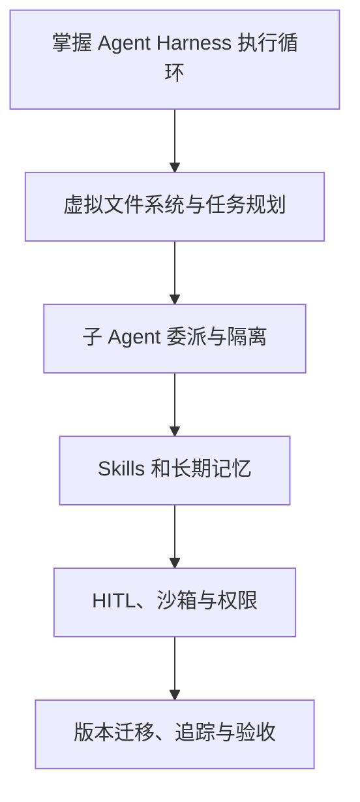
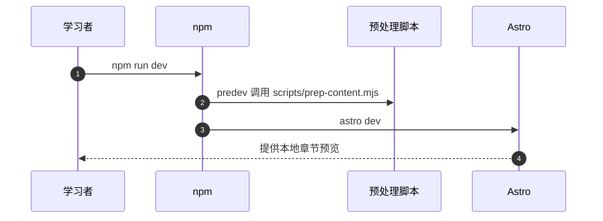

# Deep Agents 实战：Agent Harness 工程课程

## 一句话定义

这是一套讲解如何搭建和调试生产化 Agent Harness 的教程网站；不能与 LangChain 官方 Deep Agents 框架仓库混为同一项目。

## 英文缩写速查

| 缩写 | 英文全称 | 简要说明 |
|---|---|---|
| LLM | Large Language Model | 模型推理核心 |
| MCP | Model Context Protocol | 扩展外部工具连接 |
| HITL | Human in the Loop | 需要人参与审批的环节 |
| API | Application Programming Interface | 模型与工具接口 |

## 为什么重要

Agent 的实际可靠性依赖状态、工具调用、可恢复执行和权限边界，不能只用“模型能回答”衡量。课程将编排、文件系统、规划、子 Agent、持久记忆、HITL 和执行隔离放在同一工程学习路线中。

## 核心原理

官方第 1–2 章讲 Agent Harness 与模型/工具循环，第 3–6 章覆盖虚拟文件系统、规划和子 Agent，第 7–12 章覆盖 Skills、长期记忆、人机协作、沙箱、权限和 MCP；第 13–17 章是部分新版本/前沿能力。不同功能有明确 Deep Agents 版本要求，不宜把单个新版本特性推广到旧版本。

### 课程结构与验证路径

## 源码运行时序图

这里仅依据已核对的**实际入口**描述一条运行路径，不代表其他章节项目。

## 工程实践

先按 README 进入环境准备与 ch02-quickstart，确认模型凭据与 deepagents 依赖版本；实践后通过 LangSmith Trace 或可重复的日志定位工具调用与状态变化。课程站的构建脚本为 npm dev，使用 Astro，不等于 Deep Agents 自身的执行入口。

## 局限与风险

库的版本和 Middleware API 变化快，0.5、0.6 与 0.7 功能不可直接混用；不要把教程中的权限设置理解为物理机器人执行的安全联锁。

**健康度口径：** `original` 对应的是已完整阅读的官方 README **入口原文**，所以本页作为“课程总览”可以独立完结；不代表所有子章节、实验及应用源码已逐篇通读或成功运行。

## 关联页面

- [agentic-rl-lab ](./agentic-rl-lab.md) — 同领域的基础、工程或应用对照。
- [langchain ](./langchain.md) — 同领域的基础、工程或应用对照。
- [agnes-harness ](./agnes-harness.md) — 同领域的基础、工程或应用对照。

## 参考来源

- [2026-11-13 官方入口原文与核对范围](../../sources/repos/deepagents-in-action-course-overview-read-20261113.md)
- [课程资料总归档](../../sources/repos/deepagents-in-action.md)
- [官方 GitHub 仓库](https://github.com/datawhalechina/deepagents-in-action)

## 推荐继续阅读

- [官方教程与项目入口](https://datawhalechina.github.io/deepagents-in-action/)
