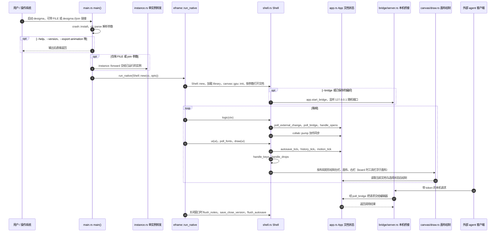

# Desigma：本地优先的界面设计工具

## 一句话定义

Desigma 是 Rust 编写的开源桌面设计工具，提供界面绘制、组件、交互原型、Figma 文件导入和本地 MCP 接口。

## 英文缩写速查

| 缩写 | 英文全称 | 简要说明 |
|------|----------|----------|
| UI | User Interface | 编辑器用于设计的用户界面 |
| MCP | Model Context Protocol | 本地设计文件检查与编辑接口 |
| API | Application Programming Interface | Figma REST JSON 的来源接口 |
| PDF | Portable Document Format | 支持导出的文档格式 |

## 核心能力

- **编辑与原型：** 自动布局、组件与变体、变量、交互原型、矢量编辑、白板和演示文稿。
- **导入与交接：** 可从 Figma REST JSON 或 `.fig` 导入；开发模式提供尺寸和 CSS、React、SwiftUI 等代码片段。
- **实现：** 文档模型、编辑引擎、渲染、导入和应用分为多个 Rust crate；README 描述 tiny-skia CPU 渲染、空间索引与分块缓存。
- **智能体接入：** 本地 MCP 服务可检查和编辑设计文件；启用编辑器桥接后可操作当前文档，具体权限与工具见官方文档。

## 工程实践与局限

- 仓库公开源码与发行包；源码启动命令为 `cargo run --release -p desigma-app`。Linux 依赖窗口系统开发头文件。
- README 将项目标为 **early alpha**，并列出协作、插件、PDF 导出、部分 `.fig` 功能和发行包签名等不足。应使用真实设计文件验证导入效果。
- 普通本地编辑与在线协作、字体下载是不同使用方式；不能把所有功能都视为离线运行。
- 可用于探索机器人控制面板或遥操作界面原型；这是基于通用设计功能的应用推论，仓库未展示机器人专用集成。

## 源码运行时序图

入口：源码启动 `cargo run --release -p desigma-app`（可附文件路径；`--bridge` 打开本机 agent 桥接）。`crates/desigma-app/src/main.rs` 的 `main()` 解析参数后交给 eframe，窗口生命周期由 `shell.rs` 的 `Shell`（实现 `eframe::App`）驱动。

图依据：deepfounder-ai/desigma@e0d5c3a，实际读过 README.md、Cargo.toml（workspace 成员）、crates/desigma-app/src/main.rs（main 段）、crates/desigma-app/src/shell.rs（Shell::new、logic、ui、draw 段）、crates/desigma-app/src/app.rs（仅函数名与 new）、crates/desigma-app/src/canvas/draw.rs（函数名）、crates/desigma-app/src/bridge/server.rs（start、dispatch 等函数名）。未读 bridge 与 poll_bridge 的请求/回复实现细节、instance.rs、canvas/gpu.rs、desigma-render 与 desigma-doc 的内部；外部 agent 客户端（desigma-mcp）未读，仅按 server.rs 的调用入口标注。

## 关联页面

- [Tidy Design](./tidy-design.md) — 同样提供设计画布和 MCP 接口，可对照部署与协作方式。
- [Model Context Protocol](../concepts/model-context-protocol.md) — 理解智能体与设计工具的连接边界。

## 参考来源

- [Desigma 仓库归档](../../sources/repos/deepfounder-desigma.md)
- [官方 README](https://github.com/deepfounder-ai/desigma#readme)
- 源码核对（2026-11-02）：deepfounder-ai/desigma@e0d5c3a，读过 README.md、Cargo.toml、crates/desigma-app/src/main.rs、crates/desigma-app/src/shell.rs、crates/desigma-app/src/app.rs、crates/desigma-app/src/canvas/draw.rs、crates/desigma-app/src/bridge/server.rs；时序图依据以上文件，未运行代码。

## 推荐继续阅读

- [Desigma 源码与安装说明](https://github.com/deepfounder-ai/desigma)
