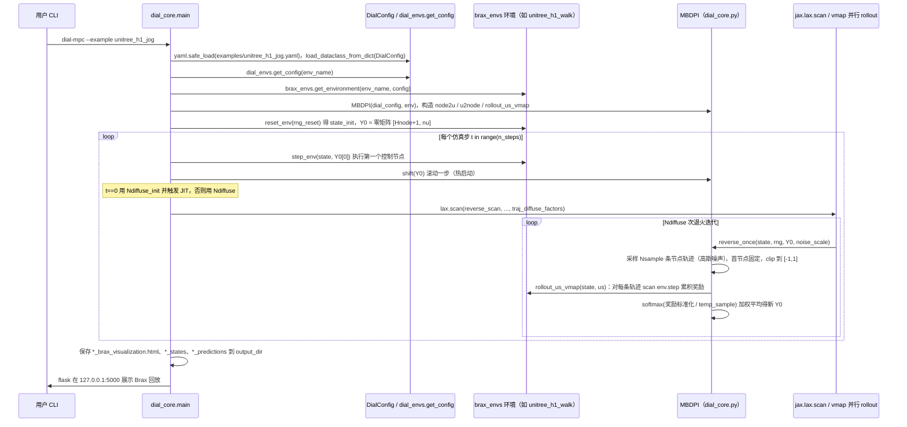

# DIAL-MPC

**DIAL-MPC**（[GitHub](https://github.com/LeCAR-Lab/dial-mpc)）来自 [古月居转载的四足机器人开源项目综述](https://mp.weixin.qq.com/s/pRGoPm41qYCNyHPWR6Dl6A)，属「优化控制（MPC / WBC）」组。

## 一句话定义

**DIAL-MPC（Diffusion-Inspired Annealing for Legged MPC）是 training-free 的全阶、力矩级采样式 MPC，直接在 Brax 物理仿真中采样 rollout，不需要降阶建模、线性化或预设接触序列（ICRA 2025 Best Paper Finalist）。**

## 英文缩写速查

| 缩写 | 英文全称 | 简要说明 |
|------|----------|----------|
| DIAL | Diffusion-Inspired Annealing for Legged | 扩散式退火（足式 MPC） |
| MPC | Model Predictive Control | 模型预测控制 |

## 为什么重要

- 综述把它放在「优化控制（MPC / WBC）」这条技术路线下，作为可读源码的参照项目；横向对比见 [四足机器人开源项目技术地图：从极简运动学到研究级硬件（36 个 GitHub 项目）](../overview/quadruped-open-source-projects-technology-map.md)。
- 文中星标：952（文章表述，入库日未复核）。

## 核心信息

| 项 | 内容 |
|----|------|
| **仓库** | [LeCAR-Lab/dial-mpc](https://github.com/LeCAR-Lab/dial-mpc) |
| **最近提交** | 2025-05-28 |
| **可达性** | `git ls-remote` 可达（2026-11-01） |
| **文章归类** | 优化控制（MPC / WBC） |

## 文章说法核对

- **文章：** 文章仅在附录清单列出（952 星）。
- **README / 核查：** README 标注 ICRA 2025 Best Paper Finalist，对应论文「Full-Order Sampling-Based MPC for Torque-Level Locomotion Control via Diffusion-Style Annealing」（arXiv:2409.15610），Apache-2.0 徽章，基于 JAX。
- **差异与保留：** 未发现与已读 README 的冲突。

## 源码运行时序图

入口：`dial-mpc --example unitree_h1_jog`（`setup.py` 的 console_scripts：`dial-mpc=dial_mpc.core.dial_core:main`）。下图为同步仿真路径；异步的 `dial-mpc-sim` / `dial-mpc-plan` / `dial-mpc-real` 未读，未画。

图依据：dial-mpc@871c84f，读过 `README.md`、`setup.py`、`dial_mpc/core/dial_core.py`（全文）、`dial_mpc/envs/__init__.py`、`dial_mpc/examples/unitree_h1_jog.yaml`。环境类内部 `step` 的奖励细节未读。

## 关联页面

- [paper-notebook-full-order-sampling-based-mpc-for-torque-level-l](../entities/paper-notebook-full-order-sampling-based-mpc-for-torque-level-l.md)
- [model-predictive-control](../methods/model-predictive-control.md)
- [mppi](../methods/mppi.md)
- [locomotion](../tasks/locomotion.md)
- [quadruped-open-source-projects-technology-map](../overview/quadruped-open-source-projects-technology-map.md)

## 参考来源

- [dial_mpc.md](../../sources/repos/dial_mpc.md)
- [wechat_guyueju_quadruped_opensource_deep_dive_2026-11-01.md](../../sources/blogs/wechat_guyueju_quadruped_opensource_deep_dive_2026-11-01.md)
- [原文（微信公众号）](https://mp.weixin.qq.com/s/pRGoPm41qYCNyHPWR6Dl6A)
- 源码核对（2026-11-02）：LeCAR-Lab/dial-mpc@871c84f，读过 README.md、setup.py、dial_mpc/core/dial_core.py、dial_mpc/envs/__init__.py、dial_mpc/examples/unitree_h1_jog.yaml；时序图依据以上文件，未运行代码。

