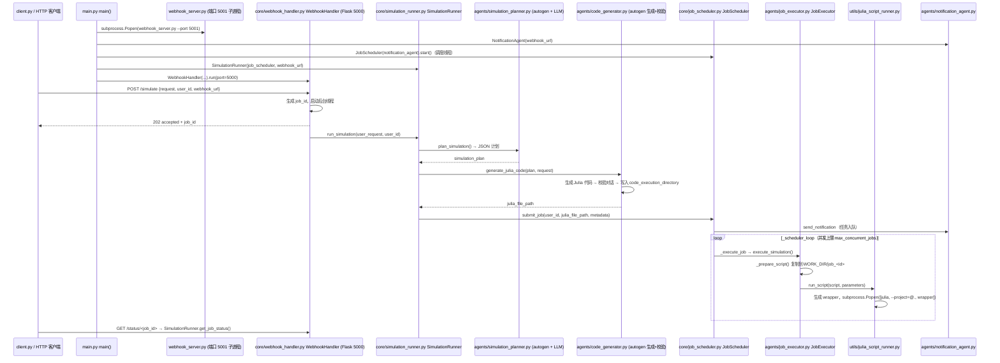

# CAE Physics Simulations Agent（DipanBartaula/CAE_Physics_Simulations_Agent）

## 一句话定义

CAE Physics Simulations Agent（DipanBartaula/CAE_Physics_Simulations_Agent）是使用 Julia/CUDA 脚本运行 CAE 物理仿真，并以 Redis/Celery 与 SLURM 管理集群任务。

## 英文缩写速查

| 缩写 | 英文全称 | 简要说明 |
|------|----------|----------|
| FEA | Finite Element Analysis | 有限元分析工作流 |
| FEM | Finite Element Method | 有限元离散求解方法 |
| V&V | Verification and Validation | 数值验证与模型确认 |

## 为什么重要

对 CAE 自动化而言，代理能否稳定完成任务，取决于工程步骤是否清楚、工具边界是否明确、结果是否保留可审查证据。使用 Julia/CUDA 脚本运行 CAE 物理仿真，并以 Redis/Celery 与 SLURM 管理集群任务；与桌面软件助手相比，重点在集群计算编排。

## 核心原理

**项目自身范围：** Agentic CAE simulation jobs using Julia/CUDA and cluster scheduling.

**工作流：** 代理生成/管理仿真作业，Celery/Redis 跟踪任务，SLURM 提交到集群并返回运行状态。

## 工程实践

1. 从目标问题识别所需的 Skill、MCP、CLI 或软件接口，不把指导文件当成求解器。
2. 依照仓库 README 检查安装前提、软件/许可证、输入文件和输出证据。
3. 小规模运行并逐项核对几何、网格、边界、求解状态和物理量，再决定是否扩大任务。

文章所述的项目特征：使用 Julia/CUDA 脚本运行 CAE 物理仿真，并以 Redis/Celery 与 SLURM 管理集群任务；与桌面软件助手相比，重点在集群计算编排。

## 局限与风险

文章没有给出与商业求解器等价的模型验证依据；CUDA、集群和作业调度依赖部署环境配置。

源码状态核验：该 GitHub 仓库于 2026-10-07 可公开访问。仓库 API 未报告 SPDX 许可证，应检查仓库内 LICENSE 与依赖许可。 

## 源码运行时序图

入口：`python app.py`（转调 `main.py` 的 `main()`），随后向 `http://localhost:5000/simulate` 发 POST（`client.py` 为示例客户端）。

图依据：DipanBartaula/CAE_Physics_Simulations_Agent@bd61268，读过 README.md、app.py、main.py、core/simulation_runner.py、core/webhook_handler.py、core/job_scheduler.py（部分）、agents/simulation_planner.py、agents/code_generator.py（部分）、agents/job_executor.py、utils/julia_script_runner.py（部分）。

## 关联页面

- [CAE / CFD 代理工具项目总览](../overview/cae-cfd-agent-skills-landscape.md)
- [FEP Agent Hub](./s2mon123-fep-agent-hub.md)

## 参考来源

- [公众号文章原始资料归档](../../sources/blogs/wechat_cae_cfd_agent_skills_2026-10-07.md)
- [GitHub 仓库资料归档](../../sources/repos/dipanbartaula-cae-physics-simulations-agent.md)
- [DipanBartaula/CAE_Physics_Simulations_Agent 官方仓库](<https://github.com/DipanBartaula/CAE_Physics_Simulations_Agent>)
- 源码核对（2026-11-02）：DipanBartaula/CAE_Physics_Simulations_Agent@bd61268，读过 README.md、app.py、main.py、core/simulation_runner.py、core/webhook_handler.py、core/job_scheduler.py（部分）、agents/simulation_planner.py、agents/code_generator.py（部分）、agents/job_executor.py、utils/julia_script_runner.py（部分）；时序图依据以上文件，未运行代码。

## 推荐继续阅读

- [项目 README](<https://github.com/DipanBartaula/CAE_Physics_Simulations_Agent/blob/main/README.md>)