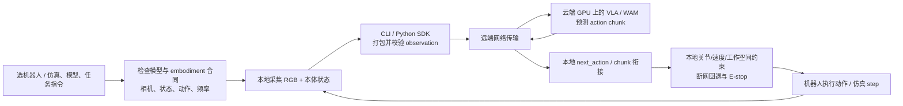
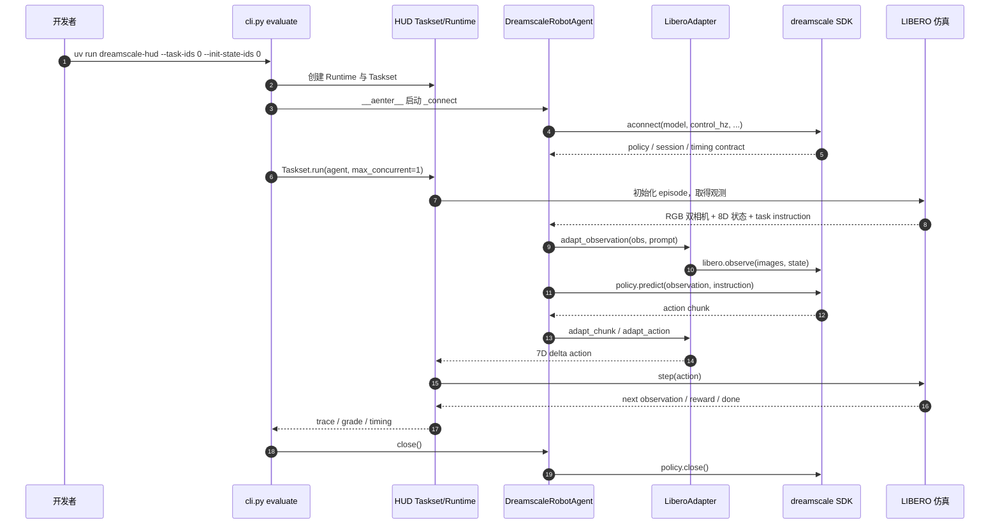

# Dreamscale Labs — 在云上运行机器人基础模型 / Real-time cloud for Physical AI

**官方口号意译：** I want to run a **model** on a **robot** to **do something**——选模型、匹配机器人、下达任务，让机器人本地采集感知/状态，云端模型返回动作。Dreamscale 是 **机器人 AI 训练/部署/推理服务平台**，不是名为 Dreamscale 的新 VLA 基座权重。

## 一句话定义

Dreamscale Labs 在远程 GPU 上托管机器人基础模型的推理（并提供微调与自有模型部署入口），通过 CLI、Python SDK、机器人观测/动作适配协议将模型连接到真实机械臂或仿真环境。

## 英文缩写速查

| 缩写 | 英文全称 | 简要说明 |
|---|---|---|
| VLA | Vision-Language-Action | 将视觉、语言与机器人动作连接的策略 |
| WAM | World Action Model | 同时建模未来状态/动作的世界动作模型 |
| SDK | Software Development Kit | 调用云端策略与组织动作执行的开发接口 |
| RTC | Real-Time Chunking | 处理推理时延与动作块衔接的技术 |
| HUD | HUD（评测框架名称） | 负责评测环境、轨迹 trace 与评分的工具 |
| RTT | Round-Trip Time | 网络往返时延；远端控制的重要约束 |
| E-stop | Emergency Stop | 本地硬件急停；不可由云服务替代 |

## 为什么重要

- **重模型不上机：** 端侧只负责采集、适配、执行和安全控制，远端使用更强算力推理。对于 VLA/WAM 原型与仿真评测，可以减少前期 GPU 设备采购。
- **复用服务接口：** 不同模型可经同一 SDK / CLI 管理，但**每个模型有特定 embodiment、相机/状态布局、动作维度、频率**，不能认为任意模型适配任意机器人。
- **高并发评测：** 官方 2026-10-16 技术博客展示用 MolmoAct2 / π0.5 做 128 个 LIBERO 仿真机器人并发 rollout；该数字是其演示场景，并非真机 128 台的独立验证。
- **部署边界清楚：** 云端输出动作块不是端侧力矩伺服；局部速度/位置限制、断网退化与急停仍必须由本地机器人系统负责。

## 核心信息

| 维度 | 官方资料所述 |
|---|---|
| 项目 / 主体 | Dreamscale Labs，2026 年发布机器人云推理平台 |
| 一手主页 | [dreamscalelabs.com](https://www.dreamscalelabs.com/) |
| 开发文档 | [docs.dreamscalelabs.com](https://docs.dreamscalelabs.com/) |
| 产品能力 | Cloud Inference、Training/Fine-tuning、Deployments |
| 开放接口 | CLI `dreamscale`；Python 包 `dreamscale` / `dreamscale.connect` |
| 现有实机路径 | SO-101、双臂 I2RT YAM；其他机型见官方文档的 experimental 条目 |
| 现有仿真路径 | LIBERO、RoboCasa365；HUD 集成另覆盖多种评测环境 |
| 模型示例 | π0.5、MolmoAct2、FLUX 3 Action、GR00T N1.7、Xiaomi Robotics 1（按具体 embodiment） |
| 官方计费说明 | Quick start：连接期间 **$5/机器人小时**、按秒计费（2026-11-08 页面快照；价格可能变化） |
| 代码开放程度 | **部分开源**：HUD 评测集成 MIT；平台云端 serving/控制平面和完整权重不在该仓库中 |
| 信息性质 | 官网、产品手册与厂商技术文章；不是独立同行评审的性能 benchmark |

## 核心原理

### 1. 模型、机器人与动作合同不可分

官方 Models 表列出了严格绑定的组合：

| 模型 ID | 对象 | 每次动作块 shape | 动作时基 |
|---|---|---|---|
| `molmoact2-so101` / `pi0.5-so101` | SO-101 | 30 × 6 | 30 Hz |
| `flux-3-action-so101` | SO-101 | 42 × 6 | 30 Hz |
| `molmoact2-bimanual-yam` / `pi0.5-bimanualyam` | 双臂 YAM | 30 × 14 | 30 Hz |
| `molmoact2-droid` | Franka / DROID | 15 × 8 | 15 Hz |
| `pi0.5-libero` | LIBERO | 20 × 7 | 20 Hz |
| `gr00t-n1.7-libero` | LIBERO | 16 × 7 | 20 Hz |
| `xiaomi-robotics-1-robocasa365` | RoboCasa365 | 16 × 12 | 20 Hz |

**动作时基并不等于神经网络前向推理 Hz。** SO-101 使用 6 路标定后绝对关节位置（夹爪 0–100），YAM 使用 14 路双臂绝对关节目标（关节弧度），LIBERO 使用 7 维末端位姿 delta + 夹爪；错误地互换可能导致危险动作。官方公开列表应与登录后的 `dreamscale models list` 再对照权限。

### 2. 云端输出动作，本地执行与安全

- 机器人本地读相机 RGB 帧、关节/末端状态与指令，经 embodiment helper 构建 observations；SDK 验证/准备传输。
- 云 GPU 计算动作 chunk；`predict` 提供完整动作块，`next_action` 按控制 tick 推进，官方 SDK 负责动作块衔接与断连重试/hold。
- 机器人本地执行 absolute target 或 delta；遵循自己的运动限幅、防碰撞、机械急停与故障状态机。官方强调 **cloud inference does not replace safety controller**。
- 云端延迟可通过地域近端部署、传输优化和动作块分离部分影响；但不能仅用网络平均 RTT 替代 P99/P999、观测时间戳与动作超时测量。

### 3. 仿真评测和工程事实

官方与 HUD 合作博客展示 **128 条并行 LIBERO rollout**、WAM（Cosmos 3 / FLUX 3 Action）仿真评测、双臂 YAM 上的 π0.5 实机轨迹。作者报告示例场景附加可感知延迟 **<50 ms**，30 Hz 平滑动作；这**不是**任意地区/网络/模型组合的端到端延迟 SLA，也没有独立复现本次部署。

## 流程总览

依据 [SDK / Models 官方文档](../../sources/sites/dreamscale-labs.md) 与 [博客技术架构](../../sources/blogs/dreamscale_cloud_robot_inference_2026.md)：



**边界：** 图中的云服务是官方功能层级，而非未公开服务端类、进程或内部 API 的伪造细节。

## 源码运行时序图

官方 [dreamscale-hud](../../sources/repos/dreamscale-hud.md) 已公开可运行的 HUD/LIBERO 适配代码。下图只依据 `cli.py:evaluate`、`agent.py:DreamscaleRobotAgent/DreamscaleModel`、`adapter.py:LiberoAdapter`、`contract.py` 真实接口；不把这个单路 HUD agent 与官网的 128 并发平台架构混为一谈。



**具体版本差异：** 官方 HUD 代码固定 `MODEL="molmoact2-libero"`、20 Hz、10×7 chunk，而当前网页共享模型表并未列此名称；这只是**该公开适配代码的 pinned 合同**，不能据此保证账户可访问或与 `pi0.5-libero` 的 20×7 chunk 相同。

## 工程实践

仿真先行（官方 Quick start）：

```bash
uv tool install dreamscale
dreamscale login
dreamscale sim libero --model pi0.5-libero
```

SO-101 实机（**需要硬件急停与人工监护**）：

```bash
dreamscale robots so101 setup
dreamscale robots so101 calibrate
dreamscale doctor so101 --model molmoact2-so101
dreamscale run so101 --model molmoact2-so101
```

Python SDK（官方支持接口）：`uv add dreamscale` → `policy = dreamscale.connect("pi0.5-libero")` → `dreamscale.libero.observation(...)` → `policy.predict(observation, instruction="...")`。要真实闭环执行，则用 `policy.next_action(...)` 并在本地控制程序设置关节、速度、工作空间限制与急停。不能把 SDK 的断连 hold 文案视作经过验证的功能安全认证。

**建议的 Sim2Real 验收项（工程推论）：** 对不同 RTT/丢包/断网进行注入测试；同时测模型推理、到包时延、动作年龄、缓冲耗尽次数、执行频率、末端误差、故障停机时间与安全区域越界率。对高动态人形/腿足机器人尤其不能直接把云模型接入 1 kHz 力矩环。

## 局限与风险

1. **开放边界：** HUD 适配仓库 MIT 开源；并不包含云端 serving 机制完整源码/完整模型权重，无法独立复现厂商所有加速主张。
2. **接口非通配：** 不同机器人采用不同相机、状态单位、动作语义、chunk 长度、更新频率；未经标定映射，不得互换。
3. **性能证据：** 128 仿真并发、<50 ms、30 Hz 来源于作者特定演示；不构成普遍的网络可用率或实时安全保证。
4. **成本与隐私：** 云端计费、网络带宽、图像上传、日志留存与数据地区需要逐项核对服务条款。官方 $5/机器人小时是当日公开 quick start 价格快照。
5. **本地执行安全：** 云端模型失败、网络分区和错目标时，本地必须具备运动限制、看门狗/安全状态、实体 E-stop；不适合直接替换低层实时稳定环。
6. **复现状态：** 本次核实官网、文档、源码静态内容；**没有**实际运行收费 GPU 服务、LIBERO benchmark 或真机实验。深层 Training/Deployments 文档本次无法完整读取，细节不推测。

## 关联页面

- [边缘计算与云端协同](../concepts/edge-cloud-robotics.md)：本地安全环与云端模型职责分配。
- [控制/推理频率解耦](../concepts/control-inference-frequency-decoupling.md)：动作 chunk / 低频推理 / 高频执行。
- [Action Chunking](../methods/action-chunking.md)：chunk 调度与开环时间。
- [VLA 真机部署指南](../queries/vla-deployment-guide.md)：Sim2Real 性能与限幅验收。
- [具身大模型评测基准选型闭环](../queries/embodied-eval-benchmark-selection-loop.md)：LIBERO/HUD 仿真评测归其 ③ 策略任务成功率层，外推到 SO-101/YAM 实机前须过 ④ sim↔real 校准层。

## 参考来源

- [官方平台与 SDK 文档逐页核查](../../sources/sites/dreamscale-labs.md)
- [官方完整博客：架构与三类评测实验](../../sources/blogs/dreamscale_cloud_robot_inference_2026.md)
- [官方 HUD 集成源码：真实入口与调用链](../../sources/repos/dreamscale-hud.md)

## 推荐继续阅读

- [Dreamscale 模型与 embodiment 参数表](https://docs.dreamscalelabs.com/models)
- [Dreamscale Python SDK](https://docs.dreamscalelabs.com/python)
- [官方合作源码仓库](https://github.com/Dreamscale-Labs/dreamscale-hud)
- [Why Robot Brains Will Live in the Cloud](https://www.dreamscalelabs.com/blog/why/)
