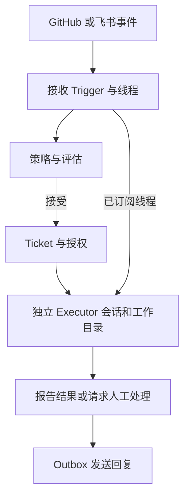
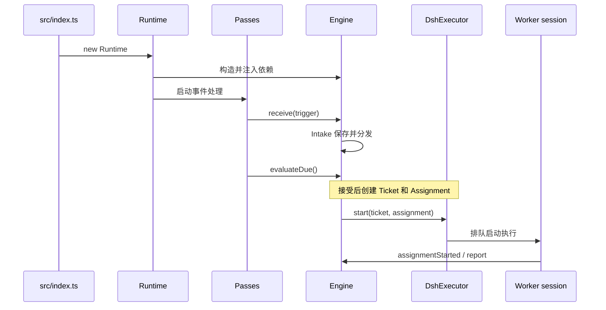

# dsh-superagent-prototype

DeepSeek 将该项目作为 DeepSeek Harness 的插件包公开：接收 GitHub 和可选飞书事件，为符合授权的任务建立独立工作项和会话，结果可返回原会话。它是研究原型，不是正式产品。

## 英文缩写速查

| 缩写 | 英文全称 | 简要说明 |
|------|----------|----------|
| PR | Pull Request | 供人审查的代码变更 |
| CLI | Command Line Interface | 命令行接口 |
| LLM | Large Language Model | 用于评估和执行任务的语言模型 |

## 流程总览

以下依据公开原型的官方架构文档，不代表文章中所有设想均已实现。

系统将事件和线程关联，接收时也会向订阅该线程的 Ticket 分发输入。策略、评估与授权共同决定是否开始任务；主动工作须匹配团队规则，非自动模式只记录原本会采取的行动。结果通过持久化 Outbox 发回来源。

## 源码运行时序图

代码入口及关系见 [归档](../../sources/repos/deepseek_dsh_superagent.md)；图概括已核对的主路径，省略异步效果队列和具体评估分支。

## 工程实践与局限

- 原型代码采用 MIT 许可；仓库明确说明与内部版本和文章不完全一致，部分文章设想尚未实现。
- Worker 以操作系统用户权限执行命令，目录与账号包装并非安全隔离；部署文档建议使用专用系统账号。
- 目前尚未找到官方文章全文，文章设计、实验和局限尚待核实；本页为草稿，不能视为对长文的完整解读。

## 关联页面

- [Deep Agents](./deep-agents.md)：另一种包含子代理和上下文管理的 agent harness。
- [Hermes Agent](./hermes-agent.md)：独立 agent 运行时。

## 参考来源

- [官方源码与文档归档](../../sources/repos/deepseek_dsh_superagent.md)
- [官方架构文档](https://github.com/deepseek-ai/dsh-superagent-prototype/blob/main/docs/007-architecture.md)
- [部署与权限](https://github.com/deepseek-ai/dsh-superagent-prototype/blob/main/docs/006-deployment.md)

## 推荐继续阅读

- [官方 README](https://github.com/deepseek-ai/dsh-superagent-prototype)
