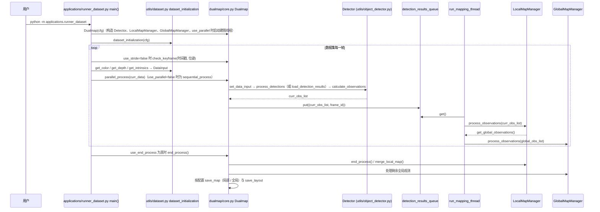

# DualMap

**DualMap**（[Eku127/DualMap](https://github.com/Eku127/DualMap)，RAL 2025）是面向动态环境的 **在线开放词汇语义建图** 与自然语言导航系统。

## 一句话定义

用混合分割前端与 MobileCLIP 特征在线建图，维护 **全局抽象地图 + 局部具体地图**，支持自然语言查询目标并导航，且对场景变化可更新。

## 英文缩写速查

| 缩写 | 英文全称 | 简要说明 |
|------|----------|----------|
| CLIP | Contrastive Language–Image Pretraining | 开放词汇查询的视觉语言特征 |
| SAM | Segment Anything Model | 二维分割；本系统可用 MobileSAM / FastSAM；基础模型见 [paper-segment-anything](./paper-segment-anything.md) |
| YOLO | You Only Look Once | 检测前端（YOLO-World 等） |
| ROS | Robot Operating System | 支持 ROS1 / ROS2 与 rosbag |
| OV | Open-Vocabulary | 不限定闭集类别列表的语义 |
| RAL | IEEE Robotics and Automation Letters | 论文发表 venue |

## 为什么重要

- 同时覆盖 **建图 + 语言导航 + 动态更新**，比「只投影 mask 到 PCD」更接近落地。
- 有 **ROS 模式**，便于后续接到 GO2 等移动平台（需自配相机/深度与时间同步）。
- 与 [OVO](./ovo-semantic-mapping.md)、[OV-SAM3D](./ov-sam3d.md)、[FindAnything](./findanything.md) 形成开放词汇语义选型池（FindAnything 仓仍待发布）。

## 核心信息

| 字段 | 内容 |
|------|------|
| 机构 | 香港科技大学（广州）（HKUST(GZ)）；香港科技大学（HKUST） |
| 代码 | <https://github.com/Eku127/DualMap> |
| 开源 | **已开源** |
| 论文 | arXiv:2506.01950（RAL 2025） |
## 核心原理

| 组件 | 说明 |
|------|------|
| **混合前端** | YOLO-World 类检测 + FastSAM/MobileSAM 等开放分割 |
| **特征** | MobileCLIP（v1 默认；文档亦述 v2） |
| **双地图** | 全局 abstract 候选选择；局部 concrete 精达目标 |
| **输入** | Dataset / ROS（含 bag）/ Record3d（iPhone） |

## 工程实践

1. 克隆时用 `--recurse-submodules` 拉 MobileCLIP。
2. 先 Dataset 或 rosbag 模式验证分割与查询，再上真机流。
3. 导航联调可参考上游 Habitat Data Collector（ROS2）文档。
4. 接到 GO2：几何位姿仍建议由 Point-LIO 提供；本仓作语义层，勿每帧硬跑最大模型。

## 局限与风险

- **非官方 GO2 一体栈**：传感器标定与 L1 投影需自建。
- 算力：官方实验叙事偏桌面 GPU（如 RTX 4090）；机载需换轻量权重与降频关键帧。
- 动态物体策略依赖其对象状态检查；静态占据层仍应单独管理。

## 源码运行时序图

入口：`python -m applications.runner_dataset`（Hydra 配置 `config/runner_dataset.yaml`，数据集离线建图；ROS 与 iPhone 入口分别为 `applications/runner_ros.py`、`applications/runner_record_3d.py`，本图不覆盖）。

图依据：Eku127/DualMap@157235e，读过 README.md、resources/doc/app_runner_dataset.md（命令部分）、applications/runner_dataset.py、config/runner_dataset.yaml（use_stride、use_parallel、run_detection）、dualmap/core.py（__init__、sequential_process、parallel_process、run_mapping_thread、end_process）；Detector、LocalMapManager、GlobalMapManager 内部实现及导航、查询、ROS 部分未读。

## 关联页面

- [GO2 三维语义建图与 SAM 流水线](../queries/go2-3d-semantic-mapping-sam-pipeline.md)
- [OVO](./ovo-semantic-mapping.md)
- [OV-SAM3D](./ov-sam3d.md)
- [FindAnything](./findanything.md)
- [导航·SLAM 栈](../overview/navigation-slam-autonomy-stack.md)
- [ORB-SLAM3](./orb-slam3.md)

## 参考来源

- [sources/repos/dualmap.md](../../sources/repos/dualmap.md)
- 项目页：<https://eku127.github.io/DualMap/>
- arXiv：<https://arxiv.org/abs/2506.01950>
- 源码核对（2026-11-02）：Eku127/DualMap@157235e，读过 README.md、resources/doc/app_runner_dataset.md、applications/runner_dataset.py、config/runner_dataset.yaml、dualmap/core.py（部分）；时序图依据以上文件，未运行代码。

## 推荐继续阅读

- 上游 README：<https://github.com/Eku127/DualMap>
