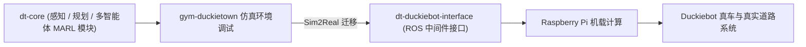
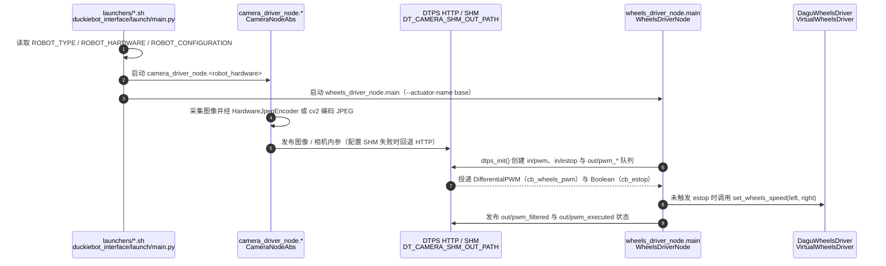

# Duckiebot（Duckietown）

## 一句话定义

**Duckiebot** 是 Duckietown 生态中的标准化开源小车，组织 [duckietown](https://github.com/duckietown)，关键仓库 [dt-duckiebot-interface](https://github.com/duckietown/dt-duckiebot-interface)、[dt-core](https://github.com/duckietown/dt-core)。

## 英文缩写速查

| 缩写 | 英文全称 | 简要说明 |
|------|----------|----------|
| ROS | Robot Operating System | 机器人中间件 |
| Gym | OpenAI Gym interface | 强化学习环境接口 |
| MARL | Multi-Agent RL | 多智能体强化学习 |
| Sim2Real | Simulation to Real | 仿真到真机迁移 |

## 为什么重要

- 自动驾驶教学领域的标准化平台；本库另有 Duckietown 论文清单条目，本页是平台节点。
- 在微信文章《想进入机器人领域吗？学习这18个开源项目就够了》中排第 **18** 位。

## 核心要点（据文章）

- 基于 Raspberry Pi，支持 ROS，有完整的仿真环境（gym-duckietown）和真实道路系统。
- 代码高度模块化，组织下有数百个仓库；适合学习感知、规划和多智能体。

## 机制与架构图

## 源码运行时序图

在底层硬件接口仓 [`duckietown/dt-duckiebot-interface`](https://github.com/duckietown/dt-duckiebot-interface)（`ente` 分支）中，容器启动脚本与 `duckiebot_interface` 启动器按机器人硬件型号拉起基于 DTPS（HTTP / 可选共享内存 SHM）的传感器与执行器驱动节点：

- **最短复现路径：** 通过 `README.md` 中的 `duckietown/duckiebot-interface:ente-arm64v8` 容器启动脚本（如 `launchers/sensor-camera.sh`、`launchers/actuator-wheels.sh`）或 `packages/duckiebot_interface/include/duckiebot_interface/launch/main.py` 按硬件配置拉起各驱动节点，经 DTPS 队列完成感知发布与底盘 PWM 闭环。
- **本次核查源码文件（`duckietown/dt-duckiebot-interface` `ente`）：** `README.md`、`launchers/default.sh`、`launchers/actuator-wheels.sh`、`launchers/sensor-camera.sh`、`packages/duckiebot_interface/include/duckiebot_interface/launch/main.py`、`packages/wheels_driver/include/wheels_driver_node/main.py`、`packages/camera_driver/include/camera_driver/camera_driver_abs.py`、`packages/camera_driver/include/camera_driver_node/raspberry_pi_64.py`。

## 工程实践

- 先从 dt-duckiebot-interface 与 dt-core 入手，在 gym-duckietown 里调通再上真车。
- 以上规格与许可证均出自文章叙述，**未逐项核对官方仓库**；动手前请以官方 README/BOM 为准。

## 局限与风险

- 本页仅基于一篇第三方公众号文章，规格数字可能随版本变化。
- 仓库迁移、分叉和许可证以官方当前状态为准。

## 关联页面

- [turtlebot3](./turtlebot3.md)
- [paper-openbot-smartphone-mobile-robot](./paper-openbot-smartphone-mobile-robot.md)
- [sim2real](../concepts/sim2real.md)
- [paper-as-130-duckietown-an-open-inexpensive-and-flexible-plat](./paper-as-130-duckietown-an-open-inexpensive-and-flexible-plat.md)
- [机器人开源项目 18 例（微信 GitHubStore）索引](../overview/robot-open-source-wechat-githubstore-18-projects.md)
- [Sim-to-Real Transfer Workflow · Sim2Real 迁移工作流](../methods/sim2real-transfer-workflow.md)：对应从 gym-duckietown 仿真环境调试策略后迁移至 Raspberry Pi 真车与真实道路系统的验证工作流。
- [多智能体强化学习（MARL） | Multi-Agent Reinforcement Learning](../methods/marl.md)：对应基于 dt-core 模块化软件栈与多车道路场景开展多智能体强化学习教学与实验的研究方向。

## 推荐继续阅读

- [Duckietown 组织](https://github.com/duckietown)

## 参考来源

- [wechat_githubstore_18_open_source_robot_projects.md](../../sources/blogs/wechat_githubstore_18_open_source_robot_projects.md)
