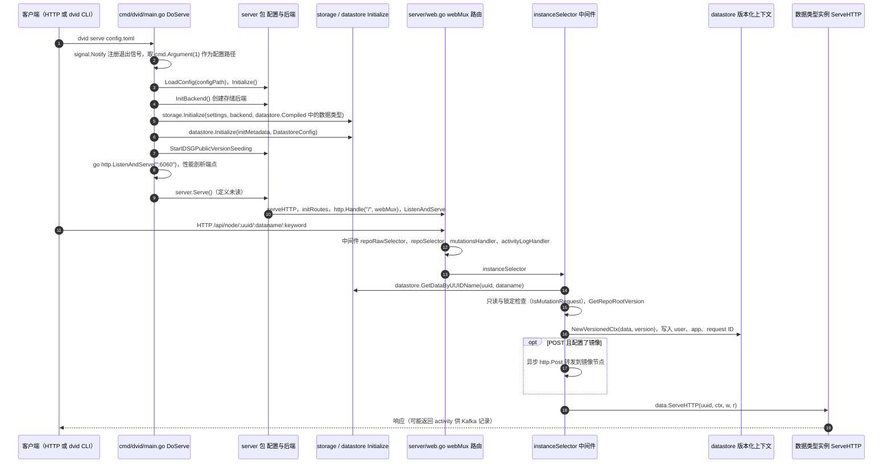

# DVID

**DVID**（*Distributed, Versioned, Image-oriented Dataservice*）是 HHMI Janelia FlyEM 团队开发的 **大尺度科学数据版本化服务**（Go 实现）。它为神经重建提供 **分支版本化** 的 HTTP API，统一托管 **TB 级 EM 体数据、分割 labelmap、突触点注释与 JSON 元数据**，并被 [Neuroglancer](./neuroglancer.md) 等客户端直接读取。

## 英文缩写速查

| 缩写 | 英文全称 | 简要说明 |
|------|----------|----------|
| API | Application Programming Interface | 科学导向 HTTP 接口 |
| EM | Electron Microscopy | 电子显微镜体数据 |
| ROI | Region of Interest | 注释与分割区域 |
| JSON | JavaScript Object Notation | 元数据与配置格式 |
| GPU | Graphics Processing Unit | 客户端渲染加速（非 DVID 本体） |

## 为什么重要

- **连接组数据「git」：** 成像、分割、proofreading 各阶段可 **分支共存**，所有版本可同时查询。
- **可插拔 datatype：** `labelmap`、`annotation`、`keyvalue` 等按科学对象建模，而非裸文件树。
- **存储分层：** 大体数据走云存储，高频突变 label 走本地 NVMe（Badger 等后端）。

## 核心信息

| 字段 | 内容 |
|------|------|
| 仓库 | https://github.com/janelia-flyem/dvid |
| 语言 | Go 1.25+（CGO） |
| 许可 | 开源（见仓库） |
| 客户端 | Neuroglancer、FlyEM 内部工具链 |

## 工程实践

```bash
git clone https://github.com/janelia-flyem/dvid
cd dvid && make
bin/dvid about
```

- **生产部署：** 使用 [releases](https://github.com/janelia-flyem/dvid/releases) 而非 `main` 分支。
- **与 Neuroglancer：** 配置 DVID `ngprecomputed` 或原生 DVID 数据源 URL。
- **公开数据：** Male CNS / FlyWire 最终用户多通过 **GCS precomputed + neuPrint** 访问；DVID 主要用于 **FlyEM 内部与自托管重建管线**。

## 局限与风险

- **运维复杂度高：** 需规划 datastore 分片、备份与监控（见 README Monitoring 节）。
- **无 GitHub 式 PR diff：** 版本可并存，但缺少域专用协作 diff 工具。
- **学习曲线：** 科学 API 与 datatype 概念需阅读 GUIDE.md。

## 源码运行时序图

入口：`dvid serve <config.toml>`（`cmd/dvid/main.go` 的 `DoCommand` 对 `serve` 子命令调用 `DoServe`；其他子命令经 RPC 发给已运行的服务）。



图依据：janelia-flyem/dvid@7f26371，实际读过 README.md（安装与 Basic Usage 段）、cmd/dvid/main.go（main、DoCommand、DoServe 段）、server/web.go（serveHTTP、initRoutes 路由注册、repoSelector、instanceSelector 段）、datastore/datainstance.go 与 datastore/datastore.go（仅 DataService 接口与 GetDataByUUIDName 签名）；未读 server.Serve 的定义、InitBackend、storage.Initialize 与各数据类型的 ServeHTTP 实现，图中这些环节按调用名标注。

## 关联页面

- [Neuroglancer](./neuroglancer.md)
- [果蝇连接组工具栈](../concepts/fly-connectomics-stack.md)
- [仿真评测基础设施](../concepts/simulation-evaluation-infrastructure.md)

## 参考来源

- [DVID 仓库归档](../../sources/repos/dvid.md)
- 源码核对（2026-11-02）：janelia-flyem/dvid@7f26371，读过 README.md、cmd/dvid/main.go、server/web.go、datastore/datainstance.go、datastore/datastore.go；时序图依据以上文件，未运行代码。

## 推荐继续阅读

- [DVID GUIDE.md](https://github.com/janelia-flyem/dvid/blob/master/GUIDE.md)
- [Neuroglancer DVID 数据源](https://github.com/google/neuroglancer/tree/master/src/datasource/dvid)
