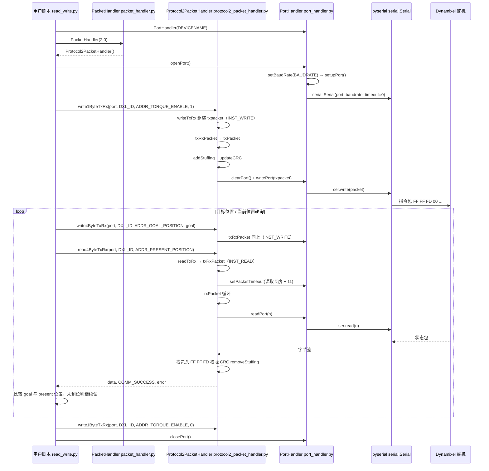

# Dynamixel SDK

**Dynamixel SDK**（[`ROBOTIS-GIT/DynamixelSDK`](https://github.com/ROBOTIS-GIT/DynamixelSDK)，~595★，Apache-2.0）是 ROBOTIS **DYNAMIXEL** 舵机的官方软件开发包，通过串口/USB 报文实现 Protocol **1.0 / 2.0** 控制表读写与运动指令。eManual：<https://emanual.robotis.com/docs/en/software/dynamixel/dynamixel_sdk/overview/>。

## 一句话定义

用统一 API（C/C++/Python/C#/Java/MATLAB/LabVIEW/Arduino 等）访问 Dynamixel 总线设备——上层 ROS 包、教育平台与开源灵巧手多数最终落到这层协议或兼容实现。

## 英文缩写速查

| 缩写 | 英文全称 | 简要说明 |
|------|----------|----------|
| DXL | DYNAMIXEL | ROBOTIS 智能舵机产品族 |
| SDK | Software Development Kit | 本仓库 |
| TTL / RS-485 | 物理层接口 | 常见 Dynamixel 总线形态 |
| U2D2 | USB→DXL 适配器 | 官方常用上位机接口板 |
| ros2_control | ROS 2 控制框架 | 组织内另有 `dynamixel_hardware_interface` 插件 |

## 为什么重要

- **硬件生态底座**：TurtleBot3、OpenMANIPULATOR、OpenCR 固件路径，以及 [EN02-OP](./en02-op.md)、[Yale OpenHand](./yale-openhand.md) 等第三方项目，都依赖 Dynamixel 协议或 SDK。
- **跨语言复现**：同一控制表语义可在嵌入式与 Python 脚本间切换，降低「换语言就要换协议栈」成本。
- **与 ros2_control 衔接**：组织内 `dynamixel_hardware_interface` 把 DXL 装进现代 ROS 2 控制循环（本页不展开，选型时从 SDK 文档进入）。

## 核心原理

1. **Packet Handler**：按 Protocol 版本组包/拆包（Ping、Read、Write、Sync/Bulk 等）。
2. **Port Handler**：串口或 USB 串设备的开关与波特率。
3. **控制表**：型号相关地址映射（目标位置、速度、电流、LED…）；换型号先对 eManual 控制表。
4. **上层封装**：Workbench、Arduino 库、ROS 驱动是 SDK 之上的便利层，排障时常需回到本 SDK 的最小读写示例。

## 工程实践

1. 从 eManual 确认舵机型号、协议版本、波特率与供电（欠压是最常见「SDK 无响应」原因）。
2. 用官方示例做 **Ping → Read 型号 → 写目标位置** 最小闭环，再接入 ROS。
3. 多舵机总线注意 **ID 冲突** 与 **终止电阻**；U2D2 + 供电 hub 是常见实验台配置。
4. ROS 2 集成优先查组织内 `dynamixel_hardware_interface` / Workbench，而不是在应用节点里重写协议。
5. 仅 Arduino 场景可看 `Dynamixel2Arduino` / `DynamixelShield`（组织内相关仓）。

## 局限与风险

- **开源状态：已开源**（Apache-2.0）。
- **型号碎片化**：X / P / Y / PRO 等系列控制表与力矩模式细节不同，文档必须对型号。
- **SDK ≠ 整机栈**：本仓不包含机器人运动学或安全层；扭矩使能前务必机械限位与电流限制。
- **第三方「兼容 Dynamixel」设备**：协议子集或时序差异可能导致偶发丢包，需单独验证。

## 源码运行时序图

入口：`python3 python/tests/protocol2_0/read_write.py`（官方 Python 示例，Protocol 2.0，`DEVICENAME=/dev/ttyUSB0`）

图依据：ROBOTIS-GIT/DynamixelSDK@a8d35d5，实际读过 `python/tests/protocol2_0/read_write.py`、`python/src/dynamixel_sdk/packet_handler.py`、`python/src/dynamixel_sdk/protocol2_packet_handler.py`（txPacket / txRxPacket / rxPacket 及 read/write TxRx 包装）、`python/src/dynamixel_sdk/port_handler.py`（openPort / setupPort / readPort / writePort）。

## 关联页面

- [ROBOTIS hub](./robotis.md)
- [TurtleBot3](./turtlebot3.md) · [OpenMANIPULATOR 线](./robotis-open-manipulator-line.md)
- [EN02-OP](./en02-op.md) · [Yale OpenHand](./yale-openhand.md)
- [Manipulation](../tasks/manipulation.md)
- [执行器驱动链选型闭环](../overview/hub-actuator-drive-chain.md) · [选型 Query](../queries/actuator-drive-chain-selection-loop.md)

## 参考来源

- [sources/repos/dynamixel_sdk.md](../../sources/repos/dynamixel_sdk.md)
- 上游：<https://github.com/ROBOTIS-GIT/DynamixelSDK>
- 源码核对（2026-11-02）：ROBOTIS-GIT/DynamixelSDK@a8d35d5，读过 README.md、python/src/dynamixel_sdk/{__init__,packet_handler,port_handler,protocol2_packet_handler}.py（protocol1 仅 grep）、python/tests/protocol2_0/read_write.py；时序图依据以上文件，未运行代码。

## 推荐继续阅读

- [Dynamixel SDK eManual](https://emanual.robotis.com/docs/en/software/dynamixel/dynamixel_sdk/overview/)
- [dynamixel.com](https://www.dynamixel.com/)
