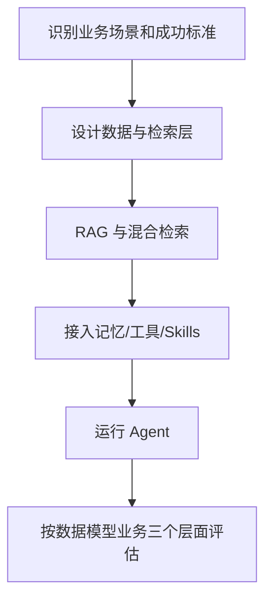
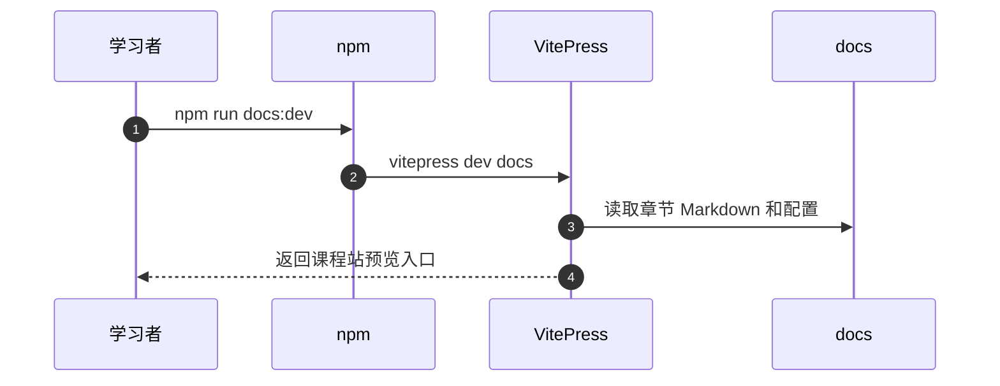

# Easy Data × AI：数据与智能体工程课程

## 一句话定义

课程围绕 AI Agent 在真实数据场景的使用，先回答“适不适合做”，再处理数据、记忆、工具和工作流；本节点记录官方入口范围。

## 英文缩写速查

| 缩写 | 英文全称 | 简要说明 |
|---|---|---|
| RAG | Retrieval-Augmented Generation | 检索增强生成 |
| MCP | Model Context Protocol | 工具与服务连接协议 |
| LLM | Large Language Model | Agent 的语言模型 |
| API | Application Programming Interface | 服务调用接口 |

## 为什么重要

Agent 的可靠性不只看模型，还取决于数据的可检索性、记录的持久性和业务规则。课程强调数据层、模型层、业务层分层度量，适合用来评估智能体落地的瓶颈。

## 核心原理

README 的公共基础篇建立大模型与 Agent 图景；道篇覆盖场景识别、RAG/Memory/MCP/Skill 的产品判断；术篇进一步介绍 streaming、tool use、数据层、混合检索以及带记忆的 Agent；产业应用篇关注不同场景适配。

### 官方课程结构/执行思路

## 源码运行时序图

下图仅依据已核对的**代表性入口**，不把未阅读的其他子项目一并视为已复现。

## 工程实践

官方 README 提供在线阅读、本地 VitePress 文档预览及离线评测脚本路线；网站开发入口 package.json 的 docs:dev 为 vitepress dev docs。需要真实模型/数据库的练习应单独填写配置并做密钥管理。

## 局限与风险

教材的练习能建立搭建经验，但不能据此承诺所有企业数据自动可靠、隐私合规或模型结果可重复；混合检索的收益取决于数据集和评估指标。

**原文通读范围：** 本页是课程入口的概览节点；`original` 仅对应已完整核对的官方 README，其他课程单篇仍可能未逐篇核验。节点健康度 3/3 不等于全课程实操结业。

## 关联页面

- [retrieval-augmented-generation](../concepts/retrieval-augmented-generation.md) — 相关概念、工具或工程路线。
- [easy-vibe](./easy-vibe.md) — 相关概念、工具或工程路线。
- [hello-agents](./hello-agents.md) — 相关概念、工具或工程路线。

## 参考来源

- [官方 README 原文核对和范围](../../sources/repos/easy-data-x-ai-course-overview-read-20261113.md)
- [上游资料索引](../../sources/repos/easy-data-x-ai.md)
- [官方仓库](https://github.com/datawhalechina/easy-data-x-ai)

## 推荐继续阅读

- [官方课程原始页面](https://github.com/datawhalechina/easy-data-x-ai)
