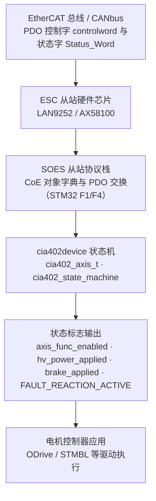
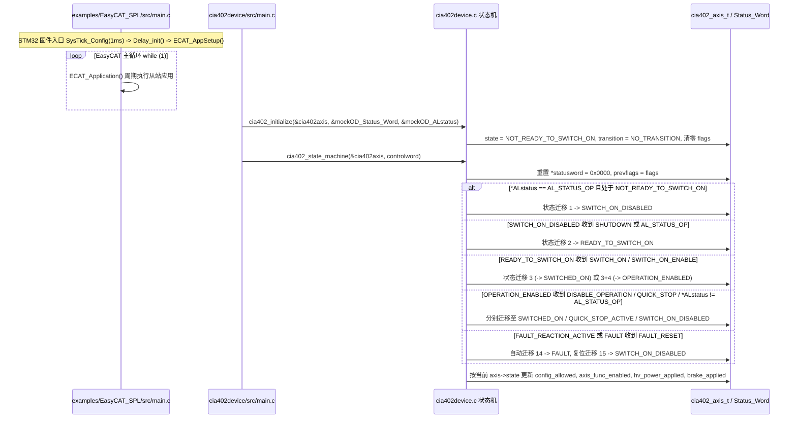

# ecat_servo

## 一句话定义

实现 CiA402 伺服状态机的 EtherCAT 伺服配套库。（分类：EtherCAT 伺服 CiA402 配套；语言/形态：C（CiA402 伺服状态机））

## 英文缩写速查

| 缩写 | 英文全称 | 简要说明 |
|------|----------|----------|
| CiA402 | CAN in Automation 402 drive profile | 伺服驱动器状态机与运动模式标准 |
| CoE | CANopen over EtherCAT | 最常用的 EtherCAT 应用层协议 |
| ESC | EtherCAT Slave Controller | 从站硬件芯片（如 ET1100 / LAN9252 / ET1815） |

## 为什么重要

- 在 [EtherCAT 开源库清单](../overview/ethercat-opensource-libs-wechat.md) 中属于「伺服 CiA402 配套」一栏，是机器人关节总线工具链的一环。
- 自研 EtherCAT 伺服驱动器时参考 CiA402 状态机的开源实现；搭配 [SOES](./soes.md)。

## 核心原理

文章对该项目的描述（以下均为文章声明，未独立核查）：

- 文章称为 CiA402 伺服状态机实现，归入「伺服 CiA402 运动控制配套库」。
- 仓库地址由文章给出。

### 架构流程图

## 工程实践

- 适用场景：自研 EtherCAT 伺服驱动器时参考 CiA402 状态机的开源实现；搭配 [SOES](./soes.md)。
- 官方地址：<https://github.com/kubabuda/ecat_servo>（文章给出，本次未独立打开核查）
- 协议背景见 [EtherCAT 协议基础](../concepts/ethercat-protocol.md)；主站实时调优见 [主站优化指南](../queries/ethercat-master-optimization.md)。

## 源码运行时序图

以下时序图基于仓库 `cia402device/src/main.c`、`cia402device/lib/cia402device/cia402device.c` 与 `examples/EasyCAT_SPL/src/main.c` 源码整理，展示 CiA402 状态机驱动流程及 STM32/EasyCAT 固件主循环入口。

## 局限与风险

- **开源状态：** 文章声明为公开仓库；**本次会话无法访问该仓库，开源程度/许可证未独立核查**，待后续按 ingest 步骤 2.5 补查。
- **推测/待核查：** 从文章描述推测其面向从站侧（做伺服驱动器的 EtherCAT 固件），是否同时提供主站侧封装需读仓库（推测，未核查）。
- EtherCAT 协议本身不开源，协议栈代码开源，ESC 硬件芯片需单独购买（文章避坑提醒）。

## 关联页面

- [PID Control（比例-积分-微分控制）](../methods/pid-control.md) — CiA402 状态机管理伺服使能与模式，电机反馈环仍需应用或驱动器实现。
- [MIT 模式模拟 CSP：前馈优先的内环整定与五关验证](../methods/mit-mode-csp-emulation-tuning.md) — 对照 CSP 位置目标与关节阻抗接口适配，需先核实 PDO、模式和控制周期；本页二手入口不证明完整实现。

- [soes](./soes.md)
- [opensml](./opensml.md)
- [ethercat-protocol](../concepts/ethercat-protocol.md)
- [ethercat-opensource-libs-wechat](../overview/ethercat-opensource-libs-wechat.md)

## 参考来源

- [sources/blogs/wechat_ethercat_opensource_libs_qt_adventure.md](../../sources/blogs/wechat_ethercat_opensource_libs_qt_adventure.md)
- [sources/raw/wechat_ethercat_opensource_libs_qt_adventure_2026-10-14.md](../../sources/raw/wechat_ethercat_opensource_libs_qt_adventure_2026-10-14.md)

## 推荐继续阅读

- EtherCAT Technology Group：<https://www.ethercat.org/>
- 文章原文：<https://mp.weixin.qq.com/s/C34QLsVb7Sd-GlvPvQlGKQ>
