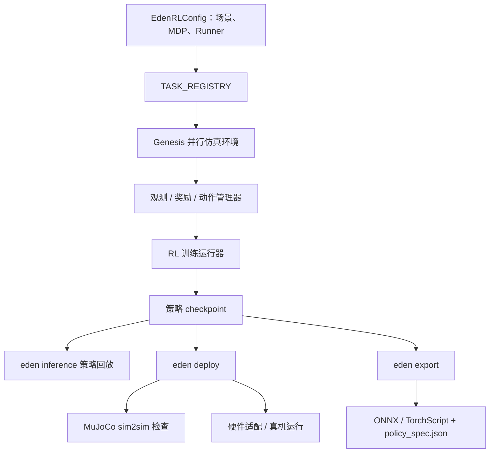
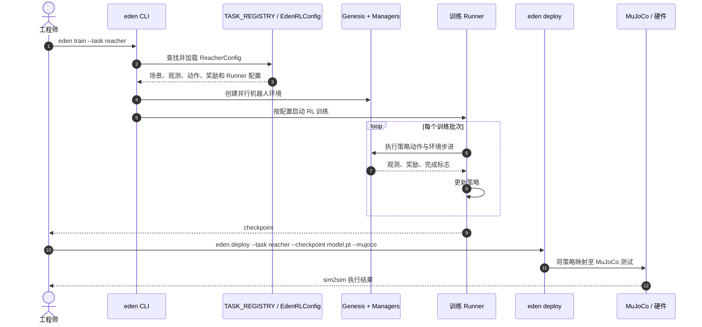

# Eden：统一任务配置的并行机器人学习与部署框架 / Embodied-AI Development Environments Nexus

## 一句话定义

Eden 是基于 Genesis 的机器人学习框架，把场景、观测、动作、奖励和训练运行器收敛到一个类型化任务配置，并延伸到并行训练、MuJoCo 复核与机器人部署。

## 英文缩写速查

| 缩写 | 英文全称 | 简要说明 |
|---|---|---|
| MDP | Markov Decision Process | 任务中的观测、动作、奖励及终止定义 |
| RL | Reinforcement Learning | GPU 并行环境中的策略优化 |
| DDP | Distributed Data Parallel | 多 GPU 训练并行 |
| ONNX | Open Neural Network Exchange | 策略导出的可移植表示 |

## 核心信息

| 项 | 资料 |
|---|---|
| 官方入口 | [项目或论文](https://embodied-ai-nexus.github.io/Eden/) |
| 官方源码 | [GitHub](https://github.com/embodied-ai-nexus/Eden) |
| 开放程度 | 官方代码/资料可访问，详见归档与许可边界 |
| 本次检查 | 2026-11-23，一手材料静态核对，未独立复现 |

## 为什么重要

仿真训练与真机部署常有不同的配置、机器人模型、观测顺序和动作单位。Eden 的核心工程价值是复用任务定义并暴露同一命令式入口，使训练产物的部署契约可以明确检查。

## 核心机制

1. 使用 `EdenRLConfig`、场景、观测/动作/奖励/终止管理器和 task registry 定义任务。
2. 基于 Genesis 及相应物理后端批量构建环境，选定训练 runner 进行策略训练。
3. `eden inference` 运行 checkpoint；`eden deploy --mujoco` 对同一策略做 sim2sim，再按硬件配置运行真机。
4. `eden export` 输出 ONNX 或 TorchScript 与 `policy_spec.json`，用以检查推理输入/输出契约。

## 流程总览

## 源码运行时序图

依据仓库 README、官方可运行入口及相应模块文件编写；仅核对静态源码，未声称已执行训练或真机运行。

## 项目资料与能力边界

| 项目材料 | 核对结果 |
|---|---|
| 发行包 | `eden-world` 0.1.1，Python 3.12+（项目 metadata 限定 <3.14） |
| 仿真核心 | Genesis 1.4.7；支持多种任务与机器人构型 |
| 官方示例 | `eden train --task reacher`，演示 4096 并行环境 |
| 出口 | `eden deploy`、`eden export`，含 MuJoCo 和策略描述文件 |

## 结论

**Eden 是基于 Genesis 的机器人学习框架，把场景、观测、动作、奖励和训练运行器收敛到一个类型化任务配置，并延伸到并行训练、MuJoCo 复核与机器人部署；使用时必须区分作者报告和可独立复现的验证结果。**

1. 把任务配置作为训练与部署之间的可核对契约。
2. 先在 `eden train` 与 `eden inference` 上验证观测动作，再执行 `eden deploy --mujoco`。
3. 实际机器人的传感器、执行器、频率与安全状态仍需另外测试。

## 工程实践

官方入口包括 `pip install eden-world`、`eden list`、`eden train --task reacher`、`eden inference`、`eden deploy --mujoco`、`eden export`；源码任务定义示例见 `eden/tasks/benchmark/reacher/config.py`。项目使用 Apache-2.0，具体可选机器人硬件支持和第三方依赖应逐项核对。

## 与其他工具对比

| 工具 | 定位 | 区别 |
|---|---|---|
| Genesis | 物理仿真与渲染后端 | Eden 在其上组织 MDP 管理器、训练、数据和部署 |
| [强化学习](../methods/reinforcement-learning.md) 的传统脚本 | 每项任务分别拼装 | Eden 更强调统一任务类型和 CLI |

## 局限与风险

一个 checkpoint 能由相同 CLI 加载不等于一定可 sim2real；数值单位、关节次序、控制频率、传感器延迟与安全互锁需真机验收。项目和可选依赖演进较快，锁定版本复现。

## 关联页面

- [相关知识与路线](../methods/reinforcement-learning.md)
- [相关知识与路线](../tasks/manipulation.md)
- [相关知识与路线](../tasks/locomotion.md)
- [相关知识与路线](../concepts/sim2real.md)
- [相关知识与路线](../../roadmap/depth-sim2real.md)

## 参考来源

- [原始资料归档](../../sources/repos/eden-embodied-ai-nexus.md)
- [原始资料归档](../../sources/sites/eden-embodied-ai-nexus.md)

## 推荐继续阅读

- [Eden 源码与 README](https://github.com/embodied-ai-nexus/Eden)
- [官方文档](https://embodied-ai-nexus.github.io/Eden/)
