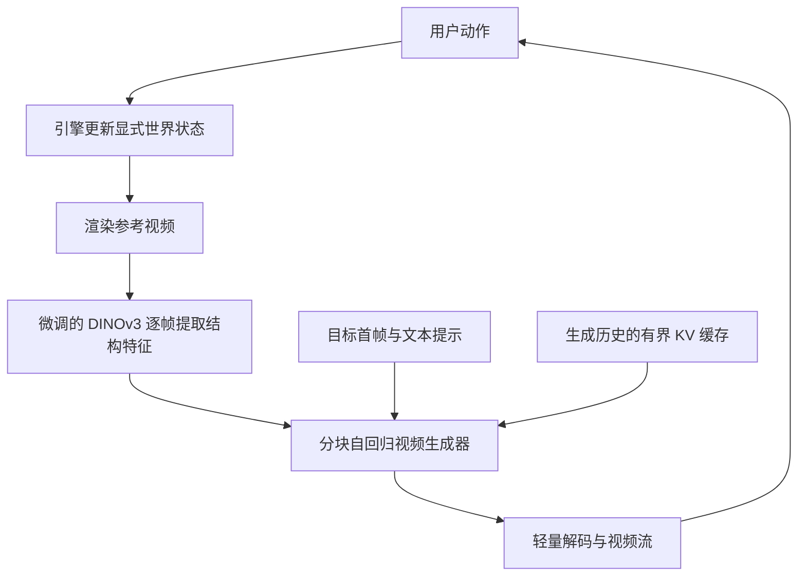
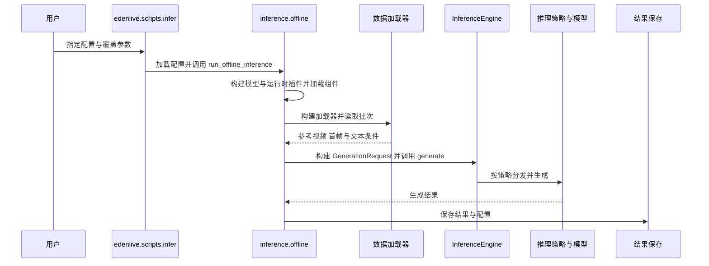

# EdenLive: Real-Time Generative Rendering from Any Visual Reference / 基于任意视觉参考的实时生成渲染

**EdenLive** 是一个生成式渲染器：上游游戏引擎、coding agent 或其他程序维护世界状态、规则和动作，并提供参考视频；EdenLive 根据参考视频、目标首帧和文本提示输出更高细节的视频流。它把“状态如何演化”留给上游，把“状态看起来怎样”交给视频生成模型。

## 英文缩写速查

| 缩写 | 英文全称 | 简要说明 |
|---|---|---|
| AR | Autoregressive | 少步 chunk-AR 按视频块依次生成，以延续先前上下文 |
| FPS | Frames Per Second | 帧率；README 报告实时渲染演示达到 24 FPS 以上 |
| I2V | Image-to-Video | 以图像条件驱动视频生成；14B 配置面向 Wan2.1 I2V |
| TI2V | Text-Image-to-Video | 文本与图像共同条件的视频生成；5B 配置面向 Wan2.2 TI2V |

## 为什么重要

- **保持可执行的状态来源。** 游戏引擎或程序仍掌握碰撞、对象状态和规则，渲染器不必独自承担完整动力学模拟。
- **为交互场景添加细节。** 低细节 proxy 视频可作为布局、相机和动作的控制信号，生成模型负责视觉增强；这样美术外观可以更新，而上游交互逻辑保持可控。
- **连接机器人视觉数据增强。** 官方 README 将“把人类视频转换为机器人视角”列为具身数据增强的用途之一；这提示可用生成渲染构造目标视角，但它本身并不保证物理状态或机器人动作标签正确。

## 核心原理

### 输入与输出

输入是上游产生的参考视频（proxy 或其他视觉参考）、目标首帧和文本提示。参考视频承载布局、相机与运动线索；首帧和文本提示约束整体外观。输出是与参考运动对齐的生成视频，官方演示目标包括 480p / 720p 以及实时播放。

### 推理模式

官方仓库提供两类推理：

| 模式 | 生成方式 | 仓库配置示例 |
|---|---|---|
| 双向 | 对完整视频帧联合去噪；适合离线生成或完整片段优化 | Wan2.1-I2V-14B 480p、Wan2.2-TI2V-5B 720p |
| 少步 chunk-AR | 以视频块为单位因果生成，README 给出每块 4 步采样 | 同上两种模型的 few-step 配置 |

官方称实时服务接收游戏画面并通过 WebRTC 流式输出。关于 chunk 长度、缓存、端到端闭环延迟等实际运行指标，应以对应配置和技术报告中的测量定义为准；FPS 推理吞吐不等于含引擎、网络和交互调度的总延迟。

## 项目流程图

流程据 2026 年 10 月[技术报告](https://assets.vast-eden.ai/assets/edenlive/EdenLive-tech-report.pdf)第 3–4 节整理；闭环中引擎负责状态，生成器负责视觉呈现。

### 训练与流式生成

- **特征对齐：** 从 DINOv3 ViT-L/16 初始化，使用配对图像的对应位置对齐、对比学习和域对抗训练；微调后冻结编码器。特征保留结构并抑制参考外观泄漏，但不保证每个细节准确。
- **生成器：** 基于 Wan2.2-TI2V-5B 或 Wan2.1-I2V-14B；参考帧特征与潜变量沿通道拼接。训练结合配对视频与对参考分支施加外观扰动的自配对视频。
- **流式化：** 先用 teacher forcing 适配分块因果注意力，再用自身 rollout 蒸馏；推理每块四步去噪，KV 缓存保留固定前缀和滚动历史，轻量解码器输出视频。
- **交互延迟：** 论文的单块前瞻流水线把模拟和视觉编码与上一块生成重叠；稳态输入到显示约为两个块时长加传输。缩短块可降低延迟，但会增加自回归次数并降低并行度。

## 源码运行时序图

对应官方离线入口 [`edenlive/scripts/infer.py`](https://github.com/VAST-AI-Research/EdenLive/blob/main/edenlive/scripts/infer.py)、[`inference/offline.py`](https://github.com/VAST-AI-Research/EdenLive/blob/main/edenlive/inference/offline.py) 和 [`inference/engine.py`](https://github.com/VAST-AI-Research/EdenLive/blob/main/edenlive/inference/engine.py)；该图描述离线入口，实时 WebRTC 服务另有独立入口。

### 报告实验与局限

报告表 2 在预热后的单张 H100 上，5B 模型 832×480 达到 73.52 FPS、1280×704 达到 29.80 FPS；计时包括条件编码、生成、解码和传回 CPU，不包括代理场景渲染或网络传输。长视频评估使用约 30 秒片段；不同方法采用各自支持的条件接口，EdenLive 使用动态提示而部分基线使用静态提示，比较时应注意此差异。编码器消融中粗输入的 DreamSim 从 0.5134 降至 0.3675，但细输入重建距离从 0.1049 增至 0.3344，体现外观抑制的取舍。

报告指出对象身份映射仍是隐式的；有界缓存没有专门保存长期外观细节，长时间遮挡或重访场景可能受影响；当前编码器也无法显式调节保留参考细节的层级。

## 工程实践与开源状态

| 项 | 核查结果 |
|---|---|
| 实时推理代码 | **已开源**，入口位于仓库 `realtime/`；README 提供服务配置与启动流程 |
| 模型权重 | **已公开**，包括 5B / 14B 双向及少步版本；README 估计全量下载约 210 GB |
| 运行规模 | README 给出 5B 单 GPU 720p 示例；安装说明亦列出特定 80 GB GPU 验证配置，部署时需按具体推理模式核对显存、CUDA 与注意力内核依赖 |
| 报告帧率 | README 报告 RTX 5090、1280×704 下约 24.7 FPS 推理吞吐；此数值不能直接视为任何硬件上的服务端到端帧率 |
| 许可证 | 主仓代码及实时服务为 Apache-2.0；工作台首帧服务使用 FLUX.2 [klein] 9B，其非商业许可只约束相关工作台路径。模型权重及其他依赖按各自许可证核实 |

### 许可范围需要分开看

EdenLive 仓库主代码和实时服务采用 Apache-2.0。官方 README 另指出，prompt-to-game 工作台的首帧生成使用 FLUX.2 [klein] 9B，受该模型非商业许可及内容过滤要求约束。不要把这个限制扩大成所有 EdenLive 实时推理的许可，也不要把主仓许可证自动套用到每个权重和第三方组件。

## 局限与风险

- **画面生成不等于状态仿真。** 若生成画面与引擎的碰撞、物体身份或运动状态不一致，下游 agent 仍可能收到误导性观察；状态真值需从引擎侧获取或校验。
- **帧率数字有测量边界。** 24.7 FPS 是 README 报告的单卡特定分辨率模型推理吞吐，不能外推到其他 GPU、分辨率或端到端交互周期。
- **具身增强需标签与动力学校验。** 视角转换可扩充视觉分布，但外观逼真本身不保证几何、接触关系和动作标签仍正确。
- **部署依赖较重。** 仓库总权重下载规模约 210 GB，且不同模型 / 推理模式依赖相应 GPU、CUDA 与注意力内核版本。
- **工作台和 renderer 的许可不是同一层。** 应按组件和权重分别审阅许可证；FLUX 首帧工作台的非商业要求不应与核心 renderer 混为一谈。

## 关联页面

- [生成式世界模型](../methods/generative-world-models.md) — 把生成模型放入交互式世界系统中理解
- [Video-as-Simulation](../concepts/video-as-simulation.md) — 视频模型承担视觉观察或状态演化时的边界
- [AgentGarten](./paper-agentgarten.md) — 比较显式引擎状态、共享神经渲染和智能体交互闭环

## 参考来源

- [EdenLive 官方项目页与报告入口](../../sources/sites/edenlive-vast-eden-ai.md)
- [EdenLive 官方仓库](../../sources/repos/edenlive-vast-ai-research.md)

## 推荐继续阅读

- [EdenLive 技术报告](https://assets.vast-eden.ai/assets/edenlive/EdenLive-tech-report.pdf)
- [EdenLive 官方 README](https://github.com/VAST-AI-Research/EdenLive#readme)
- [Hugging Face 权重页](https://huggingface.co/VAST-AI/EdenLive)
