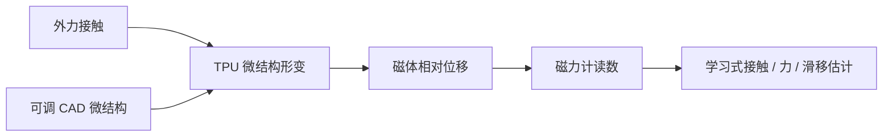

# eFlesh：可定制磁性触觉皮肤

[eFlesh](https://e-flesh.com/)（NYU；[论文](https://arxiv.org/abs/2506.09994)，[代码](https://github.com/notvenky/eFlesh)）是一种低成本软触觉传感器：将磁体嵌入柔性 TPU 微结构，外力造成磁体相对磁力计位移，学习模型再从磁信号估计接触位置、力与滑移。参数化微结构使传感器既能适配不同外形，也能调节机械顺应性和传感响应。

## 系统链路

## 关键结果与边界

项目页报告接触定位误差约 **0.5 mm**、法向力预测误差 **0.27 N**、剪切力预测误差 **0.12 N**，并在未见物体上取得约 **95%** 滑移检测表现。论文涉及插 USB、插头、刷卡和白板擦拭等精细操作。视触觉任务成功率网页和论文摘要分别呈现约 90% 与 91% 的平均值，属于表述/版本的轻微差异，应按来源口径引用；这些都是论文实验条件下的结果。

## 制造与复现

基本硬件由家用 3D 打印的 TPU 结构、嵌入式永磁体和磁力计板组成。CAD-to-eFlesh 工具从凸形 OBJ/STL 生成传感器结构；仓库还提供微结构生成、标定/数据及滑移与操作实验代码。克隆时需递归获取子模块并检查每个依赖、模型及数据的许可；低成本硬件不代表免标定或跨装置零样本通用。

## 关联

- [触觉感知](../concepts/tactile-sensing.md)：磁性形变传感与力/滑移估计。
- [视触觉融合](../concepts/visuo-tactile-fusion.md)：触觉闭环如何补足视觉遮挡。
- 来源：[论文](../../sources/papers/eflesh_arxiv_2506_09994.md)、[仓库](../../sources/repos/eflesh.md)、[项目页](../../sources/sites/eflesh-project.md)。
