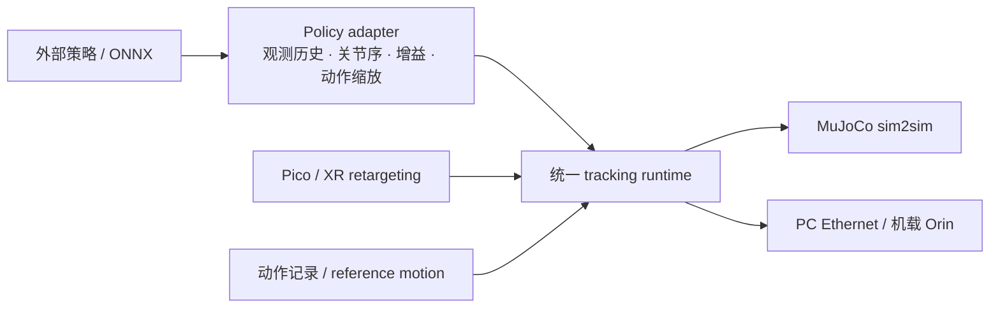
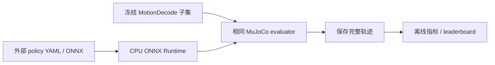

# sim2real：G1 部署运行时与跨代码库跟踪评测

## 英文缩写速查

| 缩写 | 英文全称 | 简要说明 |
|---|---|---|
| sim2real | Simulation to Real | 将仿真策略迁移到真机运行 |
| ONNX | Open Neural Network Exchange | 策略模型交换格式 |
| G1 | Unitree G1 | 本仓库主要支持的人形机器人平台 |
| XR | Extended Reality | Pico/XR 动作输入与遥操作工具链 |

[EGalahad/sim2real](https://github.com/EGalahad/sim2real) 是一个轻量、模块化的人形控制部署栈，覆盖外部策略适配、ONNX 推理、MuJoCo sim2sim 跟踪、遥操作与 Unitree G1 真机 I/O。它是一套工程 runtime，不是一篇提出新学习算法的论文。

## Runtime 架构

仓库把 policy runtime 与执行后端解耦。Root project 负责推理、tracking 和 MuJoCo；Pico/XR retargeting、viewer 与 motion recording 使用单独环境。官方文档列出 x86_64 PC 通过 Ethernet 连接 G1，以及在 G1 onboard Orin 本地运行两种硬件布局。当前资料重点在 Unitree G1，不能据此推断任意 humanoid 都可直接部署。

## Leaderboard：15 个条目映射到 10 个唯一项目节点

排行榜的版本行按其所属策略项目归并；相同项目的 release 共享该项目的唯一实体页。表中每一行均有项目详情链接，避免复制论文/项目节点。

| Leaderboard policy | 独立项目详情节点 | 归并说明 |
|---|---|---|
| Mimic Lite v1.1 | [MimicLite](./mimiclite.md) | 同一项目的 v1.1 发布配置 |
| MimicLite-ROA | [MimicLite](./mimiclite.md) | PPO-ROA 版本 |
| MimicLite-PPO | [MimicLite](./mimiclite.md) | PPO 版本 |
| HEFT | [HEFT](./paper-heft.md) | 论文与项目实体 |
| HoloMotion | [HoloMotion](./holomotion.md) | 独立项目实体 |
| SONIC | [SONIC](./nvidia-sonic.md) | 同一 NVIDIA 策略系列 |
| SONIC-Low-Latency | [SONIC](./nvidia-sonic.md) | 低延迟发布配置 |
| SONIC-v1.1 | [SONIC](./nvidia-sonic.md) | v1.1 发布配置 |
| GRIT v0.0.1 | [GRIT v0.0.1](./grit-v0-0-1.md) | 策略及其官方部署仓库 |
| ScaleBFM-XL | [ScaleBFM](./paper-scaling-bfm-humanoid.md) | XL 模型规模 |
| ScaleBFM-M | [ScaleBFM](./paper-scaling-bfm-humanoid.md) | M 模型规模 |
| BFM-Zero | [BFM-Zero](./paper-bfm-zero.md) | 独立项目实体 |
| TeleopIt | [TeleopIT](./paper-teleopit.md) | 独立项目实体 |
| Humanoid-GPT | [Humanoid-GPT](./paper-humanoid-gpt.md) | 独立项目实体 |
| TWIST2 | [TWIST2](./paper-twist2.md) | 独立项目实体 |

因此 15 行没有被误当成 15 个不同项目，也没有为同一 MimicLite/SONIC/ScaleBFM 系列重复建实体；缺失的 SONIC 与 GRIT v0.0.1 节点已单独补充。

## 榜单快照（2026-09-15）

页面展示的前三行如下；括号内为 Locomotion / Manipulation 均值。位置与姿态误差越低越好，Tracking Return 与 Progress 越高越好。该数字是页面当前报告口径，比较时需同时保留数据集拆分与 GPU Hours 来源信息。

| 排名 / 策略 | Body Pos (mm) | Body Ori (rad) | Wrist Pos (mm) | Tracking Return | Progress (%) | GPU Hours |
|---|---:|---:|---:|---:|---:|---:|
| 1 · Mimic Lite v1.1 | 26.68 (25.11 / 28.25) | 0.088 (0.081 / 0.095) | 22.86 (22.15 / 23.57) | 1.852 (1.913 / 1.790) | 96.5 (99.3 / 93.6) | 50.1 |
| 2 · MimicLite-ROA | 31.98 (29.22 / 34.74) | 0.106 (0.095 / 0.118) | 33.21 (31.61 / 34.81) | 1.826 (1.886 / 1.766) | 96.6 (98.7 / 94.5) | 173.2 |
| 3 · MimicLite-PPO | 32.92 (31.52 / 34.32) | 0.109 (0.097 / 0.121) | 35.96 (33.25 / 38.66) | 1.836 (1.900 / 1.772) | 97.6 (100.0 / 95.2) | 92.3 |

这组结果说明排名不能只看单一进度值：PPO 的进度最高，但 v1.1 在所列位置、姿态、手腕误差及 Tracking Return 上领先。GPU Hours 是页面单列训练成本，不能脱离各项目的训练流程直接视为同条件成本比较。

## Benchmark 协议与指标

默认集合包含 Locomotion-80、Manipulation-48、Ground-60、Dance-40；Legacy LAFAN-40、PHUMA-30、Root-90 可作为历史面板。官方教程固定数据 revision、motion 顺序及校验 hashes；所有策略使用 seed 0、50 Hz、零初始暂停、无 runtime cap 和一致的失败条件。每个 dataset 内 motion 等权，headline 再对所选数据集均值等权平均。

| 指标 | 口径 | 解释 |
|---|---|---|
| Body Pos / Ori | pelvis XY/yaw 对齐后的局部姿态误差 | 越低越好；ORI 为 rad |
| Global Root | 仅 Locomotion 的 root 终点误差 | 越低越好；需和 progress 一起看 |
| Wrist Pos / Ori | 双腕均值误差 | 越低越好；Ground/Dance 不适用 |
| Tracking Return | 归一化跟踪回报 | 越高越好；最高约 2 |
| Progress | 故障前完成的参考动作比例 | 越高越好 |
| GPU Hours | 有来源时的训练成本记录 | 缺失表示无可辩护来源，不表示零成本 |

Manipulation-48 仍是 humanoid reference-motion tracking 集，不测抓取/插入等物体任务成功率。排行榜是可复现实验快照，不能脱离上述评估器、数据版本与指标口径直接比较不同论文的原始结果。

## 使用与边界

- 安装入口采用 uv；CPU 推理 extra 可用于通用环境，G1 真机 mode 需额外安装对应 SDK/依赖并遵照网络与硬件配置文档。
- 大型 checkpoints 与 third-party runtime artifacts 从项目提供的共享资源下载，不在 git 主仓库中完整分发。
- 迁移策略要核对 observation/history、joint ordering、PD gains、action scale；单独拿到 ONNX 不等于部署适配完成。
- [官方项目文档](https://egalahad.github.io/sim2real/)、[Leaderboard](https://egalahad.github.io/sim2real/leaderboard/) 与 [复现实验教程](https://egalahad.github.io/sim2real/tutorials/cross-codebase-evaluation/) 是此栈的主要使用入口。

## 参考来源

- [仓库归档](../../sources/repos/egalahad-sim2real.md)
- [官方文档归档](../../sources/sites/egalahad-sim2real-docs.md)
- [排行榜和评测协议归档](../../sources/sites/egalahad-sim2real-leaderboard.md)

## 关联页面

- [Sim2Real 概念](../concepts/sim2real.md)
- [Processor-in-the-loop Sim2Real](../concepts/processor-in-the-loop-sim2real.md)
- [具身大模型评测基准选型闭环](../queries/embodied-eval-benchmark-selection-loop.md) — 该 leaderboard 属于"sim↔real 评测 gap 校准"层：同一 MuJoCo evaluator 统一口径，但不等于真机成功率
- 榜单政策节点见上表；来源归档见 [仓库](../../sources/repos/egalahad-sim2real.md)、[文档](../../sources/sites/egalahad-sim2real-docs.md)、[排行榜与协议](../../sources/sites/egalahad-sim2real-leaderboard.md)。