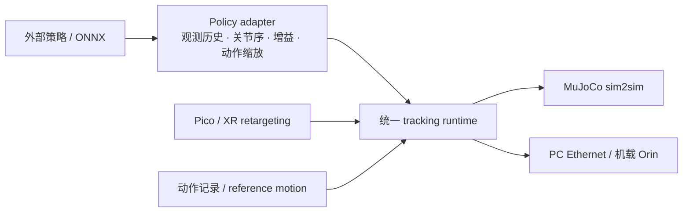
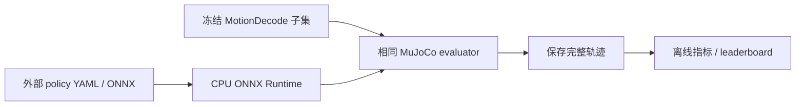
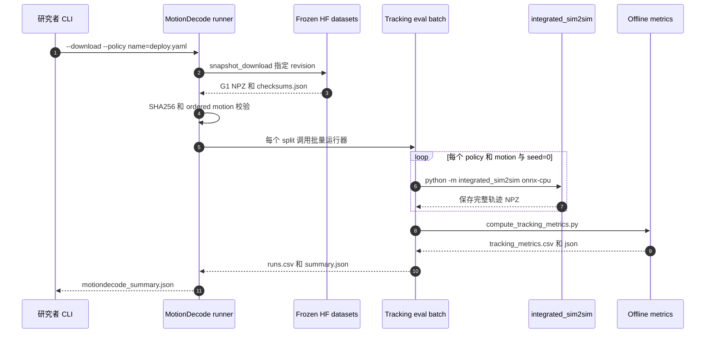

# sim2real：G1 部署运行时与跨代码库跟踪评测

## 一句话定义

**EGalahad/sim2real** 是 RoboParty Lab 使用的 G1 策略部署与统一参考动作跟踪评测栈，在共享 MuJoCo 环境中接入不同 ONNX 策略并保存可供离线评分的轨迹。

## 英文缩写速查

| 缩写 | 英文全称 | 简要说明 |
|---|---|---|
| sim2real | Simulation to Real | 将仿真策略迁移到真机运行 |
| ONNX | Open Neural Network Exchange | 策略模型交换格式 |
| G1 | Unitree G1 | 本仓库主要支持的人形机器人平台 |
| XR | Extended Reality | Pico/XR 动作输入与遥操作工具链 |

## 为什么重要

跨框架跟踪结果常受动作集、模型 I/O、控制频率与失败判定的差异影响；统一评测的价值，是固定这些变量并保留可复核的完整轨迹，而不是把单项误差解释为真机性能。

[EGalahad/sim2real](https://github.com/EGalahad/sim2real) 是一个轻量、模块化的人形控制部署栈，覆盖外部策略适配、ONNX 推理、MuJoCo sim2sim 跟踪、遥操作与 Unitree G1 真机 I/O。它是一套工程 runtime，不是一篇提出新学习算法的论文。

## 核心原理

部署适配器负责策略观测与关节控制接口，评测运行器将**冻结动作 → 同一仿真器中的策略 rollout → 轨迹保存 → 离线打分**拆为可检查的步骤。训练算法仍由各项目独立提供，故评测可比较跟踪结果，但不代表训练配置完全同一。

## Runtime 架构



仓库把 policy runtime 与执行后端解耦。Root project 负责推理、tracking 和 MuJoCo；Pico/XR retargeting、viewer 与 motion recording 使用单独环境。官方文档列出 x86_64 PC 通过 Ethernet 连接 G1，以及在 G1 onboard Orin 本地运行两种硬件布局。当前资料重点在 Unitree G1，不能据此推断任意 humanoid 都可直接部署。

## 官方归属：RoboParty Lab 的跨代码库跟踪评测

[RoboParty Party OS 的 MimicLite 使用指南 §6](https://roboparty.com/documents/party-os?doc=mimiclite&lang=zh) 将这个页面作为 tracking leaderboard 入口，并公开了运行命令。EGalahad/sim2real 的 README 将项目 citation 作者署为 **RoboParty Lab Team**，可将其理解为 RoboParty 使用的开源运动跟踪基准实现，而非另一份独立排行榜。

它固定 **Unitree G1 + MuJoCo + CPU ONNX Runtime**，测量跟随给定参考动作的保真度与完成程度；不是跨机器人、跨硬件的真实运动控制能力总榜。此评测的 `Manipulation` 指手腕和全身运动**跟踪**，并不评测物体抓取成功率。

## Leaderboard：15 个条目映射到 10 个唯一项目节点

排行榜的版本行按其所属策略项目归并；相同项目的 release 共享该项目的唯一实体页。表中每一行均有项目详情链接，避免复制论文/项目节点。

| Leaderboard policy | 独立项目详情节点 | 归并说明 |
|---|---|---|
| Mimic Lite v1.1 | [MimicLite](./mimiclite.md) | 同一项目的 v1.1 发布配置 |
| MimicLite-ROA | [MimicLite](./mimiclite.md) | PPO-ROA 版本 |
| MimicLite-PPO | [MimicLite](./mimiclite.md) | PPO 版本 |
| HEFT | [HEFT](./paper-heft.md) | 论文与项目实体 |
| HoloMotion | [HoloMotion](./holomotion.md) | 独立项目实体 |
| SONIC | [SONIC](./nvidia-sonic.md) | 同一 NVIDIA 策略系列 |
| SONIC-Low-Latency | [SONIC](./nvidia-sonic.md) | 低延迟发布配置 |
| SONIC-v1.1 | [SONIC](./nvidia-sonic.md) | v1.1 发布配置 |
| GRIT v0.0.1 | [GRIT v0.0.1](./grit-v0-0-1.md) | 策略及其官方部署仓库 |
| ScaleBFM-XL | [ScaleBFM](./paper-scaling-bfm-humanoid.md) | XL 模型规模 |
| ScaleBFM-M | [ScaleBFM](./paper-scaling-bfm-humanoid.md) | M 模型规模 |
| BFM-Zero | [BFM-Zero](./paper-bfm-zero.md) | 独立项目实体 |
| TeleopIt | [TeleopIT](./paper-teleopit.md) | 独立项目实体 |
| Humanoid-GPT | [Humanoid-GPT](./paper-humanoid-gpt.md) | 独立项目实体 |
| TWIST2 | [TWIST2](./paper-twist2.md) | 独立项目实体 |

因此 15 行没有被误当成 15 个不同项目，也没有为同一 MimicLite/SONIC/ScaleBFM 系列重复建实体；缺失的 SONIC 与 GRIT v0.0.1 节点已单独补充。

## 榜单快照（2026-09-15）

页面展示的前三行如下；括号内为 Locomotion / Manipulation 均值。位置与姿态误差越低越好，Tracking Return 与 Progress 越高越好。该数字是页面当前报告口径，比较时需同时保留数据集拆分与 GPU Hours 来源信息。

| 排名 / 策略 | Body Pos (mm) | Body Ori (rad) | Wrist Pos (mm) | Tracking Return | Progress (%) | GPU Hours |
|---|---:|---:|---:|---:|---:|---:|
| 1 · Mimic Lite v1.1 | 26.68 (25.11 / 28.25) | 0.088 (0.081 / 0.095) | 22.86 (22.15 / 23.57) | 1.852 (1.913 / 1.790) | 96.5 (99.3 / 93.6) | 50.1 |
| 2 · MimicLite-ROA | 31.98 (29.22 / 34.74) | 0.106 (0.095 / 0.118) | 33.21 (31.61 / 34.81) | 1.826 (1.886 / 1.766) | 96.6 (98.7 / 94.5) | 173.2 |
| 3 · MimicLite-PPO | 32.92 (31.52 / 34.32) | 0.109 (0.097 / 0.121) | 35.96 (33.25 / 38.66) | 1.836 (1.900 / 1.772) | 97.6 (100.0 / 95.2) | 92.3 |

这组结果说明排名不能只看单一进度值：PPO 的进度最高，但 v1.1 在所列位置、姿态、手腕误差及 Tracking Return 上领先。GPU Hours 是页面单列训练成本，不能脱离各项目的训练流程直接视为同条件成本比较。

## Benchmark 协议与指标



默认集合包含 Locomotion-80、Manipulation-48、Ground-60、Dance-40；Legacy LAFAN-40、PHUMA-30、Root-90 可作为历史面板。官方教程固定数据 revision、motion 顺序及校验 hashes；所有策略使用 seed 0、50 Hz、零初始暂停、无 runtime cap 和一致的失败条件。每个 dataset 内 motion 等权，headline 再对所选数据集均值等权平均。

| 指标 | 口径 | 解释 |
|---|---|---|
| Body Pos / Ori | pelvis XY/yaw 对齐后的局部姿态误差 | 越低越好；ORI 为 rad |
| Global Root | 仅 Locomotion 的 root 终点误差 | 越低越好；需和 progress 一起看 |
| Wrist Pos / Ori | 双腕均值误差 | 越低越好；Ground/Dance 不适用 |
| Tracking Return | 归一化跟踪回报 | 越高越好；最高约 2 |
| Progress | 故障前完成的参考动作比例 | 越高越好 |
| GPU Hours | 有来源时的训练成本记录 | 缺失表示无可辩护来源，不表示零成本 |

Manipulation-48 仍是 humanoid reference-motion tracking 集，不测抓取/插入等物体任务成功率。排行榜是可复现实验快照，不能脱离上述评估器、数据版本与指标口径直接比较不同论文的原始结果。

## 源码运行时序图

下图按官方 [评测启动脚本](https://github.com/EGalahad/sim2real/blob/main/scripts/tracking_experiment/run_motiondecode_eval.py)、[批量执行器](https://github.com/EGalahad/sim2real/blob/main/scripts/tracking_experiment/run_tracking_metrics_eval.py) 和 [评分脚本](https://github.com/EGalahad/sim2real/blob/main/scripts/tracking_experiment/compute_tracking_metrics.py) 的实际调用路径整理，而非推测性训练架构。



## 复现：官方命令与冻结数据

在 [sim2real 仓库](https://github.com/EGalahad/sim2real) 根目录使用已适配的 `policy.yaml`（需要匹配 ONNX、观测历史、关节顺序、PD 与 action scale）：

```bash
uv sync --extra inference-cpu
uv run scripts/tracking_experiment/run_motiondecode_eval.py \
  --download \
  --policy my_policy=checkpoints/my_policy/policy.yaml \
  --output-dir outputs/my_policy_motiondecode \
  --max-workers 8
```

默认评估 Locomotion-80 与 Manipulation-48；追加 `--splits locomotion manipulation ground dance` 可评四组，追加第二条 `--policy name=path` 可比较不同策略。`--dry-run` 用于先下载与校验，不执行仿真；`--skip-existing` 只适用于冻结了策略、仿真和数据版本后的重新计分。官方冻结源是 ChingMu MotionDecode 的 G1 120 Hz 转换子集，并以 [motiondecode.json](https://github.com/EGalahad/sim2real/blob/main/scripts/tracking_experiment/manifests/motiondecode.json) 的独立 revision 与 SHA256 校验保证输入一致。每个 split 输出原始 trajectories、`runs.csv`、`tracking_metrics.csv/json`、`summary.json`，顶层另有 `motiondecode_summary.json`。

**评分关键约束：** 运行 seed 0、50 Hz policy frames、初始暂停 0、无 runtime cap；骨盆高度差严格大于 **0.3 m** 或投影重力 Z 差严格大于 **0.8** 则判失败。失败后的位置误差不进入均值，Tracking Return 不含失败帧，因此必须把 **Body Pos 与 Progress 一起看**。Global Root 是 Locomotion 专属、起始 XY/yaw 对齐后的有效终点 XYZ 距离；历史 root 轨迹均值口径不能直接与之混合比较。原始 MotionDecode 数据许可仍适用，不应改采样或未经验证转到其他机器人。

**结果解释补充：** 官方 [README](https://github.com/EGalahad/sim2real/blob/main/README.md) 还报告各发布策略所需未来参考动作窗口（motion-lookahead）：Mimic Lite v1.1 为 0.08 s、HEFT 为 0.12 s、SONIC release 为 0.90 s、SONIC low-latency 为 0.18 s；这是参考窗口需求而不是真实端到端推理时延。榜单 GPU Hours 来源与训练流程可能不同，不等于相同设备实测的可比训练成本。

## 工程实践与使用边界

- 安装入口采用 uv；CPU 推理 extra 可用于通用环境，G1 真机 mode 需额外安装对应 SDK/依赖并遵照网络与硬件配置文档。
- 大型 checkpoints 与 third-party runtime artifacts 从项目提供的共享资源下载，不在 git 主仓库中完整分发。
- 迁移策略要核对 observation/history、joint ordering、PD gains、action scale；单独拿到 ONNX 不等于部署适配完成。
- [官方项目文档](https://egalahad.github.io/sim2real/)、[Leaderboard](https://egalahad.github.io/sim2real/leaderboard/) 与 [复现实验教程](https://egalahad.github.io/sim2real/tutorials/cross-codebase-evaluation/) 是此栈的主要使用入口。

## 局限与风险

- **仿真替代不了真机：** 统一 MuJoCo 跟踪未覆盖实际网络延迟、驱动温度、接触稳定性与跨机体迁移；在真机部署前仍需独立验证安全边界。
- **动作跟踪替代不了任务成功率：** Manipulation-48 的手腕/姿态误差并非抓取、插入或交互的成功率。
- **榜单并非恒定事实：** 排名对应官方页面最近一次发布的基准快照，改动模型、数据 revision、失败准则或 Root 口径后应重新评测；本次未独立复现榜单成绩。

## 参考来源

- [仓库归档](../../sources/repos/egalahad-sim2real.md)
- [官方文档归档](../../sources/sites/egalahad-sim2real-docs.md)
- [排行榜和评测协议归档](../../sources/sites/egalahad-sim2real-leaderboard.md)
- [RoboParty 官方 MimicLite 第 6 章来源归档](../../sources/sites/mimiclite-official-guide-2026-11-11.md)

## 推荐继续阅读

- [RoboParty MimicLite 官方指南：Evaluation §6](https://roboparty.com/documents/party-os?doc=mimiclite&lang=zh) — 原始评测入口与各集合定义。
- [Cross-Codebase Tracking Evaluation](https://egalahad.github.io/sim2real/tutorials/cross-codebase-evaluation/) — 复现命令、冻结数据、失败与指标口径。
- [EGalahad/sim2real 官方实现](https://github.com/EGalahad/sim2real/tree/main/scripts/tracking_experiment) — 批量运行器、MuJoCo 环境与离线指标源码。

## 关联页面

- [遥操作](../tasks/teleoperation.md) — 将 Pico/XR 输入放到操作员、指令映射和机器人反馈链路中理解。
- [人形运动控制](../tasks/humanoid-locomotion.md) — 定位 Unitree G1 的动作跟踪与仿真到实机校验。
- [Sim2Real 概念](../concepts/sim2real.md)
- [Processor-in-the-loop Sim2Real](../concepts/processor-in-the-loop-sim2real.md)
- [具身大模型评测基准选型闭环](../queries/embodied-eval-benchmark-selection-loop.md) — 该 leaderboard 属于"sim↔real 评测 gap 校准"层：同一 MuJoCo evaluator 统一口径，但不等于真机成功率
- 榜单政策节点见上表；来源归档见 [仓库](../../sources/repos/egalahad-sim2real.md)、[文档](../../sources/sites/egalahad-sim2real-docs.md)、[排行榜与协议](../../sources/sites/egalahad-sim2real-leaderboard.md)。