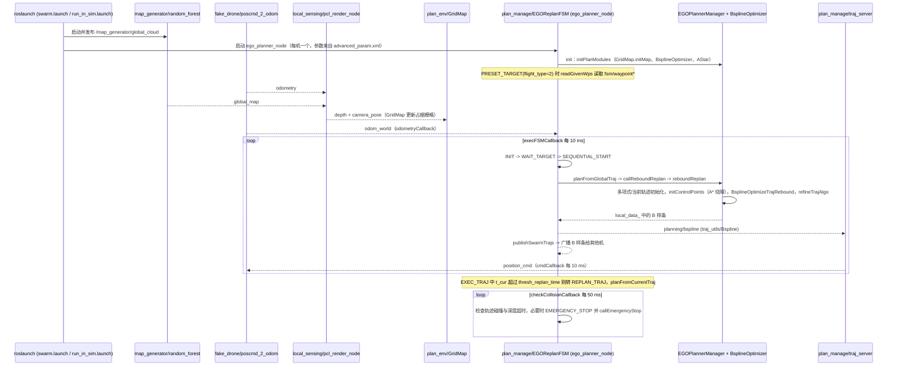

---

type: entity
tags: [repo, planning, swarm, esdf, uav, ros, zju-fast-lab, zju]
status: complete
updated: 2026-10-17
related:
  - ../overview/multirotor-simulation-planning-control-stack.md
  - ./px4-autopilot.md
  - ./mavsdk.md
  - ./flightmare.md
  - ./airsim.md
  - ./paper-mighty-hermite-spline-trajectory-planning.md
  - ./paper-flap-fov-active-perception-3d-navigation.md
  - ./paper-sando.md
sources:
  - ../../sources/repos/ego_planner_swarm.md
summary: "EGO-Planner Swarm 是 ZJU FAST Lab 的单/多机局部轨迹规划器：ESDF 地图 + B-spline 优化，输出可对接 PX4 Offboard 的位置/速度设定点。"
---

# EGO-Planner Swarm

**EGO-Planner Swarm**（[ZJU-FAST-Lab/ego-planner-swarm](https://github.com/ZJU-FAST-Lab/ego-planner-swarm)）实现 **未知/半已知环境** 下的快速 **局部重规划**，并扩展 **多机 swarm 避碰**。

## 英文缩写速查

| 缩写 | 英文全称 | 简要说明 |
|------|----------|----------|
| SLAM | Simultaneous Localization and Mapping | 同步定位与建图 |
| LiDAR | Light Detection and Ranging | 激光雷达，地形感知与建图主传感器 |
| VIO | Visual-Inertial Odometry | 视觉-惯性里程计，融合相机与 IMU 估计位姿 |

## 为什么重要

- **规划—控制分界清晰**：输出轨迹/设定点，不替代 [PX4](./px4-autopilot.md) 姿态内环。
- **ESDF + B-spline** 是近年多旋翼自主导航文献与工程中的常见组合，便于与 SLAM/深度相机管线对接。
- 与 [Flightmare](./flightmare.md)、[AirSim](./airsim.md) 等仿真器组合做 **感知—规划—控制** 闭环验证。

## 核心结构/机制

1. **感知/建图**（常外接）：深度或 LiDAR → 占据/ESDF 更新  
2. **前端**：路径搜索或引导路径  
3. **后端**：均匀 B-spline 优化（平滑、动力学、障碍约束）  
4. **Swarm**：机间碰撞代价或协调策略  
5. **执行**：ROS 话题 → MAVROS/[MAVSDK](./mavsdk.md) Offboard → PX4  

**Rebound replanning**：当前轨迹不可行时局部反弹式重优化，适合动态障碍。

## 常见误区或局限

- **误区：有 planner 即可无定位** — 仍需可靠位姿（VIO、动捕、GPS 等）。
- **局限：算力与传感器标定** — 深度噪声会直接反映在 ESDF 与轨迹可行性上。
- **局限：极端动态障碍** — 需额外安全层（限速、禁飞区、人工接管）。
- **对照：[MIGHTY](./paper-mighty-hermite-spline-trajectory-planning.md)** — 同层软约束 UAV 规划器，用 **Hermite 联合时空优化** 在论文 benchmark 中报告更短飞行/求解时间；EGO 优势在 **ROS 1/2 生态与 swarm 扩展**。
- **对照：[FLAP](./paper-flap-fov-active-perception-3d-navigation.md)** — 同机构（ZJU）**无先验地图** 路线，把 **FOV 主动感知** 嵌入 MINCO 轨迹优化；EGO 不显式优化传感器可见性，FLAP 侧重窄 FOV 与竖向机动安全。
- **对照：[SANDO](./paper-sando.md)** — 显式追踪动态障碍并以 STSFC + 硬约束 MIQP 做连续时间避碰分析；EGO 的核心路线仍是 ESDF + B-spline 快速局部规划。两者的安全保证和评测场景不能仅凭成功率横比。

## 源码运行时序图

入口：`roslaunch ego_planner simple_run.launch`（`plan_manage/launch/simple_run.launch` 包含 `rviz.launch` 与 `swarm.launch`；`swarm.launch` 启动 `map_generator/random_forest`，并对每架无人机 include `run_in_sim.launch`，后者再包含 `advanced_param.xml`（`ego_planner_node`）、`traj_server` 与 `simulator.xml`（`poscmd_2_odom`、`odom_visualization`、`local_sensing_node/pcl_render_node`））。

图依据：ZJU-FAST-Lab/ego-planner-swarm@92fe9f7，读过 `README.md`、`plan_manage/launch/{simple_run,swarm,run_in_sim,advanced_param,simulator}.xml/launch`、`plan_manage/src/{ego_planner_node,ego_replan_fsm,planner_manager,traj_server}.cpp`、`plan_manage/include/plan_manage/ego_replan_fsm.h`、`plan_env/src/grid_map.cpp`、`uav_simulator` 下 `poscmd_2_odom.cpp`、`pcl_render_node.cpp`、`random_forest_sensing.cpp`（仅看订阅/发布与定时器）。`bspline_opt` 内部优化细节、`drone_detect`、`rosmsg_tcp_bridge` 未读，未画。

## 参考来源

- [sources/repos/ego_planner_swarm.md](../../sources/repos/ego_planner_swarm.md)
- [ZJU-FAST-Lab/ego-planner-swarm](https://github.com/ZJU-FAST-Lab/ego-planner-swarm)
- 源码核对（2026-11-02）：ZJU-FAST-Lab/ego-planner-swarm@92fe9f7，读过 README.md、plan_manage 的 launch 文件与 ego_planner_node.cpp、ego_replan_fsm.cpp/.h、planner_manager.cpp、traj_server.cpp、plan_env/grid_map.cpp、uav_simulator 的 poscmd_2_odom.cpp、pcl_render_node.cpp、random_forest_sensing.cpp；时序图依据以上文件，未运行代码。

## 关联页面

- [多旋翼栈总览](../overview/multirotor-simulation-planning-control-stack.md)
- [PX4 Autopilot](./px4-autopilot.md)
- [MAVSDK](./mavsdk.md)
- [MIGHTY（Hermite 样条规划 · RA-L 2026）](./paper-mighty-hermite-spline-trajectory-planning.md)
- [FLAP（FOV 主动感知 · 无先验地图 3D 导航）](./paper-flap-fov-active-perception-3d-navigation.md)
- [SANDO](./paper-sando.md) — 动态未知环境下的时空安全走廊规划
- [野外微型飞行机器人蜂群（Science Robotics 2022）](./paper-swarm-micro-flying-robots-in-the-wild.md)
- [EuRoC MAV 数据集](./euroc-mav-datasets.md)

## 推荐继续阅读

- [EGO-Planner 原版仓库](https://github.com/ZJU-FAST-Lab/ego-planner) — 单机算法与论文入口
