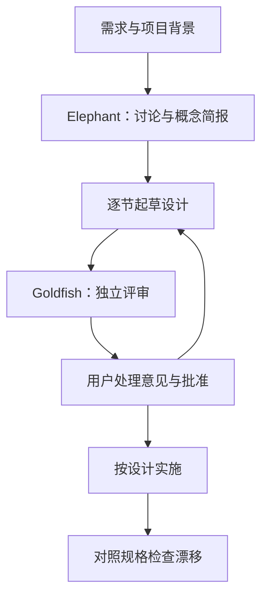
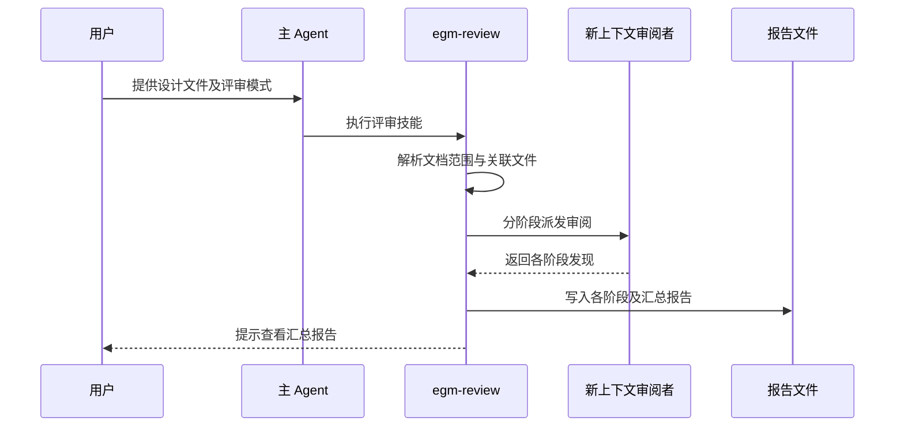

# Elephant-Goldfish Model（大象与金鱼设计评审模型）

## 一句话定义

Elephant-Goldfish Model（EGM）是设计先行的 Agent 工作流：主 Agent 与人讨论并起草规格，再由不继承此前对话的子 Agent 评审。

## 英文缩写速查

| 缩写 | 英文全称 | 简要说明 |
|---|---|---|
| EGM | Elephant-Goldfish Model | 大象与金鱼设计评审模型 |
| SDD | Spec-Driven Development | 规格驱动开发 |
| CLI | Command-Line Interface | 命令行接口 |

## 核心机制

Elephant 使用项目背景、需求和已讨论的决策，协助澄清问题、起草文档；Goldfish 在独立的新上下文中检查设计及所提供的源码或资料，以发现缺失假设和实现风险。审阅范围依阶段而异：理解测试只读文档，其他阶段可接收已解析的本地关联文件。用户判断审阅意见，决定取舍并批准设计。

## 流程总览

## 源码运行时序图

以下为公开技能指令描述的 `egm-review` 不间断评审路径，不代表程序级调用栈；宿主 Agent 负责解释和执行指令。

依据固定版本的 `skills/egm-review/SKILL.md` 和 `skills/egm-review-loop/SKILL.md`。理解测试直接派发给理解审阅者；其他阶段可经 synthesizer 或直接派发。

## 工程实践与局限

- README 列出 Antigravity、Claude Code 和 Codex 安装方式，并指向 Claude Cowork、ChatGPT Work 的配置说明。
- 无法创建新上下文子 Agent 时，项目要求停止 Goldfish 评审；审阅不代替测试和人工判断。简单明确的修复不一定需要完整设计流程。
- 仓库采用 Apache-2.0；官网注明该项目不是 Google 官方支持的产品。未实机验证，原始文章全文及其他技能和审阅者提示词仍待完整核对。

## 关联页面

- [Agent Autoloop](./agent-autoloop.md)：事件驱动的 Agent 调度。
- [LangGraph](./langgraph.md)：有状态的 Agent 工作流编排。

## 参考来源

- [源码归档与核查范围](../../sources/repos/elephant-goldfish-model.md)
- [官网归档](../../sources/sites/elephant-goldfish-model.md)
- [README 固定版本](https://github.com/google/elephant-goldfish-model/blob/0dfb5bf3eebd551d1e805c3ab16cbaa9b1c2c42a/README.md)
- [评审技能固定版本](https://github.com/google/elephant-goldfish-model/blob/0dfb5bf3eebd551d1e805c3ab16cbaa9b1c2c42a/skills/egm-review/SKILL.md)
- [评审循环固定版本](https://github.com/google/elephant-goldfish-model/blob/0dfb5bf3eebd551d1e805c3ab16cbaa9b1c2c42a/skills/egm-review-loop/SKILL.md)

## 推荐继续阅读

- [Dave Rensin 的原始文章](https://medium.com/@drensin/elephants-goldfish-and-the-new-golden-age-of-software-engineering-c33641a48874)
