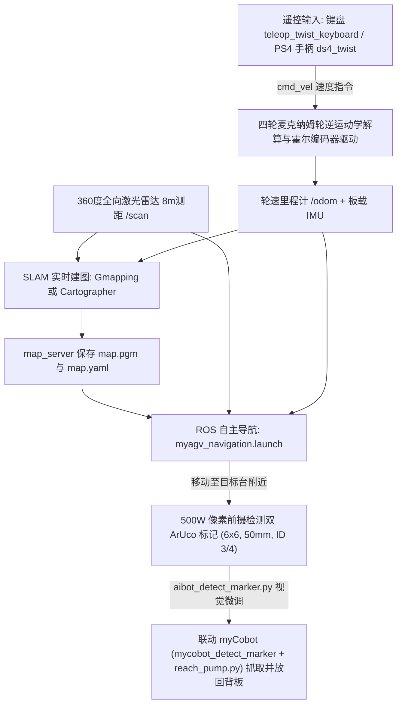
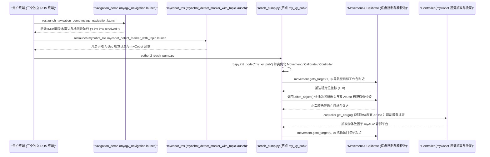

# myAGV（Elephant Robotics）

**myAGV** 是由大象机器人（Elephant Robotics）与华蔚联合推出的紧凑型全向移动机器人科研与教育平台（文档仓库：[elephantrobotics/myAGV](https://github.com/elephantrobotics/myAGV)）。平台以树莓派 4B（Raspberry Pi 4B）为主控，集成四轮麦克纳姆轮、霍尔编码器电机、IMU、360° 全向激光雷达与 500 万像素前摄，并通过机身 `XT30UPB-F`（12V 5A）供电口与标准 ROS 接口联动 myCobot 等轻量桌面机械臂，构成低门槛的移动操作（Mobile Manipulation）实验载体。

## 一句话定义

**树莓派 + 全向麦克纳姆轮 + 激光雷达的轻量 ROS 移动与复合抓取底盘** — 面向教学与原型验证，提供从 `Gmapping`/`Cartographer` 建图、二维地图导航到双 ArUco 视觉精准对准及 myCobot 协同取放的开箱工作流。

## 英文缩写速查

| 缩写 | 英文全称 | 简要说明 |
|------|----------|----------|
| AGV | Automated Guided Vehicle | 自动导引移动机器人平台 |
| ROS | Robot Operating System | 机载底层采用的标准机器人中间件框架 |
| SLAM | Simultaneous Localization and Mapping | 借助激光雷达与里程计完成的同步定位与建图 |
| IMU | Inertial Measurement Unit | 机载惯性测量单元，与轮速里程计共同支撑建图与导航 |
| ArUco | Augmented Reality University of Cordoba Marker | 车体精准停靠与机械臂手眼抓取采用的二进制视觉基准码 |
| VNC | Virtual Network Computing | 官方手册推荐的无外接屏幕远程桌面调试协议 |

## 为什么重要

1. **低成本打通「全向底盘 + 复合臂」教学闭环：** 通过镜像对称分布的四组麦克纳姆轮（45° 辊子矢量合成实现横移、斜行与原地转向），配合机身预留的 12V 5A 机械臂供电与 GPIO 扩展组，使移动抓取实验不再受限于大型昂贵工业 AGV。
2. **标准 ROS 工具链覆盖完整导航链路：** 出厂镜像预置 `/home/ubuntu/Documents/aibot_ws` 工作空间，完整串联激光 SLAM（Gmapping 与 Cartographer 双方案）、`map_server` 存图、AMCL/代价地图导航与手柄/键盘遥操作。
3. **结合 ArUco 实现厘米级视觉精停靠：** 单靠二维激光导航停靠精度难以满足小负载桌面臂抓取要求，myAGV 通过前置 500 万像素摄像头识别工作台对称布置的双 ArUco 码完成末端对接纠偏，再触发 myCobot 吸泵取物。

## 核心原理

myAGV 采用「轮速里程计 + IMU 融合定位 → 激光 SLAM 建图与全局/局部导航 → 单目 ArUco 视觉精调 → 机械臂协同抓取」的分层运行架构：

### 平台硬件与 ROS 工作流拆解（依据仓内文档与 GitBook 手册）

1. **硬件与扩展体系：** GitBook 手册标明整机尺寸 `311×236×130 mm`、重 `3.6 kg`、额定最大负载 `2 kg`、最大移速 `0.9 m/s`、树莓派 4B（2GB 内存）、续航 `1–1.5 h`（仓内早期 `README.md` 亦记有 `300×205×145 mm` / `3.02 kg` / `24V 1A` 口径，见局限节）。机体配备 14 针 2.54mm 树莓派 GPIO 组（`3.3V-OUT-PNP/INT`）、`XT30UPB-F` 机械臂供电口（12V 5A）、HDMI-D 口、USB 2.0、网口及双侧电池扩展仓。
2. **建图与导航流水线：**
   - **建图阶段：** 启动 `roslaunch navigation_demo myagv_slam.launch` 开启 IMU、里程计、雷达建图与 RViz，再用 `rosrun teleop_twist_keyboard teleop_twist_keyboard.py` 低速遥控绕行并调用 `rosrun map_server map_saver` 生成 `map.pgm`/`map.yaml`。
   - **导航阶段：** 将地图拷贝至 `aibot_ws/src/aibot/navigation_demo/maps/` 并在 `myagv_navigation.launch` 中更新第 6 行地图名后启动导航，通过 RViz `2D Nav Goal` 下发目标点。
3. **复合操作与视觉定位：**
   - **视觉精停靠：** 单独调用 `rosrun navigation_demo aibot_detect_marker.py` 检测张贴在目标台左右两侧的 50 mm `6×6` ArUco 标记（ID `3` 与 `4`）对齐姿态。
   - **车-臂协同任务：** 同时启动底盘导航与 `roslaunch mycobot_ros mycobot_detect_marker_with_topic.launch`，运行 `python2 reach_pump.py` 注册 ROS 节点 `my_xy_pub`，串联宏观地图移动、近距对准与手眼吸泵抓取。

## 源码运行时序图

入口：复合机器人联动演示（按 `2-development/小车机械臂联动.md` 与 `3-compound/6.MYAGV摄像头精准定位.md` 记载的机载 ROS 指令链：`myagv_navigation.launch` + `mycobot_detect_marker_with_topic.launch` + `python2 reach_pump.py`）

图依据：`elephantrobotics/myAGV`（`main` 分支）仓库本身为中文 GitBook 文档与示意图仓，不含机载 C++/Python/launch 源码正文（实际 `aibot_ws` 工作空间源码随出厂 TF 卡镜像分发）；上述时序、ROS 启动指令、节点名 `my_xy_pub` 及类/方法调用（`Movement.goto_target`、`Calibrate`、`aibot_adjust`、`Controller.get_cargo`）严格依据已核查的 `2-development/小车机械臂联动.md`、`2-development/4.MYAGV小车地图导航.md` 与 `3-compound/6.MYAGV摄像头精准定位.md` 文档正文还原。

## 工程实践

1. **硬件启动与机载内存管理：** 根据 `1-introduce/初次使用.md`，开机前需先连接 HDMI 实体显示器才能顺利引导桌面系统（无外接屏需改用远程桌面配置）；若 Wi-Fi 扫描异常可执行 `sudo create_ap --fix` 并在 `/etc/rc.local` 持久化。树莓派 4B 内存仅 2GB，编辑完 `myagv_navigation.launch` 后建议立即关闭 VS Code 改用终端与 `vim`，否则 SLAM/RViz 同时运行易发生卡顿。
2. **建图与导航的零点一致性：** 启动 `myagv_slam.launch` 前必须将小车静止放置在预期起点并等待终端输出 `First IMU message received.`，运行期间切忌手动抬起或推挪小车以免里程计/IMU 漂移；后续启动 `myagv_navigation.launch` 时亦需摆回建图同一起始点，并注意文档中部分章节存在的启动文件名拼写差异（`myagv_navigation.launch` 与 `myagv_navigetion.launch`）。
3. **双 ArUco 停靠与遥控限速：** 进行摄像头精准定位时，两侧 `6×6`（50 mm）ArUco 码需关于目标抓取中心对称粘贴，且小车启动 `aibot_detect_marker.py` 前需距离目标 `>40 cm`，确保双码同时落入单目广角视野；使用 `ds4_driver` 连接 PS4 手柄遥控时因默认未提供便捷调速挡，需注意小场地速度控制。

## 常见误区与局限

- **误区：GitHub `elephantrobotics/myAGV` 仓库内含完整可编译 ROS 源码：** 实际该仓库仅为 GitBook 文档与教学截图集合，真实运行依赖官方 TF 卡出厂镜像中的 `/home/ubuntu/Documents/aibot_ws/` 工作空间；且部分联动脚本仍使用旧版 `python2` 与 ROS 1 接口，迁移至 ROS 2 需重写节点通信。
- **误区：全站文档对硬件规格的表述完全统一：** 仓内早期 `README.md` 与新版 GitBook 手册在机身尺寸（`300×205×145 mm` vs `311×236×130 mm`）、整机质量（`3.02 kg` vs `3.6 kg`）及充电电源规格（`24V 1A` vs `12V 2A`）上存在差异，实际供电与载荷规划必须核对实物铭牌与对应批次说明书。
- **局限：机载算力与结构适用场景边界：** 树莓派 4B 2GB 的计算与内存上限决定了其主要适用于轻量二维激光雷达 SLAM 与常规视觉标记识别，难以直接在本地高帧率运行三维点云重建或端到端具身大模型；麦克纳姆轮小直径辊子亦仅适合平整室内硬质地面。

## 关联页面

- [Manipulation](../tasks/manipulation.md)
- [Autonomous Exploration](../tasks/autonomous-exploration.md)
- [LiDAR-Odometry Fusion](../methods/lidar-odometry-fusion.md)
- [DWA](../methods/dwa.md)
- [AprilTag](./april-tag.md)
- [ROS 2 Basics](../concepts/ros2-basics.md)

## 参考来源

- [sources/repos/elephantrobotics_myagv.md](../../sources/repos/elephantrobotics_myagv.md) — `elephantrobotics/myAGV` 文档仓库全量文件与官方 GitBook（`2 myAGV`）核查归档
- [wechat_jixie_robot_open_source_treasury_issue02_10_robots.md](../../sources/blogs/wechat_jixie_robot_open_source_treasury_issue02_10_robots.md) — 外部机器人开源清单线索

## 推荐继续阅读

- GitHub 仓库：<https://github.com/elephantrobotics/myAGV>
- 官方中文 GitBook 文档：<https://docs.elephantrobotics.com/docs/gitbook-cn/2-myAGV/README.html>
