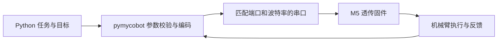
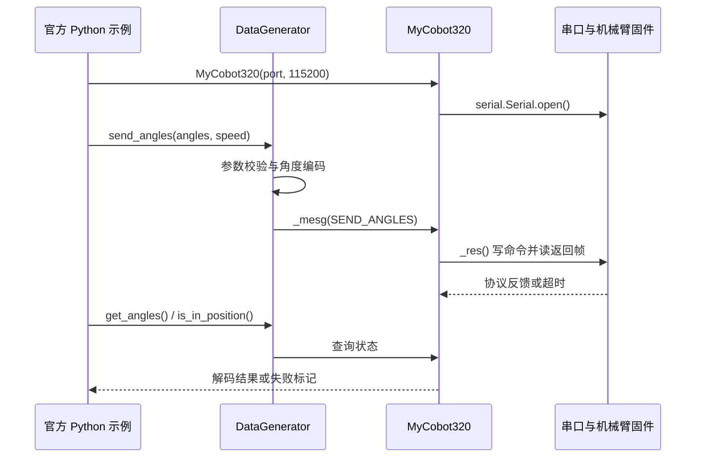

# 大象机器人 myCobot 320

## 一句话定义

**myCobot 320** 是 **大象机器人（Elephant Robotics）** 的 **桌面六轴协作机械臂**：主打 **轻量、开源、教育/创客**；产品资料在 **[mycobot-320-pi-cn](https://www.elephantrobotics.com/mycobot-320-pi-cn/)**，技术文档在 GitHub **[myCobot320-docs](https://github.com/elephantrobotics/myCobot320-docs)**，支持入口在 **[官方 Support](https://www.elephantrobotics.com/support/)**。

## 英文缩写速查

| 缩写 | 英文全称 | 简要说明 |
|------|----------|----------|
| Manipulation | Robot Manipulation | 抓取、移动、操作物体的任务总称 |
| ROS 2 | Robot Operating System 2 | 机器人系统集成与通信的常用中间件 |
| API | Application Programming Interface | 应用程序编程接口 |

## 为什么重要

- **视觉 + 臂一体化教学**：常与 **eye-in-hand** 课程设计绑定，适合作为 **ROS 操作入门** 硬件。
- **与 myAGV 组合**：同一厂商提供 **移动底盘 + 机械臂** 的二次开发叙事。

## 开源入口（策展摘录）

| 类型 | 链接 |
|------|------|
| 产品页（CN） | [elephantrobotics.com/mycobot-320-pi-cn](https://www.elephantrobotics.com/mycobot-320-pi-cn/) |
| 文档仓库 | [elephantrobotics/myCobot320-docs](https://github.com/elephantrobotics/myCobot320-docs) |
| 支持中心 | [elephantrobotics.com/support](https://www.elephantrobotics.com/support/) |

## 控制器与文档版本

按[官方 README 复核](../../sources/repos/open-robot-hardware-entry-review-2026-11-15.md)，myCobot 320 文档分别组织 **M5 与 Pi** 控制器路径，Python、ROS1 与 ROS2 章节须按实际控制器和软件版本选择；六轴本体一致不代表固件、连接或安装步骤可以混用。

## 核心原理

M5 控制路径是 **Python 调用 → 协议编码 → 串口/透传固件 → 六轴执行器 → 状态回读**。`send_angles` 的六维角度与 `send_coords` 的毫米/角度位姿是两种接口；ROS 消息的米与弧度需在适配层转换。

## 源码运行时序图

## 工程实践

先记录 M5/Pi、固件版本、SDK 版本、串口与波特率。M5 安装文档要求 Basic 透传配置，所读运动示例用 `pymycobot.mycobot320`；先检查连接和状态回读，再以低速验证已知姿态。把超时、返回 -1 和到位判据分别记录，不能用固定 sleep 当作闭环控制完成证明。

## 局限与风险

- 读到的文档有历史 import 与其他型号示例；本页只核对 M5 串口路径，不宣称相同代码适用于全部 Pi/ROS 发行版。
- 角度/速度范围检查不能证明路径无自碰、工具负载合法或基座固定可靠。
- 本次没有实机测试，教材中的演示姿态不是任意工位可直接执行的轨迹。

## 关联页面

- [Manipulation](../tasks/manipulation.md)
- [myAGV](./elephantrobotics-myagv.md)
- [ROS 2 基础](../concepts/ros2-basics.md)
- [机器人开源宝库（微信策展第02期）索引](../overview/robot-open-source-wechat-issue02-curator.md)

## 推荐继续阅读

- myCobot320-docs 仓库内 **API / ROS** 章节（版本以默认分支为准）

## 参考来源

- [官方技术文档与运行入口通读](../../sources/repos/mycobot320-core-docs-reading-2026-11-15.md)。

- [官方硬件文档与入口复核](../../sources/repos/open-robot-hardware-entry-review-2026-11-15.md)

- [wechat_jixie_robot_open_source_treasury_issue02_10_robots.md](../../sources/blogs/wechat_jixie_robot_open_source_treasury_issue02_10_robots.md)
