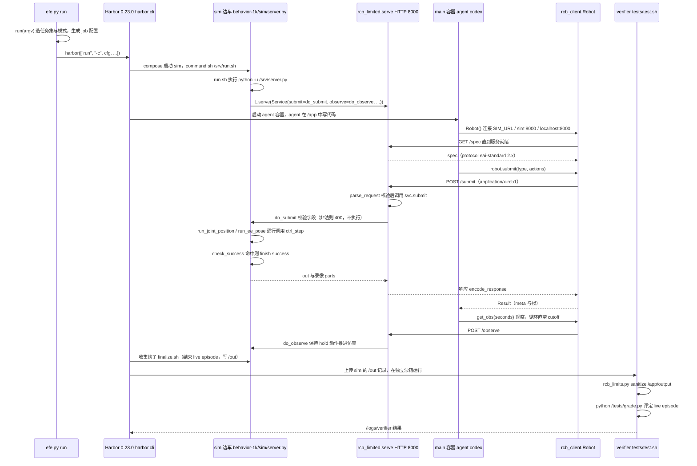

# Embodied First Exam（具身代码代理考核）

**Embodied First Exam**（[项目页](https://www.embodied-first-exam.ai/)，[GitHub](https://github.com/mll-lab-nu/embodied-first-exam)，**MIT**）把机器人任务环境作为 coding agent 的考场：agent 在固定场景里编写程序、运行并查看结果，提交结果后由独立沙箱验证。项目通过 [Harbor](https://github.com/laude-institute/harbor) 运行；它衡量的是 agent 在具身任务中的程序化交互能力，不是单独比较某个机器人策略模型的成功率。

## 一句话定义

**Embodied First Exam 把「coding agent 能否写出在机器人任务环境中正确运行的程序」变成一套可用 Harbor 批量执行、由独立沙箱验证的考核。**

## 英文缩写速查

| 缩写 | 英文全称 | 简要说明 |
|------|----------|----------|
| Harbor | Harbor evaluation framework | Laude Institute 沙箱评测运行时，用于批量运行 agent 任务 |
| MIT | MIT License | 代码仓许可；第三方模拟器、资产和基础镜像另有许可 |

## 核心信息

| 项 | 内容 |
|----|------|
| 对象 | Coding agents |
| 运行框架 | Harbor |
| 任务规模 | 官方 README 列出 32 个 benchmark；核心配置 449 个任务，完整配置 2,128 个任务目录（包含不同任务模式） |
| 任务闭环 | 编写程序 → 运行任务 → 查看结果 → 独立沙箱验证 |
| 运行环境 | Linux x86_64；Docker / Compose v2 / BuildKit；GPU 依 benchmark 而定 |
| 代码许可 | MIT；第三方模拟器、资产和基础镜像仍遵循各自许可 |
| 发布日期 | 2026-10-19（官方 GitHub README） |

## 为什么值得关注

- **评测具身 coding agent：** 任务要求代理通过程序与机器人任务环境交互，再根据执行反馈继续处理；它关注任务执行过程，不只是静态问答或代码补全。
- **汇集多种任务套件：** 将不同 benchmark 的机器人任务放入 Harbor 可运行、可验证的评测入口，便于使用同一 agent runner 批量执行。
- **把运行与验证隔开：** 任务结果由独立 sandbox 检查，有助于评测端复核产物和任务完成情况。
- **容易与 RLE-Bench 混淆：** [RLE-Bench](./rle-bench.md) 明确按机器人学习工程师的多类工作流组织资格考；Embodied First Exam 的重点是汇集多套冻结任务，考核 coding agent 在这些任务中的程序执行表现。两者对象相近，但任务设计和覆盖范围并不相同。

## 快速开始（官方 README）

~~~bash
git clone --recurse-submodules https://github.com/mll-lab-nu/embodied-first-exam.git
cd embodied-first-exam
uv tool install --force -e . --with-executables-from harbor

# 核心任务
harbor run -d embodied-first-exam -a codex -m <model>

# 全量任务
harbor run -d embodied-first-exam@all -a codex -m <model>
~~~

运行前需按具体 benchmark 准备数据、GPU 驱动和磁盘空间。部分任务首次运行会构建镜像；项目 README 说明构建过程可能接受其安装组件的许可条款。

## 源码运行时序图

入口：`efe run -a codex -m <model>`（`efe` = `scripts/efe.py:main`，其余参数交给 Harbor；等价于 `harbor run -d embodied-first-exam -a codex -m <model>`）。下图以 standard 模式的 behavior-1k 任务为例（sim 边车 + agent 容器两段式）。

图依据：mll-lab-nu/embodied-first-exam@c7b94c7，实际读过 `README.md`、`pyproject.toml`、`docs/protocol/README.md`、`scripts/efe.py`（run / main）、`embodied_first_exam/standard/run.sh`、`embodied_first_exam/standard/rcb_limited.py`（serve / bind / make_handler 的 do_POST）、`embodied_first_exam/standard/v2_4/rcb_client.py`（Robot / _post / submit / get_obs）、`embodied_first_exam/benchmarks/behavior-1k/sim/server.py`（do_submit / do_observe / ctrl_step / 入口）、`tasks/behavior-1k/behavior-assembling-gift-baskets-i00-standard/environment/docker-compose.yaml`、`tests/test.sh`、`embodied_first_exam/benchmarks/behavior-1k/sim/finalize.sh`（前若干行）。Harbor 本体（0.23.0）是外部依赖，未读其源码，图中 Harbor 内部调度只按仓库注释与调用关系画。

## 关联页面

- [RLE-Bench](./rle-bench.md) — 同样通过 Harbor 评 coding agent，但任务设计与覆盖范围不同
- [具身评测基准选型闭环](../overview/hub-embodied-eval-benchmark.md) — 本页所在的评测选型知识链

## 参考来源

- [官方项目页](../../sources/sites/embodied-first-exam-ai.md)
- [官方代码仓与运行说明](../../sources/repos/embodied-first-exam.md)
- [RLE-Bench](./rle-bench.md) — coding agent 机器人学习工程能力评测
- [具身评测基准选型闭环](../overview/hub-embodied-eval-benchmark.md)
- 源码核对（2026-11-02）：mll-lab-nu/embodied-first-exam@c7b94c7，读过 README.md、pyproject.toml、docs/protocol/README.md、scripts/efe.py、embodied_first_exam/standard/{run.sh,rcb_limited.py,v2_4/rcb_client.py}、embodied_first_exam/benchmarks/behavior-1k/sim/server.py、tasks/behavior-1k/behavior-assembling-gift-baskets-i00-standard/{environment/docker-compose.yaml,tests/test.sh}、embodied_first_exam/benchmarks/behavior-1k/sim/finalize.sh（前若干行）；时序图依据以上文件，未运行代码。
