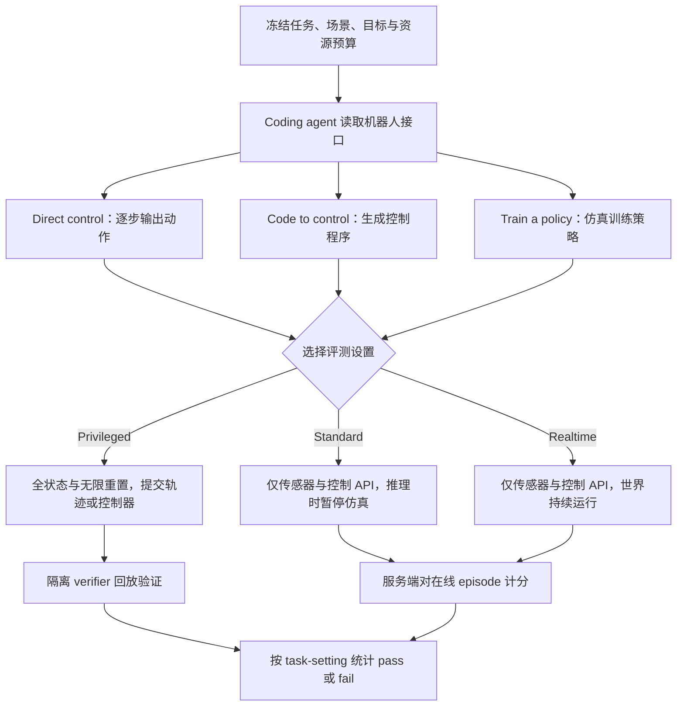
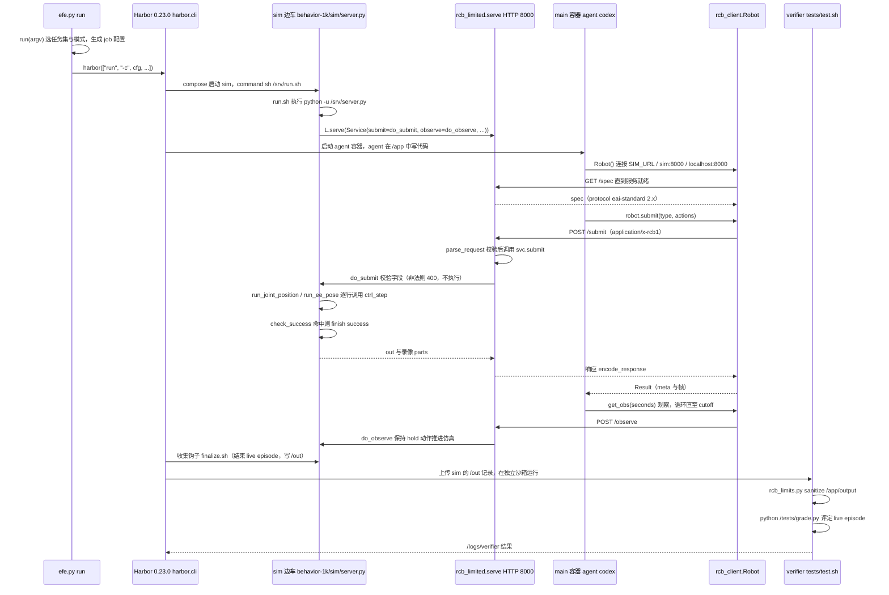

# Embodied First Exam（具身第一考：机器人环境中的代码智能体能力测评）

**Embodied First Exam**（[项目页](https://www.embodied-first-exam.ai/)，[GitHub](https://github.com/mll-lab-nu/embodied-first-exam)，**MIT**）把机器人任务环境作为 coding agent 的考场：agent 在固定场景里编写程序、运行并查看结果，提交结果后由独立沙箱验证。项目通过 [Harbor](https://github.com/laude-institute/harbor) 运行；它衡量的是 agent 在具身任务中的程序化交互能力，不是单独比较某个机器人策略模型的成功率。

## 一句话定义

**Embodied First Exam 把「coding agent 能否写出在机器人任务环境中正确运行的程序」变成一套可用 Harbor 批量执行、由独立沙箱验证的考核。**

## 英文缩写速查

| 缩写 | 英文全称 | 简要说明 |
|------|----------|----------|
| EFE | Embodied First Exam | 具身代码代理统一考核框架 |
| Harbor | Harbor evaluation framework | Laude Institute 沙箱评测运行时，用于批量运行 agent 任务 |
| MIT | MIT License | 代码仓许可；第三方模拟器、资产和基础镜像另有许可 |
| GPU | Graphics Processing Unit | 部分仿真套件需要相应的 NVIDIA GPU 环境 |

## 核心信息

| 项 | 内容 |
|----|------|
| 对象 | Coding agents |
| 运行框架 | Harbor |
| 论文规模 | 2026-11 arXiv：35 suites、1,156 unique tasks、47 种机器人；标准核心 456 任务 | 
| 论文核心结果 | 最强模型在 456 个核心 Standard 任务成功率 34%（论文作者报告） |
| 当前代码 README | 36 benchmark / 1,211 unique tasks / 2,398 task directories；核心配置 498 tasks，较论文口径增加 HumanCLAW 等；**不应改写论文分母** |
| 任务闭环 | 编写程序 → 运行任务 → 查看结果 → 独立沙箱验证 |
| 运行环境 | Linux x86_64；Docker / Compose v2 / BuildKit；GPU 依 benchmark 而定 |
| 代码许可 | MIT；第三方模拟器、资产和基础镜像仍遵循各自许可 |
| 发布日期 | 2026-10-19（官方 GitHub README） |

## 为什么重要

- **评测具身 coding agent：** 任务要求代理通过程序与机器人任务环境交互，再根据执行反馈继续处理；它关注任务执行过程，不只是静态问答或代码补全。
- **汇集多种任务套件：** 将不同 benchmark 的机器人任务放入 Harbor 可运行、可验证的评测入口，便于使用同一 agent runner 批量执行。
- **把运行与验证隔开：** 任务结果由独立 sandbox 检查，有助于评测端复核产物和任务完成情况。
- **容易与 RLE-Bench 混淆：** [RLE-Bench](./rle-bench.md) 明确按机器人学习工程师的多类工作流组织资格考；Embodied First Exam 的重点是汇集多套冻结任务，考核 coding agent 在这些任务中的程序执行表现。两者对象相近，但任务设计和覆盖范围并不相同。

## 九个原创套件与控制方式

论文将 **26 个既有套件（745 任务）**与 **9 个原创套件（411 任务）**合并为 35 套件；覆盖单臂、双臂、灵巧手、人形、四足、移动操作、空中和肌肉骨骼等机器人。原创套件并非九种训练模型，而是九组不同能力考核（§2.3、附录 A）。

| 原创套件 | 主要检验什么 |
|---|---|
| RoboPaint | 用笔、画刷完成精细工具轨迹与绘画 |
| RoboARC | 绳结、金属线、布料、装配等接触丰富的可变形操作 |
| DexHandExam | 五指灵巧手翻页、拧盖、连接等任务 |
| RoboDynamicExam | 接球、击球、动态物体交接 |
| Embodied Olympics - Fun | 人形机器人动态运动与体育动作 |
| Embodied Olympics - Match | 面对对手的足球、乒乓等竞技任务 |
| iSpatialGym | 根据目标图片完成空间布局匹配 |
| Embodied Safety Exam | 执行安全请求、拒绝有害请求并解释风险 |
| RoboEngineer | 从公开仿真迁移到隐藏动力学，依据部署反馈修正控制器 |

同一 coding agent 可以自由选用 **Direct control（直接输出动作块）**、**Code to control（生成控制器/规划器程序）**或 **Train a policy（在仿真中训练策略）**，以及混合方案；这些是可选择的解题路径，不是评测模式。参见论文 Figure 2、§2.1。

## 流程总览（论文 Figure 3 协议重绘）

**关键隔离边界：** Privileged 中 agent 与仿真器同容器，但 verifier 在另一容器中回放；Standard / Realtime 中仿真器及 verifier 与 agent 分离。任务初始化、成功规则与时间预算配对保持一致；不同设置允许观察的状态、重置次数和时间推进方式不同（§2.1、Figure 3）。

## 实验与评测（分母与因果边界）

论文固定快照为 **35 个 suites、1,156 个独立任务、2,288 个 task-setting tests、47 种机器人**，其中 **456 个难例核心任务共 901 个 tests**（Standard 456、Privileged 391、Realtime 54）。**456 不是 456 个三模式通用评测**；各模式的任务覆盖不完全相同（§2.3、Table 2）。

| 对照口径 | 作者报告结果 | 正确解释 |
|---|---|---|
| 456 核心 Standard tests | GPT-6 Astra + Codex **33.6%（约 34%）** | 每 test 一次尝试，非多随机种子均值（§3.1） |
| 同时支持 Standard / Privileged 的 391 任务 | 同一代理 **Standard 30%，Privileged 77%** | 配对模式结果，不能拿 77% 对比 456 任务的 34%（§3.2） |
| 391 任务的受控接口消融 | Standard 基线 **28%**；仅加物体真值 **45%**；仅加无限重置 **53%**；两者均加 **68%** | 这是重新运行的干预实验，基线 **28% 不等于**上行原始 Standard 30%（Figure 11a） |
| 有两种时序设置的 54 个任务 | 最强代理 Standard **23/54**，Realtime **17/54**；所有受测代理都未解出的任务分别为 **50% / 63%** | 对同一批动态任务配对，Realtime 的世界不会等待推理（§3.1） |
| 同一模型不同 harness（456 Standard） | GPT-6 Astra 在 Codex **34%**，在 Claude Code **22%** | 最高相差 **12 个百分点**，不宜把成绩仅归因于模型（§3.4） |

截至 2026-11-13，官方仓库 README 的**可运行仓库范围**已扩充为 **36 benchmark、1,211 任务、2,398 task directories**，默认核心配置为 **498 任务**；README 明言论文口径不含新增 HumanCLAW。**不要以仓库的新统计覆盖论文报告**。

## 失败阶段分析与工程启示

- **分解任务：** 作者将 427 个核心任务拆分为带前置约束的阶段图；阶段失败点由另一 coding agent 根据回放和日志标注，属于模型辅助解释，不是 verifier 的客观通过判决（§3、附录 H）。
- **精密阶段更难：** 插接、对位、穿线等高精度接触阶段受 Standard 部分可观测限制影响更明显；在配对消融中，增加重置对恢复困难阶段的帮助大于只提供物体真值（§3.2）。
- **错误常集中：** 多个代理容易在同一阶段受阻，最常见是首个阶段；材料变更阶段失败率 **66%**、身体运动阶段 **45%**，但这些差异还混有机器人与套件差别，不能作为单一因果结论（§3.3）。
- **控制策略依设置变化：** 抽样的 Standard 尝试有 **61%** 每轮看反馈再输出动作块；Realtime 尝试有 **97%** 使用程序化控制。足球案例在提供 GPU 与 RL 库时才有训练策略获胜，但该任务不同版本不构成严格的单变量因果对照（§3.5）。
- **真机演示不是排行榜：** 附录 I 的 buzz-wire 真机机械臂实验每个 agent 连续 8 次尝试，只说明接口可用于物理机器人；成绩不包含在论文仿真统计内。

## 结论

**该工作将“代码代理能不能让机器人完成任务”从文本评测转为可执行且分权限的标准化环境，但目前高难度具身任务成功率仍有限。**

1. 始终在 Standard / Realtime / Privileged 相同协议内比较。
2. 区分论文 1,156/456 和扩充版仓库 1,211/498 的分母。
3. 仿真成功率不能直接替代真机性能、能耗和安全评测。
4. 验证需要 Harbor、对应 benchmark 资产与各自许可。

## 与其他工作对比

本基准评价 agent **执行机器人任务**，不是训练一个统一操作策略。可用它比较[Claude Fable 5.2](./claude-fable-5-2.md)的独立仿真指标叙事，也可作为研究[SWAM](./paper-swam-cross-modal-alignment.md)、[WICL](./paper-world-in-context-learning-roboscript.md)、[Compass 1](./paper-compass-1-navigation.md)与[Flip Anything](./paper-flip-anything-agentic-self-learning.md)时理解任务与成功判据差异的参照；以上不同工作当前**没有相同评测协议**，不可直接排名。

## 工程实践

参照官方 README 安装 Harbor，分别选择 core/all 数据集，留存 task ID、模式、模型、agent、试验次数、GPU 与 verifier 版本；公开仓库已扩充，需要锁定 commit 再对照论文报告。

## 快速开始（官方 README）

~~~bash
git clone --recurse-submodules https://github.com/mll-lab-nu/embodied-first-exam.git
cd embodied-first-exam
uv tool install --force -e . --with-executables-from harbor

# 核心任务
harbor run -d embodied-first-exam -a codex -m <model>

# 全量任务
harbor run -d embodied-first-exam@all -a codex -m <model>
~~~

运行前需按具体 benchmark 准备数据、GPU 驱动和磁盘空间。部分任务首次运行会构建镜像；项目 README 说明构建过程可能接受其安装组件的许可条款。

## 源码运行时序图

入口：`efe run -a codex -m <model>`（`efe` = `scripts/efe.py:main`，其余参数交给 Harbor；等价于 `harbor run -d embodied-first-exam -a codex -m <model>`）。下图以 standard 模式的 behavior-1k 任务为例（sim 边车 + agent 容器两段式）。

图依据：mll-lab-nu/embodied-first-exam@c7b94c7，实际读过 `README.md`、`pyproject.toml`、`docs/protocol/README.md`、`scripts/efe.py`（run / main）、`embodied_first_exam/standard/run.sh`、`embodied_first_exam/standard/rcb_limited.py`（serve / bind / make_handler 的 do_POST）、`embodied_first_exam/standard/v2_4/rcb_client.py`（Robot / _post / submit / get_obs）、`embodied_first_exam/benchmarks/behavior-1k/sim/server.py`（do_submit / do_observe / ctrl_step / 入口）、`tasks/behavior-1k/behavior-assembling-gift-baskets-i00-standard/environment/docker-compose.yaml`、`tests/test.sh`、`embodied_first_exam/benchmarks/behavior-1k/sim/finalize.sh`（前若干行）。Harbor 本体（0.23.0）是外部依赖，未读其源码，图中 Harbor 内部调度只按仓库注释与调用关系画。

## 局限与风险

- 论文主要测量仿真环境里的 coding agent 编程与控制能力；与具身动作策略模型、真实机器人闭环和安全部署的评价对象不同。
- 论文附录 J 指出 **392/1,156 个任务没有参考解**；每个模型-harness 组合对每个 test 只做一次尝试，无法消除随机波动。核心集还筛掉一个同系列模型先验通过的题目，可能影响同系列模型比较。
- 2026-11-13 对照论文正文、Figure 3、§3.1–3.5 与附录 I–J 重新复核关键比较；原论文归档此前已记录正文及附录 A–K 通读。新增套件后的仓库与论文统计快照不同，完整仓库复现、多次随机重复与大规模真机验证均尚未执行。

## 关联页面

- [RLE-Bench](./rle-bench.md) — 同样通过 Harbor 评 coding agent，但任务设计与覆盖范围不同
- [具身评测基准选型闭环](../overview/hub-embodied-eval-benchmark.md) — 本页所在的评测选型知识链

- [Claude Fable 5.2](./claude-fable-5-2.md) — 另一类仿真机器人能力评测
- [SWAM](./paper-swam-cross-modal-alignment.md) — 视频和动作联合学习
- [WICL / RoboScript](./paper-world-in-context-learning-roboscript.md) — 具身 agent 操作
- [Compass 1](./paper-compass-1-navigation.md) — 长时导航
- [Flip Anything](./paper-flip-anything-agentic-self-learning.md) — 自迭代机器人技能

## 参考来源

- [arXiv:2611.12177 论文核验摘录](../../sources/papers/embodied-first-exam-2611-12177.md)
- [官方项目页](../../sources/sites/embodied-first-exam-ai.md)
- [官方代码仓与运行说明](../../sources/repos/embodied-first-exam.md)
- [RLE-Bench](./rle-bench.md) — coding agent 机器人学习工程能力评测
- [具身评测基准选型闭环](../overview/hub-embodied-eval-benchmark.md)
- 源码核对（2026-11-02）：mll-lab-nu/embodied-first-exam@c7b94c7，读过 README.md、pyproject.toml、docs/protocol/README.md、scripts/efe.py、embodied_first_exam/standard/{run.sh,rcb_limited.py,v2_4/rcb_client.py}、embodied_first_exam/benchmarks/behavior-1k/sim/server.py、tasks/behavior-1k/behavior-assembling-gift-baskets-i00-standard/{environment/docker-compose.yaml,tests/test.sh}、embodied_first_exam/benchmarks/behavior-1k/sim/finalize.sh（前若干行）；时序图依据以上文件，未运行代码。

## 推荐继续阅读

- [Embodied First Exam — arXiv:2611.12177](https://arxiv.org/abs/2611.12177)
- [官方任务清单与 Quick Start](https://github.com/mll-lab-nu/embodied-first-exam)
