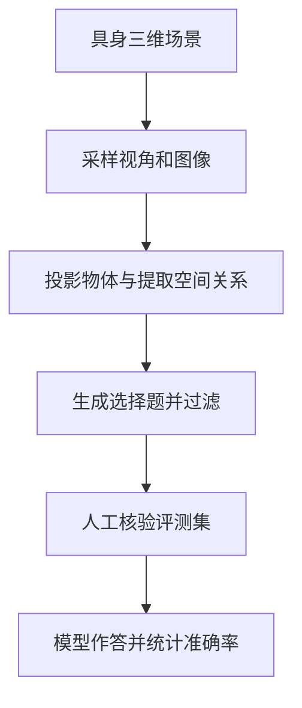

# EmbSpatial-Bench

**EmbSpatial-Bench**（[arXiv:2406.05756](https://arxiv.org/abs/2406.05756)，[代码](https://github.com/mengfeidu/EmbSpatial-Bench)）评测 **LVLM 在具身任务中的空间理解**：从 embodied 场景 **自动派生** egocentric 视角下的 **6 种空间关系** QA。

## 一句话定义

**EmbSpatial 问：LVLM 在「第一人称具身视角」下懂不懂 left-of / above / closer 这类关系。**

## 英文缩写速查

| 缩写 | 英文全称 | 简要说明 |
|------|----------|----------|
| LVLM | Large Vision-Language Model | 大视觉-语言模型 |
| ER | Embodied Reasoning | 具身推理；LightNav-ER 八项之一 |
| VQA | Visual Question Answering | 视觉问答 |

## 为什么重要

- **LightNav-ER 套件：** [LightNav-0](./paper-lightnav-0.md) 博客脚注 [3] 列入八项 ER 评测（见 [lightnav-er](./lightnav-er.md)）。
- **自动构造：** 无需人工逐条标注，可扩展 embodied 场景库。
- **与 Cambrian CV-Bench 区分：** Cambrian 的 CV-Bench 偏 2D 空间；EmbSpatial 强调 **egocentric embodied** 设定。

## 核心信息

| 项 | 内容 |
|----|------|
| **关系类型** | 6 类 egocentric 空间关系 |
| **开源** | **数据已公开**；官方仓库包含 README 与图片，未发现评测或 SFT 实现（2026-10-30 核查） |

## 数据构建流程

基于 [ACL 2024 论文](https://aclanthology.org/2024.acl-short.33/)：从 Matterport3D、AI2-THOR 与 ScanNet 的具身场景收集视角图像，投影物体位置并基于包围框及深度提取六类关系；题目经过过滤和人工核验。评测集共 3,640 题、2,181 张图。EmbSpatial-SFT 使用 MP3D 训练集构造关系识别及物体定位数据。

## 源码运行时序图

**不适用**：截至 2026-10-30，[官方仓库](https://github.com/mengfeidu/EmbSpatial-Bench)只列 README 与图片资源，数据公开，README 称微调代码与权重待发布；未找到可运行评测入口。

## 评测与局限

论文比较生成与选项似然两种评测方式；微调 MiniGPT-v2 的总体准确率分别为 32.97% 和 78.10%，两种口径不应直接混比。任务是静态图像选择题，不能直接证明动作执行能力。图中 WITA-Omni 数值尚未从基准作者公布的结果核验。

## 结论

**EmbSpatial 是「具身 egocentric 空间 VQA」早期公共基准——读 LightNav-ER 分数时应对齐其六关系设定。**

- 自动派生保证与场景库同步扩展
- 与 RoboSpatial-Home（scan QA）、RefSpatial（指代）互补
- 评测要区分生成式与 likelihood 两种答案选择方式；单张图片问答不能替代真机任务成功率

## 关联页面

- [RoboSpatial](./robospatial.md)
- [LightNav-ER](./lightnav-er.md)
- [Cambrian-1 / CV-Bench](./paper-cambrian-1.md)
- [具身大模型评测基准选型闭环](../queries/embodied-eval-benchmark-selection-loop.md) — 本页归其 ① 认知评测层：具身场景空间关系 VQA，测的是认知代理而非策略成功率

## 参考来源

- [embspatial_bench_arxiv_2406_05756.md](../../sources/papers/embspatial_bench_arxiv_2406_05756.md)
- [embspatial_lightnav_2026.md](../../sources/papers/embspatial_lightnav_2026.md)

## 推荐继续阅读

- [arXiv:2406.05756](https://arxiv.org/abs/2406.05756)
- [GitHub EmbSpatial-Bench](https://github.com/mengfeidu/EmbSpatial-Bench)
