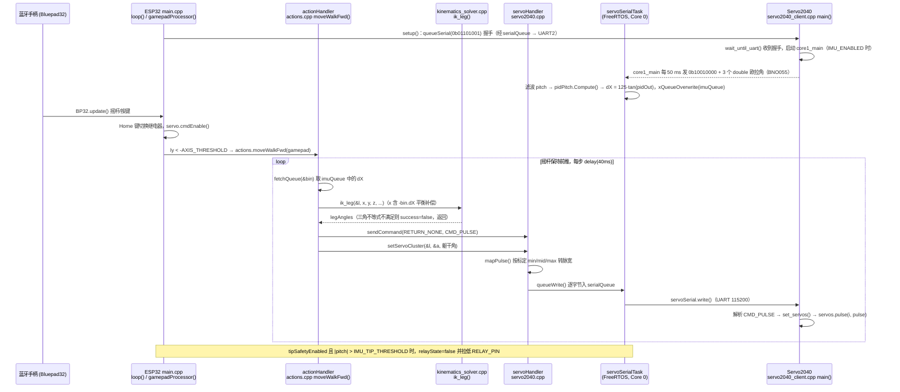

# Endeavor II

**Endeavor II**（[GitHub](https://github.com/ProtoDane/EndeavorHumanoid)）是 [GitHubStore《19 款能自己造的开源人形机器人》](https://mp.weixin.qq.com/s/UUwUAcKdVrlo-N60Oar3Xg) 的第 17 项，文章标价 约 $600。

## 一句话定义

**Endeavor II 是 ProtoDane 的 50 cm、4 kg 小型 3D 打印人形，受日本 ROBO-ONE 赛事启发，可做敏捷动作、格斗序列与舞蹈，仓库含 STEP、STL 与代码。**

## 英文缩写速查

| 缩写 | 英文全称 | 简要说明 |
|------|----------|----------|
| ROBO-ONE | ROBO-ONE | 日本双足机器人格斗/竞技赛事 |

## 为什么重要

- 属于文章按成本从低到高排列的「能自己造」清单；横向对比见 [能自己造的开源人形机器人 19 款：按成本与形态排序的阅读坐标](../overview/open-source-buildable-humanoids-19-technology-map.md)。
- 价格为文章标价（约 $600），入库日未核实。

## 核心信息

| 项 | 内容 |
|----|------|
| **链接** | [GitHub](https://github.com/ProtoDane/EndeavorHumanoid) |
| **许可（核查）** | MIT（LICENSE 文件） |
| **最近提交** | 2026-04-02 |

## 文章说法核对

- **文章：** 文章称提供组装好的 STEP 模型，持续迭代固件（ESP32 等）与机械结构，项目仍在更新。
- **README / 核查：** README 称高 50 cm、重 4 kg，使用商业现货电子件，运费不同整机成本约 $600–$800，仓库含构建与定制所需的 STEP、STL 与代码，并标注「Initial Open Source Release」；LICENSE 为 MIT。
- **差异与保留：** 「ESP32」来自文章，已读 README 段落未见；文章写「约 $600」，README 为 $600–$800。

## 源码运行时序图

入口：`firmware/esp32_controller/`（PlatformIO，`platformio.ini`：`esp32dev` + Arduino + Bluepad32）烧录 ESP32，`setup()` / `loop()` 位于 `src/main.cpp`；`firmware/servo2040_client/`（`CMakeLists.txt`，Pico SDK）烧录 Servo2040，`main()` 位于 `servo2040_client.cpp`。下图为手柄「前进」动作路径。

图依据：ProtoDane/EndeavorHumanoid@505f148，读过 `README.md`、`firmware/esp32_controller/{platformio.ini,src/main.cpp,src/actions.cpp,src/servo2040.cpp,src/kinematics_solver.cpp,src/imu.cpp}`、`firmware/servo2040_client/servo2040_client.cpp`；未读 `include/*.h`、`presets.h`、`legacy/`、`servo_calibration/` 与 PDF 文档。

## 关联页面

- [humanoid-robot](../entities/humanoid-robot.md)
- [open-source-humanoid-hardware](../entities/open-source-humanoid-hardware.md)
- [open-source-buildable-humanoids-19-technology-map](../overview/open-source-buildable-humanoids-19-technology-map.md)

## 参考来源

- [endeavor_ii_humanoid.md](../../sources/repos/endeavor_ii_humanoid.md)
- [wechat_githubstore_19_buildable_open_source_humanoids_2026-11-02.md](../../sources/blogs/wechat_githubstore_19_buildable_open_source_humanoids_2026-11-02.md)
- [原文（微信公众号）](https://mp.weixin.qq.com/s/UUwUAcKdVrlo-N60Oar3Xg)
- 源码核对（2026-11-02）：ProtoDane/EndeavorHumanoid@505f148，读过 `README.md`、`firmware/esp32_controller/` 的 platformio.ini 与 src/{main,actions,servo2040,kinematics_solver,imu}.cpp、`firmware/servo2040_client/servo2040_client.cpp`；时序图依据以上文件，未运行代码。
