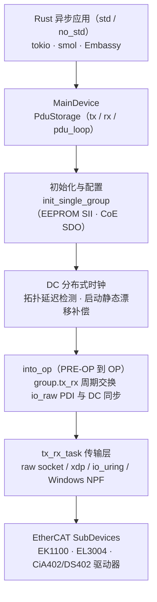
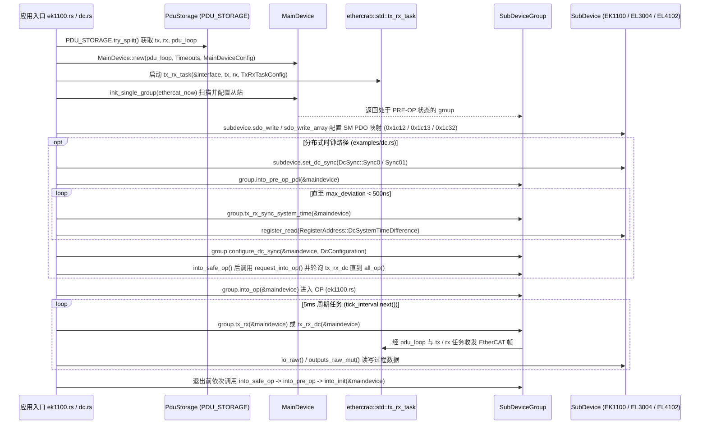

# EtherCrab

## 一句话定义

纯 Rust 实现的 EtherCAT 主站，面向 Rust 嵌入式开发。（分类：EtherCAT 主站；语言/形态：Rust）

## 英文缩写速查

| 缩写 | 英文全称 | 简要说明 |
|------|----------|----------|
| EtherCAT | Ethernet for Control Automation Technology | 工业以太网现场总线 |
| CoE | CANopen over EtherCAT | 最常用的 EtherCAT 应用层协议 |
| RTOS | Real-Time Operating System | FreeRTOS / RT-Thread 等 |

## 为什么重要

- 在 [EtherCAT 开源库清单](../overview/ethercat-opensource-libs-wechat.md) 中属于「主站」一栏，是机器人关节总线工具链的一环。
- 技术栈已是 Rust 的机器人/嵌入式团队；成熟度低于 [SOEM](./soem.md)，上生产前应自行评估。

## 核心原理

文章对该项目的描述（以下均为文章声明，未独立核查）：

- 语言：Rust；文章称纯 Rust 安全实现、无 unsafe 依赖。
- 文章称适合 Rust 嵌入式开发，项目相对年轻。
- 文章选型句：Rust 项目 → Ethercrab。

### 架构流程图

## 工程实践

- 适用场景：技术栈已是 Rust 的机器人/嵌入式团队；成熟度低于 [SOEM](./soem.md)，上生产前应自行评估。
- 官方地址：<https://github.com/ethercrab-rs/ethercrab>（文章给出，本次未独立打开核查）
- 协议背景见 [EtherCAT 协议基础](../concepts/ethercat-protocol.md)；主站实时调优见 [主站优化指南](../queries/ethercat-master-optimization.md)。

## 源码运行时序图

以下时序图基于仓库 `Cargo.toml`、`examples/ek1100.rs`（标准 `smol` 异步初始化与周期 PDI 回路）以及 `examples/dc.rs`（DC 分布式时钟对齐与 `tx_rx_dc` 周期）源码整理。

## 局限与风险

- **开源状态：** 文章声明为公开仓库；**本次会话无法访问该仓库，开源程度/许可证未独立核查**，待后续按 ingest 步骤 2.5 补查。
- **推测/待核查：** 「无 unsafe」为文章原话，未独立核查；是否 no_std、是否支持具体 RTOS 需读仓库（待核查）。
- EtherCAT 协议本身不开源，协议栈代码开源，ESC 硬件芯片需单独购买（文章避坑提醒）。

## 关联页面

- [soem](./soem.md)
- [igh-ethercat-master](./igh-ethercat-master.md)
- [ethercat-protocol](../concepts/ethercat-protocol.md)
- [ethercat-opensource-libs-wechat](../overview/ethercat-opensource-libs-wechat.md)
- [Robot Software System Integration · 机器人软件系统集成](../methods/robot-software-integration.md)：在机器人软件系统中承担现场总线通信层接入与实时设备驱动集成。
- [Robot Control System Architecture · 机器人控制系统架构](../methods/robot-control-architecture.md)：为底层关节控制环提供确定性周期通信与执行器数据通道。

## 参考来源

- [sources/blogs/wechat_ethercat_opensource_libs_qt_adventure.md](../../sources/blogs/wechat_ethercat_opensource_libs_qt_adventure.md)
- [sources/raw/wechat_ethercat_opensource_libs_qt_adventure_2026-10-14.md](../../sources/raw/wechat_ethercat_opensource_libs_qt_adventure_2026-10-14.md)

## 推荐继续阅读

- EtherCAT Technology Group：<https://www.ethercat.org/>
- 文章原文：<https://mp.weixin.qq.com/s/C34QLsVb7Sd-GlvPvQlGKQ>
