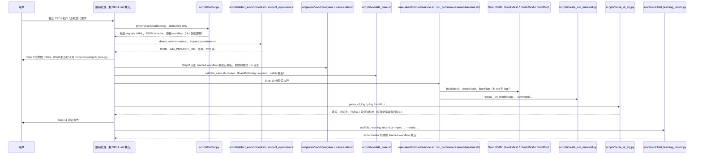

# OpenFOAM Simulation（EzraJay2333/openfoam-simulation）

## 一句话定义

OpenFOAM Simulation（EzraJay2333/openfoam-simulation）是文章总结为 13 步从规划、建模、运行、验证到文档的流程，强调流道拓扑/形状优化的证据链。

## 英文缩写速查

| 缩写 | 英文全称 | 简要说明 |
|------|----------|----------|
| CFD | Computational Fluid Dynamics | 计算流体力学计算流程 |
| MCP | Model Context Protocol | 让代理发现并调用外部工具的协议 |
| y+ | Dimensionless Wall Distance | 壁面网格分辨率相关的无量纲距离 |

## 为什么重要

对 CAE 自动化而言，代理能否稳定完成任务，取决于工程步骤是否清楚、工具边界是否明确、结果是否保留可审查证据。文章总结为 13 步从规划、建模、运行、验证到文档的流程，强调流道拓扑/形状优化的证据链；仓库自述包含经典模板、求解器编译和并行/GPU优化。

## 核心原理

**项目自身范围：** OpenFOAM simulation skill focused on topology and shape optimization workflows.

**工作流：** 按阶段完成几何与网格、物理模型和边界设置、计算运行、验证及报告；仓库提供多种编码代理的安装位置说明。

## 工程实践

1. 从目标问题识别所需的 Skill、MCP、CLI 或软件接口，不把指导文件当成求解器。
2. 依照仓库 README 检查安装前提、软件/许可证、输入文件和输出证据。
3. 小规模运行并逐项核对几何、网格、边界、求解状态和物理量，再决定是否扩大任务。

文章所述的项目特征：文章总结为 13 步从规划、建模、运行、验证到文档的流程，强调流道拓扑/形状优化的证据链；仓库自述包含经典模板、求解器编译和并行/GPU优化。

## 局限与风险

模板化工作流不能自动保证模型符合目标物理问题；需要项目负责人检查优化约束、网格收敛和验证数据。

源码状态核验：该 GitHub 仓库于 2026-10-07 可公开访问。仓库 API 报告许可证为 MIT。 

## 关联页面

- [CAE / CFD 代理工具项目总览](../overview/cae-cfd-agent-skills-landscape.md)
- [OpenFOAM Claude Suite](./swtbkim-openfoam-claude-suite.md)

## 源码运行时序图

入口：无独立服务进程。仓库是 Agent Skill：编码代理被 `SKILL.md` 触发后，按 13 步状态机调用 `scripts/` 与 `templates/`（模板入口：`bash templates/internal-flow-pressure-loss/case-skeleton/run-baseline.sh`）。

图依据：EzraJay2333/openfoam-simulation@486e266，读过 `README.md`、`SKILL.md`（执行契约、Step 1/8/9/10/12）、`scripts/doctor.py`、`detect_environment.sh`（部分）、`validate_case.sh`（头部）、`create_run_manifest.py`、`parse_of_log.py`、`scaffold_learning_record.py`（参数部分）、`templates/internal-flow-pressure-loss/case-skeleton/run-baseline.sh`、`templates/_common-case/run-baseline.sh`、`scripts/model-viewer/server.py` 与 `pick_face.py`（路由与签名）。代理侧步骤来自 `SKILL.md` 的文字规程，由 LLM 代理执行，并非程序内硬编码调用链。

## 参考来源

- [公众号文章原始资料归档](../../sources/blogs/wechat_cae_cfd_agent_skills_2026-10-07.md)
- [GitHub 仓库资料归档](../../sources/repos/ezrajay2333-openfoam-simulation.md)
- [EzraJay2333/openfoam-simulation 官方仓库](<https://github.com/EzraJay2333/openfoam-simulation>)
- 源码核对（2026-11-02）：EzraJay2333/openfoam-simulation@486e266，读过 README.md、SKILL.md、scripts/doctor.py、detect_environment.sh（部分）、validate_case.sh（头部）、create_run_manifest.py、parse_of_log.py、scaffold_learning_record.py（部分）、templates 的 run-baseline.sh、model-viewer/server.py 与 pick_face.py（部分）；时序图依据以上文件，未运行代码。

## 推荐继续阅读

- [项目 README](<https://github.com/EzraJay2333/openfoam-simulation/blob/main/README.md>)
