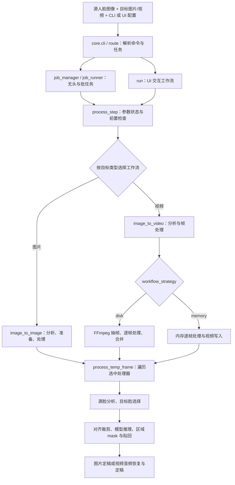
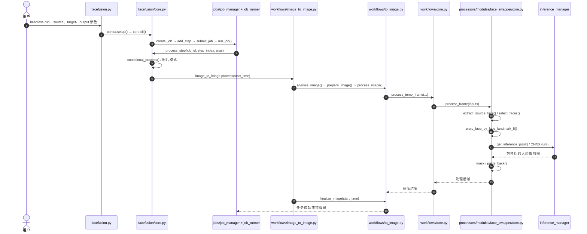

# FaceFusion — Face Manipulation Platform / 人脸图像与视频处理平台

## 一句话定义

**FaceFusion** 是 [facefusion/facefusion](https://github.com/facefusion/facefusion) 提供的 Python 人脸影像处理平台：通过可组合的处理器（例如 face swap、face enhancement、lip sync）处理目标图片或视频，提供图形界面、无头运行、批处理和 job 管理。它是**视觉媒体处理管线**，不是机器人 VLA、3D 人脸动作重建或真实动作控制模型。

## 英文缩写速查

| 缩写 | 英文全称 | 简要说明 |
|---|---|---|
| CLI | Command-Line Interface | `facefusion.py` 接收 `run` / `headless-run` / `batch-run` 等命令 |
| UI | User Interface | `run` 对应的交互式用户界面 |
| ONNX | Open Neural Network Exchange | 模型推理所采用的交换格式与相关运行时 |
| GPU | Graphics Processing Unit | CUDA 等后端可能使用的加速设备 |
| HRI | Human–Robot Interaction | 可选的人机交互合成化身演示背景，非本项目核心研究成果 |

## 为什么重要

- **维护归属：** 代码发布于 [facefusion GitHub 组织](https://github.com/facefusion)，仓库 `LICENSE.md` 标注 Henry Ruhs 版权；本站按已有的「独立维护者（Independent Maintainer）」图谱类别归档。这是知识库的归类方式，不代表对其法律主体、雇佣关系或完整授权条款作出认定。

FaceFusion 把多种面部影像任务统一到一套 **命令入口、任务调度、可插拔处理器、模型推理与媒体 IO** 下。对机器人视觉工程、数字人展示与 HRI 研究，值得学习的是软件管线的模块化及图像/视频时序处理边界，而不是将换脸效果误认为身份认证、真实面部运动测量或机器人的自主操作能力。

官方源码位于 facefusion 组织维护的 [GitHub 仓库](https://github.com/facefusion/facefusion)；入库核查采用 **master @ `decc6c9d8f8e014878624452c6e8fe208726b4ec`（Patch 3.9.2，2026-10-26 提交）**，2026-11-08 复核。以下事实来自[官方源代码归档](../../sources/repos/facefusion.md)与[官方文档归档](../../sources/sites/facefusion-official.md)，未做本地速度测试。

## 核心原理

### 入口、任务调度和处理器

1. `facefusion.py` 执行 `conda.setup()` 后调用 `facefusion.core.cli()`；CLI 解析来自 `facefusion.program.create_program()` 的参数。
2. `facefusion.core.route()` 按 `command` 分流：`run` 交由 UI，`headless-run`、`batch-run` 通过 `job_manager` 和 `job_runner` 启动 processing step。
3. `process_step()` 恢复 step 参数与状态，`conditional_process()` 进行处理器预检查，再根据目标格式进入 `image_to_image.process()` 或 `image_to_video.process()`。
4. `facefusion.processors.core.get_processors_modules()` 按选项动态导入处理器模块，要求实现 `pre_check`、`pre_process`、`process_frame`、`post_process` 等接口。

### 人脸替换的核心路径

在 `facefusion/processors/modules/face_swapper/core.py` 中，首先对源照片进行人脸检测，`extract_source_face()` 形成来源身份，`select_faces()` 按设置选出目标人脸；`swap_face()` 将目标脸按五点关键点仿射对齐，运行模型推理，并以 box/occlusion/area/region 等可选 mask 做区域混合和 `paste_back()`。模型可以接收源人脸裁剪图或 embedding，**取决于已选模型类型**，不能只用某一种模型解释全部处理器。

默认单处理器为 `face_swapper`；官方文档列出 `face_enhancer`、`face_editor`、`expression_restorer`、`lip_syncer` 等可组合模块。它们并非同一个单体网络，也不能假设所有模块安装后在任何后端都可使用。

## 流程总览

基于官方 `core.py`、图片/视频工作流和换脸处理器抽取的**主干流程**；图片与视频输出是不同分支：

## 源码运行时序图

下图专门对应官方 **`python facefusion.py headless-run` 的图片处理路径**；`run` 的 UI 分支、视频 disk/memory 两路并未混画：

以上为代码静态复核，**非执行跟踪、端到端性能验收或模型质量评估**。参见[逐文件运行链与入口归档](../../sources/repos/facefusion.md)。

## 工程实践

| 关注点 | 官方实现与复现建议 |
|---|---|
| 安装 | [官方步骤](https://docs.facefusion.io/installation)使用 Conda Python 3.12，安装 `python install.py default`；CUDA 12 示例为 `python install.py cuda@12` |
| UI 启动 | `python facefusion.py run --open-browser`；无头/批处理分别使用 `headless-run`、`batch-run`，参数以 `--help` 为准 |
| 处理器组合 | 官方文档示例 `--processors face_swapper face_enhancer`，有不同后处理开销，必须分别基准测试 |
| 视频策略 | `workflow_strategy=disk` 使用 FFmpeg 抽帧再合并；`memory` 使用视频读取/写入路径 |
| 依赖 | `core.pre_check()` 检查 Python 版本和 `curl` / `ffmpeg` / `ffprobe`；模型获取另需可用下载源与匹配后端 |
| 验证项 | 实测吞吐、峰值显存、遮挡及大姿态误差、目标人脸选择稳定性、音视频同步、来源与输出权限；本次未执行性能复现 |

## 与其他项目对比

- [Deep-Live-Cam](./deep-live-cam.md) 面向本地直播摄像头与离线换脸路径；FaceFusion 官方源码更突出**多处理器 CLI + job 调度 + 磁盘/内存视频工作流**。两者都只是媒体处理工具，不直接产生机器人关节动作。
- [KeenTools FaceBuilder](./keentools-facebuilder.md) 关注面部/头部几何重建；FaceFusion 这里的核心输出是变换后的像素，不能与可驱动的 3D 头部模型混为一谈。
- [ARGUS 深度伪造视频取证](./paper-argus-deepfake-forensics.md) 属于合成内容鉴伪方向，与 FaceFusion 的生成/处理用途不同。

## 结论

**FaceFusion 的主要工程价值在于多处理器人脸媒体流水线的可配置与任务管理，并非一种已经证明可用于机器人感知控制的统一面部模型。**

1. 先区分 CLI/UI 路由与具体处理器，遇到错误沿对应运行时调用链调试。
2. 图像和视频工作流分开测试；视频 disk/memory 策略影响 IO、内存和调试方式。
3. 源脸选取、目标选脸、裁剪变换、ONNX 推理、掩膜贴回应各自做质量与速度评估。
4. 核对模型权重许可和使用者授权，不把“公开可读源码”自动等同为任何用途均可商业重用。
5. 所有速度、面部保真与安全保障均需针对实际模型、硬件及场景独立测试。

## 局限与风险

- **许可边界：** 根目录 `LICENSE.md` 仅包含 `OpenRAIL-AS license` 标识和版权所有者信息，未附完整条款；所选模型权重及依赖的许可可能另有条件，商用前应分别验证。公开仓库并非自动取得所需肖像权或模型使用权。
- **身份与隐私：** 人脸替换与口型处理易被用作未经同意的冒充或误导。应先取得当事人授权、清楚标注合成内容，避免用于身份验证欺骗。
- **效果边界：** 遮挡、极端侧脸、运动模糊、多人跟踪与音画不同步是应测试的场景；本次未取得可核实的统一 benchmark，不能提供泛化精度或 FPS 保证。
- **内容过滤不等于合规：** 源码有 `content_analyser` 等检查，不能据此承诺所有不当用途都会被自动阻止。
- **项目定位：** 不能直接作为机器人 3D 姿态、轨迹、动力学状态或动作策略的输出端。

## 关联页面

- [Deep-Live-Cam：单图实时换脸](./deep-live-cam.md) — 同类工具的实时摄像头与图像处理实现对照
- [ARGUS：深度伪造鉴伪](./paper-argus-deepfake-forensics.md) — 合成视频真实性检测的对照工作
- [KeenTools FaceBuilder](./keentools-facebuilder.md) — 二维面部合成与三维几何重建的区别
- [图像分割方法分类](../concepts/image-segmentation-taxonomy.md) — face mask 与图像合成的基础

## 参考来源

- [FaceFusion — 官方 README、源码主链及模型/许可证边界核验](../../sources/repos/facefusion.md)
- [FaceFusion — 官方安装与处理器文档核验](../../sources/sites/facefusion-official.md)
- [FaceFusion 官方 GitHub 仓库](https://github.com/facefusion/facefusion)

## 推荐继续阅读

- [官方文档：Introduction](https://docs.facefusion.io/)
- [官方安装：Installation](https://docs.facefusion.io/installation)
- [CLI 文档：Processors](https://docs.facefusion.io/usage/cli-arguments/processors)
- [官方源码：face_swapper/core.py](https://github.com/facefusion/facefusion/blob/decc6c9d8f8e014878624452c6e8fe208726b4ec/facefusion/processors/modules/face_swapper/core.py)
