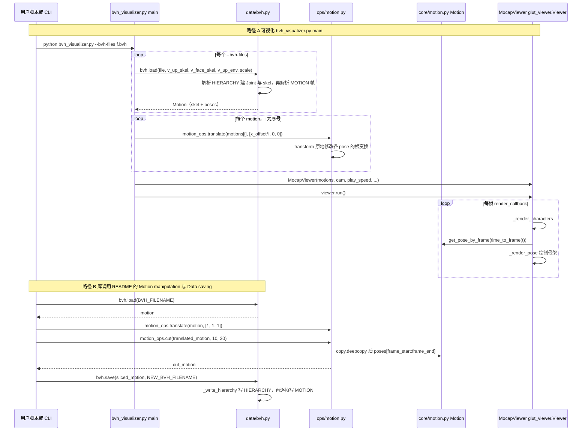

---

type: entity
tags: [repo, mocap, motion-data, smpl, toolkit, meta]
status: complete
updated: 2026-06-08
summary: "facebookresearch/fairmotion 是 Meta 的通用动捕数据处理库（BVH/AMASS IO、3D 变换、FK、可视化）；2023 年已归档，常作重定向管线的上游数据基础设施，本身不做机器人重定向。"
related:
  - ../concepts/motion-retargeting.md
  - ./amass.md
  - ./gvhmr.md
  - ../methods/motion-retargeting-gmr.md
sources:
  - ../../sources/repos/fairmotion.md
---

# fairmotion

**fairmotion**（<https://github.com/facebookresearch/fairmotion>）是 Meta Research 的通用**动捕数据处理库**：统一管理运动表示、3D 变换、文件格式与可视化，支持 **BVH / ASF-AMC / AMASS / AMASS-DIP** 读写，并提供 FK、运动操作以及 motion_prediction / clustering 等示例任务。BSD-3-Clause，**2023-05 起已归档（read-only）**。

> ⚠️ **定位说明**：fairmotion 是**上游动捕数据与骨架基础设施**，本身**不提供机器人重定向**。它常作为重定向管线的数据 IO 与表示层，下游再接 [GMR](../methods/motion-retargeting-gmr.md) / [PHC](./phc.md) 等做真正的人→机器人映射。收录于此是为补全「重定向工具链的数据上游」一环，与同样非重定向器的 [AMASS](./amass.md) 数据档案对照阅读。

## 英文缩写速查

| 缩写 | 英文全称 | 简要说明 |
|------|----------|----------|
| BVH | Biovision Hierarchy | 层级骨架动捕格式 |
| AMASS | Archive of Motion Capture as Surface Shapes | SMPL-H 统一人体运动库 |
| FK | Forward Kinematics | 由关节角求刚体/末端位姿 |
| SMPL-H | SMPL + Hand | 带手部的人体参数化模型 |

## 为什么重要

- **数据层地基**：把异构动捕格式统一成可编程的 Motion / Pose 表示，省去重定向前的 IO 与坐标系样板。
- **与 AMASS 衔接**：原生读 AMASS（SMPL-H），是 SMPL 系重定向（[PHC](./phc.md) / [GMR](../methods/motion-retargeting-gmr.md)）的常见前处理来源之一。
- **注意取舍**：已归档、无机器人重定向；新项目若只需数据加载，也可直接用各重定向仓自带的 loader。

## 源码运行时序图

入口：`python fairmotion/viz/bvh_visualizer.py --bvh-files <file>.bvh`（README「Visualization」所列入口）；库调用链取 README 的 `bvh.load → motion_ops → bvh.save` 示例。

图依据：facebookresearch/fairmotion@e400e56，实际读过 `README.md`、`fairmotion/viz/bvh_visualizer.py`（main / render_callback / _render_characters / _render_pose）、`fairmotion/data/bvh.py`（load / save 结构）、`fairmotion/ops/motion.py`（transform / translate / cut）、`fairmotion/core/motion.py`（仅 grep 类与方法定义）。`fairmotion/viz/glut_viewer.py` 的 `run()` 与 OpenGL 调用未展开，只作为 MocapViewer 的基类画出。

## 关联页面

- [Motion Retargeting](../concepts/motion-retargeting.md)
- [AMASS](./amass.md)
- [GVHMR](./gvhmr.md)
- [GMR](../methods/motion-retargeting-gmr.md)
- [PHC](./phc.md)

## 参考来源

- [fairmotion 仓库归档](../../sources/repos/fairmotion.md)
- 源码核对（2026-11-02）：facebookresearch/fairmotion@e400e56，读过 README.md、fairmotion/viz/bvh_visualizer.py、fairmotion/data/bvh.py、fairmotion/ops/motion.py、fairmotion/data/amass.py 与 amass_dip.py（save 桩）、LICENSE；时序图依据以上文件，未运行代码。

## 推荐继续阅读

- GitHub（已归档）：<https://github.com/facebookresearch/fairmotion>
