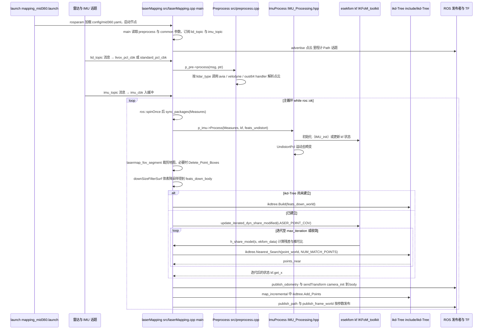

# FAST-LIO

**FAST-LIO** 以 **紧耦合迭代卡尔曼滤波** 实现低延迟 3D LiDAR-惯性里程计。

## 英文缩写速查

| 缩写 | 英文全称 | 简要说明 |
|------|----------|----------|
| LIO | LiDAR-Inertial Odometry | 激光-惯性里程计 |
| LiDAR | Light Detection and Ranging | 激光雷达，地形感知与建图主传感器 |
| SLAM | Simultaneous Localization and Mapping | 同步定位与建图 |
| VIO | Visual-Inertial Odometry | 视觉-惯性里程计，融合相机与 IMU 估计位姿 |

## 为什么重要

- **速度与鲁棒性**：在 Livox/Velodyne 等平台广泛使用。
- **HKU Mars 生态**：与 FAST-LIO2、R2LIVE 等形成系列。

## 核心结构/机制

| 组件 | 说明 |
|------|------|
| **ikd-Tree** | 增量点云地图 |
| **IESKF** | 迭代误差状态卡尔曼 |
| **输出** | 高频 odometry / TF |

## 常见误区或局限

- **里程计 vs SLAM**：默认偏 odometry；全局一致需外部位姿图或回环模块。
- **对比**：[LIO-SAM](./lio-sam.md) 更重因子图与 GPS。

## 源码运行时序图

入口：`roslaunch fast_lio mapping_mid360.launch`（加载 `config/mid360.yaml`，启动节点 `fastlio_mapping`，`name="laserMapping"`，并默认起 rviz；其他雷达见 `launch/mapping_*.launch`）。

图依据：hku-mars/FAST_LIO@7cc4175，实际读过 `README.md`（grep 启动命令）、`launch/mapping_mid360.launch`、`CMakeLists.txt`（`fastlio_mapping` 目标的源文件）、`src/laserMapping.cpp`（参数读取、`main` 主循环、`lasermap_fov_segment`、`h_share_model`、`map_incremental`、`publish_odometry`）、`src/preprocess.cpp`（`process` 分派与 handler 名称）、`src/IMU_Processing.hpp`（`Process` / `IMU_init` / `UndistortPcl` 声明与调用处）。`include/IKFoM_toolkit` 与 `include/ikd-Tree` 只读到调用处，其内部实现未展开。

## 参考来源

- [sources/repos/fast_lio.md](../../sources/repos/fast_lio.md)
- [hku-mars/FAST_LIO](https://github.com/hku-mars/FAST_LIO)
- 源码核对（2026-11-02）：hku-mars/FAST_LIO@7cc4175，读过 README.md（grep 启动命令）、launch/mapping_mid360.launch、CMakeLists.txt、src/laserMapping.cpp、src/preprocess.cpp、src/IMU_Processing.hpp；时序图依据以上文件，未运行代码。

## 关联页面

- [LIO-SAM](../entities/lio-sam.md)
- [LiDAR / LIO / VIO 选型](../comparisons/lidar-slam-lio-vio-selection.md)
- [Navigation2](../entities/navigation2.md)

## 推荐继续阅读

- https://arxiv.org/abs/2010.08196
