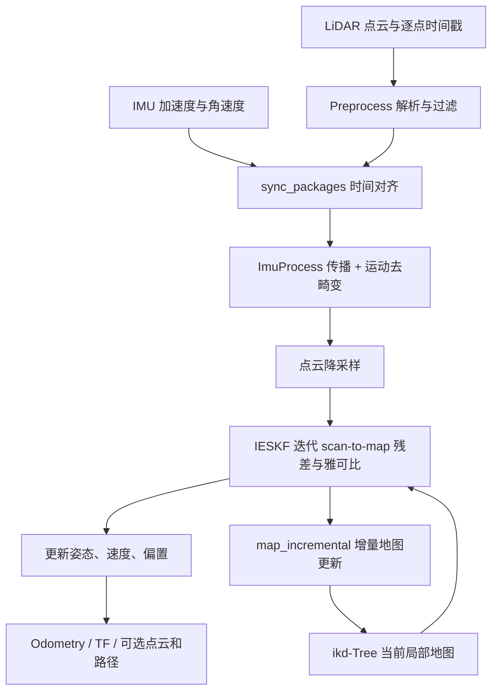
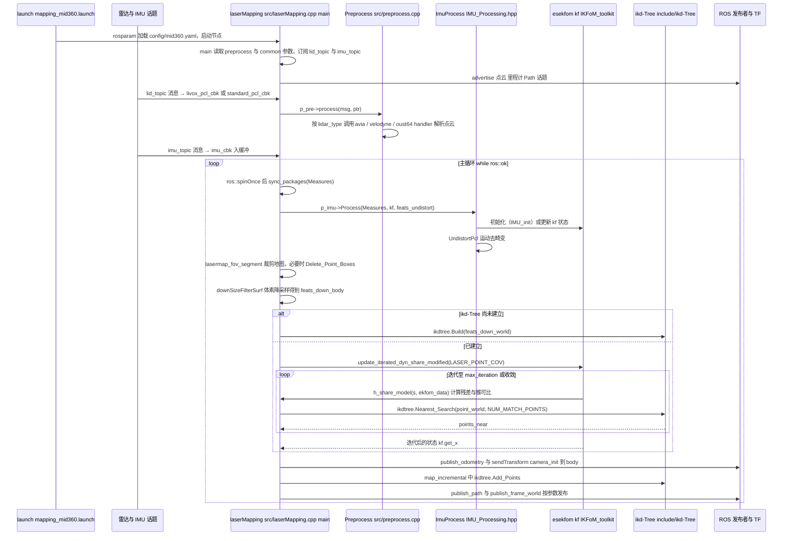

# FAST-LIO｜快速激光–惯性里程计（Fast LiDAR-Inertial Odometry）

## 一句话定义

**FAST-LIO / FAST-LIO2** 是 [HKU MARS 官方开源项目](https://github.com/hku-mars/FAST_LIO) 的紧耦合激光–惯性里程计实现：利用 IMU 传播状态并校正运动畸变，使用迭代扩展卡尔曼滤波（IESKF）将实时 LiDAR 扫描与当前局部地图匹配；FAST-LIO2 采用 ikd-Tree 增量维护地图，并支持直接用原始点云进行匹配。

## 英文缩写速查

| 缩写 | 英文全称 | 简要说明 |
|------|----------|----------|
| LIO | LiDAR-Inertial Odometry | 激光-惯性里程计 |
| LiDAR | Light Detection and Ranging | 激光雷达，地形感知与建图主传感器 |
| SLAM | Simultaneous Localization and Mapping | 同步定位与建图 |
| VIO | Visual-Inertial Odometry | 视觉-惯性里程计，融合相机与 IMU 估计位姿 |
| IESKF | Iterated Error-State Kalman Filter | 主状态估计与重复校正的滤波步骤 |
| IMU | Inertial Measurement Unit | 加速度与角速度传播及去畸变依据 |
| PCD | Point Cloud Data | 可选保存累积点云的文件格式 |

## 为什么重要

- **紧耦合滤波与直接配准**：官方 README 区分 FAST-LIO 早期特征点方案与 FAST-LIO2 直接原始点云的 scan-to-map 路线；FAST-LIO2 可以关闭特征提取。
- **增量地图更新**：FAST-LIO2 使用 ikd-Tree 插入点、按视场裁剪与查询邻域，降低每帧重建空间索引的代价。
- **机器人部署路径明确**：官方提供 Livox、Velodyne、Ouster 的 ROS 1 启动与 rosbag 示例、外参、同步和点级时间戳注意事项。
- **与全局重定位分工**：GN10 使用预先存在的静态 ESDF 地图检索全局位姿；FAST-LIO 侧重连续估计与增量局部建图，两者不应混称。

## 核心原理

| 阶段 / 模块 | 输入与动作 | 输出 |
|---|---|---|
| 点云预处理（`Preprocess`） | 解析 Livox `CustomMsg` 或标准 `PointCloud2`，使用逐点时间戳；按配置降采样、可选提取特征 | 带时间信息的点云 |
| IMU 传播和去畸变（`ImuProcess`） | 时间对齐的 IMU 与 LiDAR 数据；初始化、滤波器传播和 `UndistortPcl` | 去畸变扫描与状态预测 |
| scan-to-map 迭代更新（`h_share_model` / IESKF） | 预测姿态与局部地图查询到的近邻；构造点到局部平面的残差及雅可比 | 更新后的状态与协方差 |
| 增量地图（`ikdtree`） | 本帧匹配后的世界系点；局部视场维护与新增点 | 后续扫描匹配可复用的点云索引 |
| 发布（`publish_odometry` 等） | 本帧最优状态 | Odometry / TF、可选路径与点云 |

**核心差异：** 不必每帧先从点云提取角点和面点；FAST-LIO2 可以直接在降采样后的点上做几何约束。滤波估计仍依赖可靠的 IMU、雷达外参、时间对齐与场景结构。

## 流程总览

该图依据 `src/laserMapping.cpp` 的主循环、`src/preprocess.cpp` 和 `src/IMU_Processing.hpp` 入口，不代表 GN10 的预建静态 ESDF 全局搜索。

## 工程实践

1. **ROS 版本边界**：仓库使用 **ROS 1（Melodic 起）+ catkin**，并非 GN10 所用的 ROS 2 Humble 包。官方依赖 PCL ≥1.8、Eigen ≥3.3.4 与 Livox ROS driver。
2. **获取源码**：官方 README 使用 `git clone https://github.com/hku-mars/FAST_LIO.git`、`git submodule update --init`、`catkin_make`；编译前要正确 source Livox driver 工作空间。
3. **Livox MID-360 示例**：`roslaunch fast_lio mapping_mid360.launch`；`config/mid360.yaml` 默认订阅 `/livox/lidar` 与 `/livox/imu`，设置 `feature_extract_enable=0` 并启动 `fastlio_mapping` 节点。
4. **时间同步与外参**：逐点时间戳用于去畸变；README 特别提醒检查 LiDAR/IMU 同步和 `extrinsic_T` / `extrinsic_R`，外参已知时建议 `extrinsic_est_en=false`。软件时间同步仅作为外部同步不可行时的选项。
5. **调试与导出**：先观察 odometry、TF 与去畸变点云，再按需开启 PCD 保存；`pcd_save.interval=-1` 会累积全部点，长时间运行可能占用大量内存。

## 局限与风险

- **不等于丢定位后全局找回**：本仓库的主要实现是连续里程计与增量建图；与 [GN10](./gn10-pointcloud-localization.md) 在预建静态地图里执行全局搜索是不同功能。作者 README 将 FAST-LIO-LOCALIZATION 列为另一个扩展项目。
- **时间戳与标定敏感**：缺失逐点时间信息、LiDAR/IMU 时钟不同步或外参错误会损伤扫描去畸变与滤波可靠性。
- **环境退化与动态点**：稀少或重复几何、运动物体可能削弱 scan-to-map 约束，不能把里程计输出直接视为无漂移的全局真值。
- **部署验证边界**：官方 README 展示不同雷达与移动平台示例，但本次未实机运行、未复核可复现的端到端精度与帧率数值。

## 源码运行时序图

入口：`roslaunch fast_lio mapping_mid360.launch`（加载 `config/mid360.yaml`，启动节点 `fastlio_mapping`，`name="laserMapping"`，并默认起 rviz；其他雷达见 `launch/mapping_*.launch`）。

图依据：hku-mars/FAST_LIO@7cc4175。2026-11-17 **完整阅读官方 `README.md`**（Related Works、FAST-LIO/FAST-LIO2 说明、依赖、构建、启动、rosbag 示例、UAV 与致谢）；并核对 `launch/mapping_mid360.launch`、`config/mid360.yaml`、`CMakeLists.txt`、`src/laserMapping.cpp`（回调、主循环、邻域查询、状态更新、地图增量与发布段）、`src/preprocess.cpp`（`process` 分派及相关 handler）、`src/IMU_Processing.hpp`（初始化、传播、去畸变入口）。`include/IKFoM_toolkit` 与 `include/ikd-Tree` 的内部算法未逐行核查；未编译运行。详见 [FAST-LIO 一手源码归档](../../sources/repos/fast_lio.md)。

## 参考来源

- [sources/repos/fast_lio.md](../../sources/repos/fast_lio.md)
- [hku-mars/FAST_LIO 官方 README（原文快照）](https://github.com/hku-mars/FAST_LIO/blob/7cc4175/README.md)
- [源码快照 @7cc4175](https://github.com/hku-mars/FAST_LIO/tree/7cc4175)：`launch/mapping_mid360.launch`、`config/mid360.yaml`、`src/laserMapping.cpp`、`src/preprocess.cpp`、`src/IMU_Processing.hpp`、`CMakeLists.txt`；本次已核对相关入口与调用段，未运行代码。

## 关联页面

- [LIO-SAM](../entities/lio-sam.md)
- [LiDAR / LIO / VIO 选型](../comparisons/lidar-slam-lio-vio-selection.md)
- [Navigation2](../entities/navigation2.md)
- [GN10 PointCloud Localization](./gn10-pointcloud-localization.md) — 预建静态 ESDF 地图中的 GPU 激光定位 / 失锁全局重定位，与 FAST-LIO 里程计与建图分工不同。
- [里程计与激光雷达融合定位](../methods/lidar-odometry-fusion.md) — 对应 IMU 传播、去畸变与 scan-to-map 更新；连续里程计不等于全局重定位。
- [机器人自主探索](../tasks/autonomous-exploration.md) — LIO 地图与位姿是探索系统的输入，目标选择和安全避障仍由下游模块实现。

## 推荐继续阅读

- https://arxiv.org/abs/2010.08196
