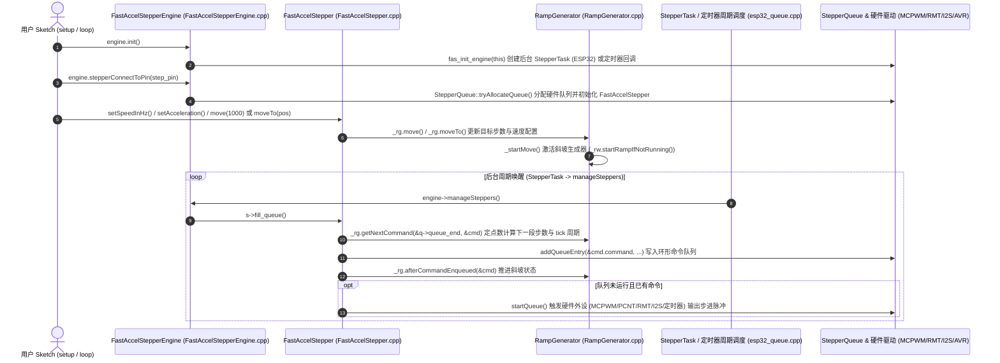

# FastAccelStepper

**FastAccelStepper**（[https://github.com/gin66/FastAccelStepper](https://github.com/gin66/FastAccelStepper)）是 [Qt历险记《C/C++ 运动控制开源库分类整理》](https://mp.weixin.qq.com/s/RIXXIltQ0ABoBO_OVLZTZw) 中「轨迹规划库」一类的项目。本页以**一手资料**为准，文章说法放在「文章说法核对」里对照。

## 一句话定义

**FastAccelStepper 是 AccelStepper 的高速替代库：为步进电机生成带加减速的脉冲，支持 AVR、SAM、SAMD51、ESP32 系列、Raspberry Pi Pico / Pico2 等，并（实验性）支持 Teensy 4.x。**

## 英文缩写速查

| 缩写 | 英文全称 | 简要说明 |
|------|----------|----------|
| OTG | Online Trajectory Generation | 在线轨迹生成 |
| PTP | Point-To-Point | 点到点运动 |

## 为什么重要

- 在文章的选型建议里属于「轨迹规划库」；横向对比见 [C/C++ 运动控制开源库地图：轨迹生成、动力学、工业总线与 ROS 栈（一手资料核对版）](../overview/cpp-motion-control-open-source-libraries-map.md)。

## 一手资料

| 项 | 内容 |
|----|------|
| **仓库 / 官方来源** | [https://github.com/gin66/FastAccelStepper](https://github.com/gin66/FastAccelStepper) |
| **许可（核查）** | MIT（LICENSE：MIT，J.Kiemes 2020） |
| **最近提交** | 2026-10-20 |
| **论文 / 文档** | 无论文；README 说明为 AccelStepper 的高速替代 |

**一手描述：** README：「a high speed alternative for the AccelStepper library」；平台表给出 ESP32 系列（MCPWM/PCNT、RMT、I2S）驱动的最大步频（如 200 kSteps/s）等。

## 机制与架构图

## 源码运行时序图

`gin66/FastAccelStepper` 采用「主循环提交目标位置 + 后台周期性任务规划加减速指令入队 + 硬件外设/ISR 精确发脉冲」的解耦架构（以下以 ESP32 后台 `StepperTask` 与 `StepperQueue` 为例）：

核对源码路径（`gin66/FastAccelStepper` branch `master`）：`README.md`、`src/FastAccelStepperEngine.cpp`、`src/FastAccelStepper.cpp`、`src/fas_ramp/RampGenerator.cpp`、`src/pd_esp32/esp32_queue.cpp`。

## 文章说法核对

- **文章：** 语言 C++（嵌入式）；许可 MIT；步进电机 S 型加减速、脉冲输出，无浮点，适合 AVR/ESP32/Pico；适用单片机步进驱动、3D 打印机、小型传送机构。
- **「S 型加减速」「无浮点」未核对**：README 的已读部分描述的是高速步进与线性加减速平台表，没有读到 S 曲线或「无浮点」字样；这两点按文章表述保留，未核实。
- 许可 MIT 一致；平台支持范围以 README 平台表为准（文章仅列 AVR/ESP32/Pico）。

## 关联页面

- [simplefoc](../entities/simplefoc.md)
- [field-oriented-control](../concepts/field-oriented-control.md)
- [cpp-motion-control-open-source-libraries-map](../overview/cpp-motion-control-open-source-libraries-map.md)

## 参考来源

- [fastaccelstepper.md](../../sources/repos/fastaccelstepper.md)
- [wechat_qt_adventure_cpp_motion_control_libs_2026-11-02.md](../../sources/blogs/wechat_qt_adventure_cpp_motion_control_libs_2026-11-02.md)
- [原文（微信公众号）](https://mp.weixin.qq.com/s/RIXXIltQ0ABoBO_OVLZTZw)
