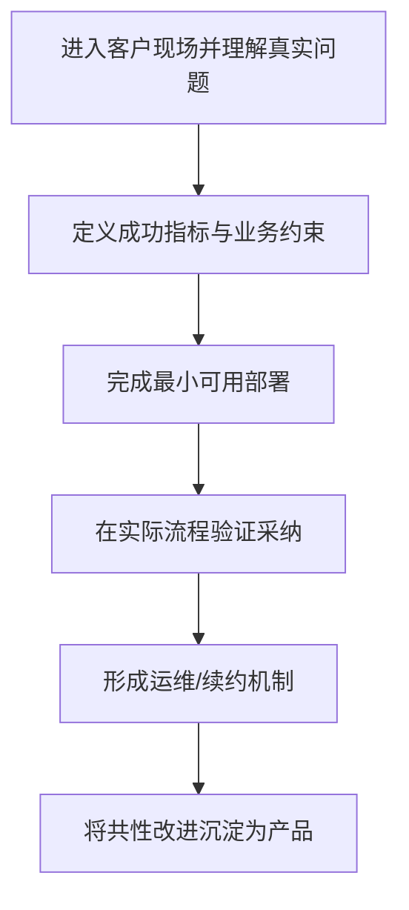

# 《前线部署工程师：人工智能时代的客户价值交付秘籍》

## 一句话定义

范冰的《前线部署工程师》从业务结果出发讨论 AI 时代的前线部署工程实践，作者公开章节 Markdown 可直接在线阅读；本节点是图书结构总览。

## 英文缩写速查

| 缩写 | 英文全称 | 简要说明 |
|---|---|---|
| FDE | Forward-Deployed Engineer | 客户现场软件与 AI 交付角色 |
| LLM | Large Language Model | 企业 AI 系统可能使用的底层模型 |
| RAG | Retrieval-Augmented Generation | 企业数据问答常用的技术模块 |
| KPI | Key Performance Indicator | 客户结果指标 |

## 为什么重要

FDE 的角色不止于售前演示或驻场写接口：作者强调共同定义客户成功指标、用真实流程验证模型与系统是否产生价值，再把现场反馈转化为产品能力。

## 核心原理

官方 README 将章节组织为 FDE 崛起 → 解决正确问题 → 赢得客户 → 激活部署 → 守住续约 → 扩大收入 → 规模化复制 → 案例集。第 1 章讨论角色边界、职责和工具箱，第 8 章提供 Palantir、OpenAI、Anthropic、垂直领域和中国案例，附录 C 为资料出处索引。

### 课程/项目主线流程总览

## 源码运行时序图

**不适用：本条目为书籍文本介绍，原文没有独立可运行的软件执行入口。**

## 工程实践

阅读应从 README 的 01–08 章和附录 C 入手；针对书中公司增长、薪酬或转换率等数字，需沿作者参考索引进一步回到原始出处，不能仅凭一本二手汇编作为独立证实。

## 局限与风险

本书是一部作者研究与案例汇编，不是新的实证论文；GitHub 仓库公开全文，但商业传播与改编须遵守作者许可。它不是一个软件项目，因此没有适用的源码执行时序图。

**原文通读范围：** 本节点以完整阅读过的官方 README 原文为主（配套内容有重点核验），不声称整本书或全部实验章节均逐篇精读。健康度描述的是知识节点的结构与已声明原文范围。

## 关联页面

- [ontology-fde](./ontology-fde.md) — 关联的工程知识或开源项目。
- [agnes-harness](./agnes-harness.md) — 关联的工程知识或开源项目。
- [easy-vibe](./easy-vibe.md) — 关联的工程知识或开源项目。

## 参考来源

- [官方入口文档通读记录](../../sources/repos/fde-guidance-book-course-overview-read-20261113.md)
- [项目来源索引](../../sources/repos/fde-guidance-book.md)
- [作者/维护者仓库](https://github.com/xdash/FDE-the-Guidance-Book-of-Forward-Deployed-Engineer)

## 推荐继续阅读

- [官方原文入口](https://github.com/xdash/FDE-the-Guidance-Book-of-Forward-Deployed-Engineer)
