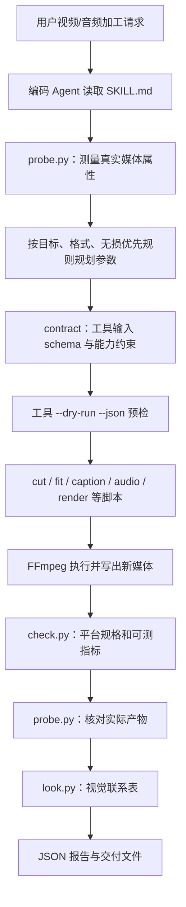
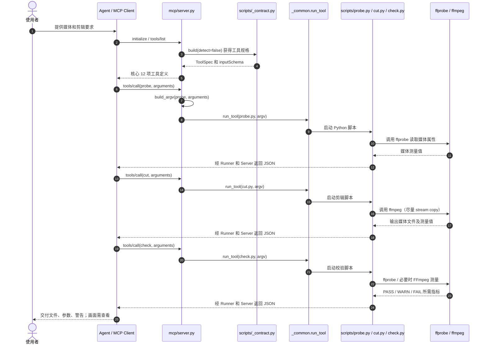

# ffmpeg-skill — Agent 原生 FFmpeg 视频编辑与验证工具

**ffmpeg-skill（Agent-Native Local Video Editing）** 是 [kajisho5/ffmpeg-skill](https://github.com/kajisho5/ffmpeg-skill) 提供的开源 Agent Skill / MCP 服务器，使编码代理通过结构化工具本地处理视频与音频，而非自由拼接未经验证的 FFmpeg shell 字符串。官方 `package.json` 读取版本为 **3.11.1**（2026-11-18）。

## 一句话定义

把 **“先探测真实媒体 → 选择尽量无损的编辑操作 → 核查交付参数 → 复核结果”** 固化为可执行的 Skill 工作流，给 Agent 42 个以 FFmpeg / ffprobe 为后端的本地媒体工具。

## 英文缩写速查

| 缩写 | 英文全称 | 简要说明 |
|---|---|---|
| FFmpeg | Fast Forward Moving Picture Experts Group（项目名称） | 负责视频、音频编解码及过滤处理的工具集 |
| MCP | Model Context Protocol | 让支持该协议的代理以 `tools/call` 调用脚本 |
| CLI | Command-Line Interface | 各 `scripts/*.py` 的参数化命令入口 |
| SPEC | Self-Producing Execution Contract | 将工具 argparse 解析器自动生成可机器读取的输入契约 |
| FPS | Frames Per Second | 探测和核对的实际视频帧率 |
| LUFS | Loudness Units relative to Full Scale | 对交付音频进行响度校验的度量 |
| HDR | High Dynamic Range | 色彩管线中需明确保留或转换的高动态范围 |

## 为什么重要

- **避免代理猜测媒体属性：** 使用 `probe.py` 先读取时长、帧率、画幅、颜色标记与音轨，再按实测结果决定剪辑和导出路径。
- **可追溯媒体产物：** 编辑工具报告实际输出、运行命令和机器可读的校验结果；`check.py` 区分 PASS / WARN / FAIL，`look.py` 生成联系表供视觉检查。
- **为机器人实验服务：** 可用于处理真机演示、仿真 rollout 视频、访谈和教学短片的剪切、拼接、字幕与平台交付；这些属于**视频后处理**，不提供机器人动作策略或物理正确性验证。
- **Agent 接口标准化：** CLI 与 MCP 都由同一套契约生成；修改参数后可通过测试检查接口漂移。

## 核心原理

| 模块 | 文件 / 接口 | 作用 |
|---|---|---|
| Skill 决策约束 | `SKILL.md` | 按请求选择工具、拒绝猜测字幕、默认保留输入、规定复核 |
| 机器契约 | `scripts/_contract.py` | 从 argparse 生成 42 项工具 schema，附带 FFmpeg 依赖与验证政策 |
| 能力检测 | `doctor` | 逐项检查编解码器、滤镜和系统环境，报告工具级可用性 |
| 媒体处理 | `scripts/probe.py`、`cut.py`、`fit.py`、`render.py` 等 | FFprobe 测量，FFmpeg 按结构化参数执行媒体变换 |
| MCP 传输 | `mcp/server.py` | stdio JSON-RPC，将 `tools/call` 转为参数映射和 Python 子进程 |
| 交付校验 | `check.py`、`look.py` | 核对平台可测指标，供代理或人工复看画面 |

官方明确：**MCP 默认只展示 12 项核心工具，但 42 项均可以名称调用**；设 `FFMPEG_SKILL_MCP_FULL=1` 可展示全部。`SPEC` 的工具输入 schema 从代码中的 `argparse` 读取，不是另外手写一份容易失同步的表。

### 项目流程总览

根据 [README](https://github.com/kajisho5/ffmpeg-skill/blob/main/README.md)、[SKILL](https://github.com/kajisho5/ffmpeg-skill/blob/main/SKILL.md) 与 [contract](https://github.com/kajisho5/ffmpeg-skill/blob/main/docs/contract.md) 的任务执行边界整理：



此图是**逻辑处理流程**，并不表示每个请求都需要全部工具。只做音频处理无需视频联系表；指定交付模板时 `render.py` 可统一组织多个阶段。

### 源码运行时序图

以下是已阅读的 `mcp/server.py`、`scripts/_contract.py`、`scripts/probe.py`、`scripts/cut.py`、`scripts/check.py` 与 `scripts/_common/runner.py` 所支持的 **MCP 工具路径**；实际工具由请求选取，而非固定总是剪切：



这里用 `Tool-->>Agent` 简写经 Runner/Server 的 JSON 回传链；未声称执行或回放了示例视频。CLI 模式可绕开 MCP 直接使用 `python3 scripts/<name>.py`。

## 工程实践

**安装与验收（依官方文档）：**

```bash
# Ubuntu: 先确认 ffmpeg/ffprobe 版本是否满足 6.1+
ffmpeg -version
python3 --version

npx ffmpeg-skill --codex             # 安装至 Codex Skill 路径
npx ffmpeg-skill doctor              # 检查 FFmpeg 功能与各工具可用性
npx ffmpeg-skill contract --json     # 读取机器契约
```

| 场景 | 推荐处理 | 验收依据 |
|---|---|---|
| 仿真/真机视频裁片 | `probe` → `cut.py --start --end` | 结果时长、截取边界/关键帧偏差 |
| 横屏演示转竖屏 | `fit.py --aspect 9:16 --fit crop` | 目标画幅、抽帧检查主体未被裁掉 |
| 访谈字幕与剪静音 | `silence.py`、`caption.py`（已有字幕或可选本地 ASR） | 字幕文本核对，时间线与画面复看 |
| 多阶段成片 | `render.py project.json` 或平台模板 | `check.py --platform ...` 校验格式、音量等 |
| 媒体发布前 QA | `check.py` + `look.py` | 格式 PASS 不替代审美/语义复核 |

**环境约束：** 官方要求 Python 3.10+、FFmpeg 6.1+；`npx` 安装另需 Node 16+。旧版 Ubuntu 的 `apt` FFmpeg 可能低于要求。`doctor` 总体不通过不代表所有工具都不可用，应看 `doctor --json` 的单项能力报告。

## 局限与风险

- **不做内容决策：** 负责执行编辑，不自动选择哪段值得保留、如何讲故事或主观视觉质量。`look` 只产生检查材料，需 Agent/人实际查看。
- **可测验证不等于主观正确：** `check.py` 只核查格式/技术指标，可选内容异常检测也不能证明机器人动作真实性或字幕语义准确。
- **兼容与成本：** 滤镜/编码器取决于本机 FFmpeg 构建；长片重编码可能超过默认 1800 秒超时；本机 CPU/GPU 性能、素材编码等均影响耗时。
- **安全与覆盖：** 处理本地文件、默认保留输入；`--overwrite` 需按实际意图显式授权。可选 ASR 安装或首次下载权重仍需网络，不能将“本地运行”理解为从不下载。
- **验证范围声明：** 本次静态通读官方文档与关键入口源码，**未实际执行 42 项工具/完整视频回归**，功能结果按上游说明归档；MIT 代码许可不等于媒体素材版权许可。

## 关联页面

- [video-shotcraft](./video-shotcraft.md) — 分镜/宣传片 Agent 制作层；本工具在后期剪辑和技术交付层
- [Remotion](./remotion.md) — 用 React 合成新画面，与本工具的现有媒体剪辑互补
- [Manim](./manim.md) — 程序化数学/机器人原理动画制作，后期仍可交由 FFmpeg 编码处理
- [Karpathy LLM Wiki](../concepts/llm-wiki-karpathy.md) — 将操作规约编译进 Skill 与把知识编译进 wiki 的分工

## 参考来源

- [ffmpeg-skill GitHub 仓库原文归档](../../sources/repos/kajisho5-ffmpeg-skill.md)
- [ffmpeg-skill 官方主页归档](../../sources/sites/kajisho5-ffmpeg-skill.md)
- [项目 README](https://github.com/kajisho5/ffmpeg-skill/blob/main/README.md)
- [SKILL.md](https://github.com/kajisho5/ffmpeg-skill/blob/main/SKILL.md)
- [机器契约](https://github.com/kajisho5/ffmpeg-skill/blob/main/docs/contract.md)

## 推荐继续阅读

- [官方工具使用示例](https://github.com/kajisho5/ffmpeg-skill/tree/main/examples)
- [官方视频演示](https://kajisho5.github.io/ffmpeg-skill/)
- [FFmpeg 官方文档](https://ffmpeg.org/documentation.html)
