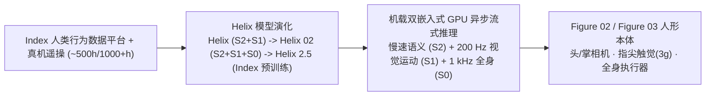

---

type: entity
tags: [hardware, humanoid, industry, vla, figure-ai]
status: complete
updated: 2026-11-21
original:
  - ../../sources/repos/figure-ai.md
  - ../../sources/sites/figure-helix-models.md
  - ../../sources/blogs/figure_ai_helix_25_zero_shot_30_home_generalization.md
related:
  - ./helix-25.md
  - ./humanoid-robot.md
  - ./1x-technologies.md
  - ./shift-app-nyc.md
  - ../queries/humanoid-robot-data-collection-landscape.md
  - ../methods/vla.md
  - ../queries/humanoid-hardware-selection.md
  - ../queries/embodied-six-routes-holes.md
sources:
  - ../../sources/repos/figure-ai.md
  - ../../sources/sites/figure-helix-models.md
  - ../../sources/blogs/figure_ai_helix_25_zero_shot_30_home_generalization.md
  - ../../sources/blogs/wechat_shenlan_embodied_six_routes_holes_2026-09-04.md
  - ../../sources/blogs/leoinai_humanoid_robot_datacollection_2026-09-06.md
summary: "Figure AI 是美国人形机器人公司，以 Figure 02 整机与自研 Helix 视觉-语言-动作（VLA）模型为核心，强调全身协同与端侧推理，代表「垂直整合具身 AI」的一条主流工程路线。"
---

# Figure AI

## 一句话定义

**Figure AI** 构建「全栈人形」：**Figure 系列硬件** + **Helix 系列 VLA 模型**，目标是在真实家庭与物流场景中完成语言条件下的全身操作与移动。

## 英文缩写速查

| 缩写 | 英文全称 | 简要说明 |
|------|----------|----------|
| AI | Artificial Intelligence | 人工智能 |
| VLA | Vision-Language-Action | 视觉-语言-动作多模态基础策略方向 |
| Sim2Real | Simulation to Real | 把仿真中学到的策略迁移落地真机的工程主线 |

## 为什么重要

- **VLA 商业叙事样板**：Helix 将视觉、语言与高频动作策略打包为可部署管线，是观测「大模型如何接地到人形控制」的关键样本。
- **垂直整合主张**：公开表述中强调机器人 AI 不能长期完全外包（与云端通用模型的分工仍在演化），对 Sim2Real、端侧算力与数据闭环提出了硬约束。
- **生态对标**：常与 Tesla Optimus、1X NEO、Agility Digit 等并列，用来评估美国人形赛道的进度条。

## 核心原理

Figure AI 采用**数据—基座模型—分层全身控制—自研人形硬件**的垂直整合架构：上游通过 **Index** 全球人类行为视频平台与真机遥操作积累动作与交互先验；模型层围绕 **Helix** 家族演化（从初代 S2+S1 上半身协同，到 Helix 02 引入 1 kHz System 0 全身平衡/接触与 Figure 03 掌部/触觉感知，再到 Helix 2.5 从 Index 随机初始化预训练跨 30 家庭零样本部署）；硬件层在 Figure 02 / Figure 03 双机载嵌入式 GPU 上异步运行多时标闭环。

## 产品与模型（归纳）

| 名称 | 类型 | 说明 |
|------|------|------|
| **Figure 02 / Figure 03** | 全尺寸人形整机 | Figure 02 面向早期商业与物流试点；Figure 03 为家庭日常通用版本，新增掌部相机与 3 g 指尖触觉支撑 Helix 02 / 2.5（细节以官方发布为准） |
| **Helix / Helix 02** | VLA 家族 | 官方发布：初代 Helix（7B S2 7–9 Hz + 80M S1 200 Hz 35-DoF 上半身）→ Helix 02（新增 10M 参数 1 kHz System 0 与掌部/触觉全传感输入）；详见 [Helix](./paper-rcl-ref-cb61c489d1333f433fc4-helix-a-vision-language-action-model-for-general.md) 与 [Helix 02](./helix-02.md) |
| **Helix 2.5** | Index 预训练全身策略 | 2026-09-17：Index 从零预训练 → 三项 locomanipulation 微调 → **30 家庭零样本** 固定 checkpoint；Index ablation **9%→56%**；详见 [Helix 2.5](./helix-25.md) |
| **Index** | 人视频数据平台 | App 下载 + 佩戴录制设备，用户完成日常任务获报酬（[LeoInAI 2026-09](../../sources/blogs/leoinai_humanoid_robot_datacollection_2026-09-06.md)）；同文转述截至 2026-08-25 自称累计超 **1600 万** 条真实世界视频；Helix 2.5 文称约 **35 分钟/秒** 新经验采集 |

## 源码运行时序图

**不适用**：截至 2026-11-21，Figure AI 全线 Helix 模型权重、训练/推理源码与 Index 数据集均未开源，官方发布页仅提供技术博客与视频演示。

## 工程实践

- **版本与硬件边界**：评估或引用 Figure 路线时须严格区分 **Helix 初代**（35-DoF 上半身）、**Helix 02**（依赖 Figure 03 掌部相机与触觉的 S2/S1/S0 全身三层控制）与 **Helix 2.5**（Index 从零预训练与 30 家庭零样本），不能把后期能力混归初代模型。
- **开放与复现口径**：Figure 栈属于**闭源垂直整合**，不可直接作为科研开箱复现基线；工程对照可参考开源的 [Isaac GR00T](./isaac-gr00t.md) 或分层控制架构页 [具身三层控制架构](../concepts/embodied-three-layer-control-architecture.md)。
- **真机端侧约束**：官方强调双嵌入式低功耗 GPU 机载异步推理与 S1/S2 训练时延对齐，部署评估需同时关注传感器遮挡、触觉阈值与长时程超时/安全介入率。

## 常见误区或局限

- **合作关系变化快**：曾与 OpenAI 在模型侧合作的新闻较多；后续转向自研 Helix。**选型讨论应以最新官方博客为准**，媒体报道仅作时间线辅助。
- **演示 ≠ 量产能力**：语音指令、抓取未知物体等亮点多在受控或半受控场景验证。
- **学术可用性**：Figure 不是典型「科研开箱平台」，复现其完整栈依赖未公开的模型与数据；Helix 2.5 / Index **截至 2026-09-17 未开源**（见 [Helix 2.5 归档](../../sources/blogs/figure_ai_helix_25_zero_shot_30_home_generalization.md)）。

## 公司路线中的版本定位

- [Helix 02 全身架构](./helix-02.md)：与本页互补，按独立发布物核对架构和开放范围。

## 关联页面

- [人形机器人](./humanoid-robot.md)
- [VLA](../methods/vla.md)
- [1X Technologies](./1x-technologies.md)
- [Query：人形机器人硬件怎么选](../queries/humanoid-hardware-selection.md)
- [六条路线的窟窿](../queries/embodied-six-routes-holes.md) — Helix 分层与 Index 数据饥渴的产业读法
- [人形数据采集产业地图](../queries/humanoid-robot-data-collection-landscape.md) — Index 与 Shift 等「服务/众包换数据」对照

## 参考来源

- [Figure AI 原始资料](../../sources/repos/figure-ai.md)
- [Helix / Helix 02 官方技术发布归档](../../sources/sites/figure-helix-models.md)
- [Helix 2.5 官方新闻归档](../../sources/blogs/figure_ai_helix_25_zero_shot_30_home_generalization.md)
- [深蓝六条路线（转述 Helix 02 / Index）](../../sources/blogs/wechat_shenlan_embodied_six_routes_holes_2026-09-04.md)

## 推荐继续阅读

- [Figure AI News](https://www.figure.ai/news)
- [Helix 纵深页](https://www.figure.ai/helix)
