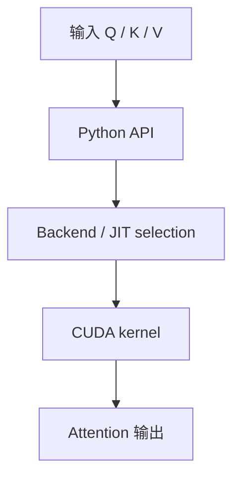
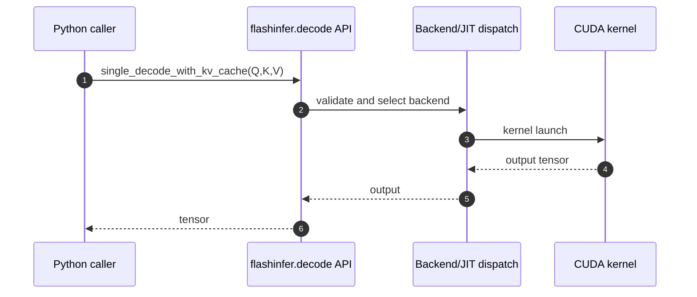

# FlashInfer｜跨框架 GPU 推理 Kernel 库

## 一句话定义

FlashInfer 提供推理所需的 attention、GEMM、MoE、sampling 等高性能 GPU kernel/API，供 vLLM、SGLang 及 TensorRT-LLM 生态复用；这是算子层，不是独立的 HTTP serving 框架。

## 英文缩写速查

| 缩写 | 英文全称 | 简要说明 |
|---|---|---|
| LLM | Large Language Model | 本页服务的自回归语言模型类型 |
| KV | Key-Value Cache | 用于增量推理的历史注意力键值缓存 |
| GPU | Graphics Processing Unit | 计算和 kernel 执行的硬件 |
| CI | Continuous Integration | 贡献审核时运行的自动验证 |
| PR | Pull Request | 提交测试、代码变更、性能证据的上游审查单 |

## 为什么重要

FlashInfer 提供推理所需的 attention、GEMM、MoE、sampling 等高性能 GPU kernel/API，供 vLLM、SGLang 及 TensorRT-LLM 生态复用；这是算子层，不是独立的 HTTP serving 框架。

## 核心原理

官方 README 的 `flashinfer.single_decode_with_kv_cache(q,k,v)` 示例将 CUDA tensors 传给高层 Python API；`flashinfer/decode.py` 引入 JIT、cudnn 与不同后端的调度/注册。贡献指南要求 kernel 在 `include/`、Torch 注册在 `csrc/`、Python API 在 `python/`（当前仓内也有 `flashinfer/` 源目录）、测试在 `tests/`、benchmark 在 `benchmarks/`；目录可能随版本迁移。

### 流程总览

## 源码运行时序图

**已核对执行入口：** 官方 README 示例 `import flashinfer` 后直接调用 `single_decode_with_kv_cache(q,k,v)`；`flashinfer/decode.py` 暴露解码 API 与多个 backend/JIT 选择工具。 此图仅覆盖所列实际入口的主干路径，不代表全部异步/多卡细节。

## 工程实践

- **可执行入口：** 官方 README 示例 `import flashinfer` 后直接调用 `single_decode_with_kv_cache(q,k,v)`；`flashinfer/decode.py` 暴露解码 API 与多个 backend/JIT 选择工具。
- **贡献切口：** 先用相同 Q/K/V 与 PyTorch reference 对齐容差，再为一个 shape/dtype/GPU 建立基准，最小化变更并按 `CONTRIBUTING.md` 写正确性和性能证据。
- **回归要求：** 说明 GPU/驱动/依赖、模型版本、输入与输出 token 长度分布、预热次数与 batch/并发；保留正确性对拍，再报告 tokens/s、TTFT 或 TPOT（按服务模式选择）。
- **开源状态：** 官方 [GitHub 仓库](https://github.com/flashinfer-ai/flashinfer) 与 README/源码可访问；对特殊 GPU kernel、训练与数据等子组件是否完全开放，不能从主页自动推断。

## 局限与风险

README 写明支持 SM75 及以上多代 NVIDIA GPU，但不是每个功能都支持全部计算能力。维护者友好、无需数据中心 GPU 或 PR 必然被接收均不是官方保证。

- **视频事实界限：** “学生 / 1–2 年 / 资深”是用户提供的视频观点，不是上游官方招聘标准；未验证作者或 Discord 时间。别把开源贡献与 PR 合并结果视为确定承诺。

## 关联页面

- [LLM 推理开源贡献分阶段路线](../roadmaps/llm-inference-open-source-contribution-by-stage.md)
- [LLM 推理显存估算](../concepts/llm-inference-vram-estimation.md)
- [Mini-SGLang｜精简但完整的在线 LLM Serving 系统](./mini-sglang.md)
- [vLLM｜生产级大模型推理与持续批处理](./painode-103-vllm.md)
- [SGLang｜大规模语言与多模态模型推理服务框架](./sglang.md)
- [TensorRT-LLM｜NVIDIA 大模型推理运行时与 LLM API](./tensorrt-llm.md)

## 参考来源

- [FlashInfer｜跨框架 GPU 推理 Kernel 库：一手文档和代码核验归档](../../sources/repos/flashinfer-official.md)
- [六项目对照与原视频证据边界](../../sources/repos/llm-inference-open-source-contribution-primary-docs-2026-11.md)
- [官方 README](https://github.com/flashinfer-ai/flashinfer/blob/main/README.md)

## 推荐继续阅读

- [官方仓库与最新文档](https://github.com/flashinfer-ai/flashinfer)
- [推理开源贡献路线](../roadmaps/llm-inference-open-source-contribution-by-stage.md)
