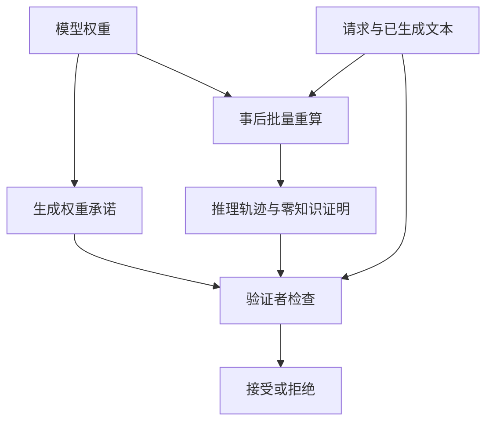
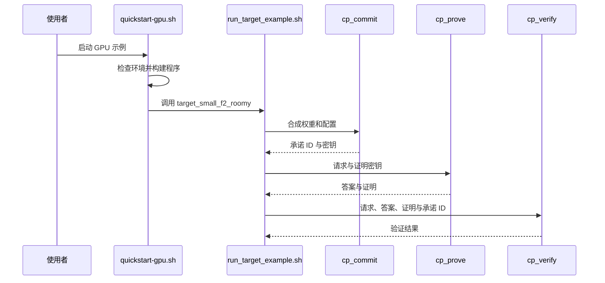

# FlashProve：大模型可证明推理

FlashProve 是 Anthropic 等发布的研究原型：提供模型权重承诺和推理证明，让验证者无需获取权重即可检查指定计算是否与承诺一致。

## 英文缩写速查

| 缩写 | 英文全称 | 简要说明 |
|------|----------|----------|
| PI | Provable Inference | 可证明推理，验证输出与指定模型的对应关系 |
| zkSNARK | Zero-Knowledge Succinct Non-Interactive Argument of Knowledge | 紧凑、非交互且隐藏秘密的密码学证明 |
| IOP | Interactive Oracle Proof | 协议使用的信息论证明构件 |
| MoE | Mixture of Experts | 每个 token 仅激活部分专家的模型架构 |

## 为什么重要

服务方可先固定权重承诺，再证明请求输出符合承诺，有助于模型身份核验与推理完整性审计。承诺须由可信渠道绑定到预期模型；证明不判断回答是否真实、安全或适合控制机器人。

## 核心原理与流程总览

权重先做隐藏式承诺；已完成的请求在事后按批重算并生成证明。IOP 结合 Merkle 承诺与 Fiat–Shamir 变换构造证明；MoE 证明工作主要对应实际激活专家，同时隐藏专家选择。

## 源码运行时序图

以下依据官方 `examples/quickstart-gpu.sh` 与 `prover/examples/run_target_example.sh` 的小型合成权重路径，非线上服务部署。

## 实验与工程实践

官方博客测试的是 4-bit Llama 4 Maverick、1024 token 上下文、每证明检查一个 token；24 请求一批、单 H100 生成速率约 110 输入 token/s，每个证明约 18.78 MB；验证约 17 秒（24 线程）。承诺初始化约 39 分钟，约 1600 万请求后须重新承诺。该速率并非在线生成 token 的延迟指标。

源码、Lean 证明及文档公开，使用 Apache-2.0；真实模型权重需另行获取并遵守对应许可。仓库声明该原型不维护。本次未运行代码。

## 局限与风险

- 当前证明涉及整数模型与贪心选择，浮点推理或采样输出可能不一致；上下文上限 1024。
- 事后证明有重算与延迟；证明内容不覆盖模型架构隐藏或侧信道。
- Lean 性质基于随机预言机等假设；快速 C++ 验证器与 Lean 规格的等价性尚未形式化证明。
- **待完成：** 技术报告全文及 prover/verifier 内部实现尚未系统通读；图仅反映博客与已阅读脚本，不能视为完整安全审计。

## 关联页面

- [AI Agent 评测](../concepts/ai-agent-evaluation.md)
- [Anthropic Claude API Skill](anthropic-claude-api-skill.md)

## 参考来源

- [官方博客归档](../../sources/sites/anthropic-provable-inference.md)
- [官方源码归档](../../sources/repos/anthropics-flashprove.md)

## 推荐继续阅读

- [FlashProve 技术报告](https://www.anthropic.com/document/flashprove-technical-report)
- [官方仓库](https://github.com/anthropics/FlashProve)
