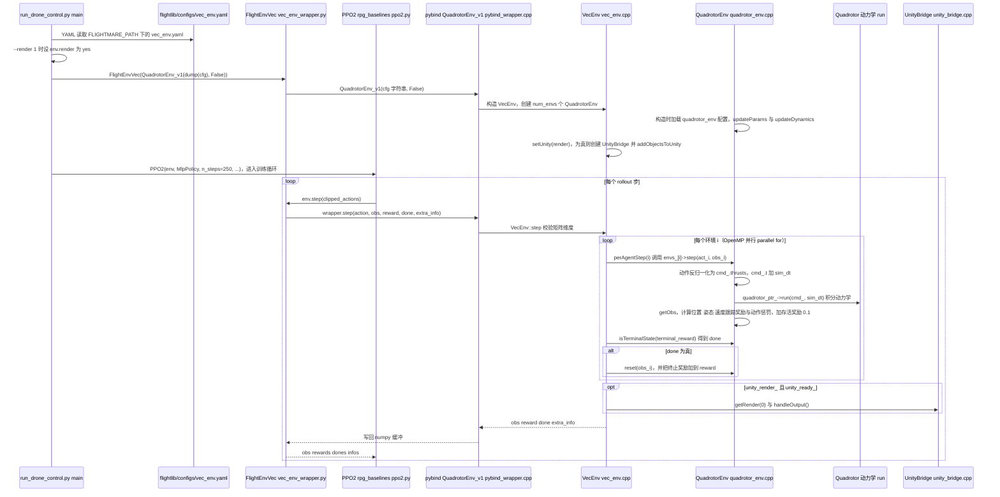

---

type: entity
tags: [repo, simulation, uav, unity, reinforcement-learning, rpg, agile-flight, eth]
status: complete
updated: 2026-05-27
related:
  - ../overview/multirotor-simulation-planning-control-stack.md
  - ./airsim.md
  - ./unity-engine.md
  - ./gym-pybullet-drones.md
  - ./paper-rl-vs-gc.md
  - ./ego-planner-swarm.md
sources:
  - ../../sources/repos/flightmare.md
summary: "Flightmare 是 UZH RPG 的灵活四旋翼仿真器：Unity 渲染与可配置动力学后端，面向敏捷飞行、感知与 RL 的高并行研究基线。"
---

# Flightmare

**Flightmare**（[uzh-rpg/flightmare](https://github.com/uzh-rpg/flightmare)）是苏黎世大学 **Robotics and Perception Group** 开源的 **四旋翼研究仿真器**，强调 **渲染与物理后端分离**、**多环境并行** 与敏捷机动实验。

## 英文缩写速查

| 缩写 | 英文全称 | 简要说明 |
|------|----------|----------|
| RL | Reinforcement Learning | 通过与环境交互最大化长期回报来学习策略的范式 |
| API | Application Programming Interface | 应用程序编程接口 |

## 为什么重要

- **RL / 感知论文常用基线**：比 [gym-pybullet-drones](./gym-pybullet-drones.md) 视觉更丰富，比 [AirSim](./airsim.md) 更偏研究迭代与批量化。
- 适合验证 **端到端策略、避障、敏捷机动** 在仿真中的样本效率。
- 与 [EGO-Planner Swarm](./ego-planner-swarm.md) 等规划器可在不同仿真器间做 **算法迁移** 对照。

## 核心结构/机制

- **渲染客户端**：[Unity Engine](./unity-engine.md) 场景与传感器合成  
- **仿真后端**：四旋翼动力学与多机实例  
- **API**：重置、控制、状态与图像获取（以仓库当前文档为准）  
- **并行**：支持多 quad 同时 rollout，服务 RL 训练吞吐  

## 常见误区或局限

- **误区：Flightmare 包含完整 PX4 栈** — 通常作为 **研究用仿真**；真机仍需独立飞控与标定。
- **局限：构建依赖** — Unity 客户端与后端版本需对齐。
- **局限：维护活跃度** — 选型时对比 AirSim fork（如 Colosseum）与团队内部脚本。

## 源码运行时序图

入口：`FLIGHTMARE_PATH=<仓库根> python3 flightrl/examples/run_drone_control.py --train 1`（需先编译生成 `flightgym` 模块；`--render 1` 打开 Unity 渲染开关，默认 `--train 1` 为训练 PPO）。

图依据：uzh-rpg/flightmare@d4218ae，实际读过 `README.md`（grep 运行相关说明）、`flightrl/examples/run_drone_control.py`（main / parser / 训练分支）、`flightrl/rpg_baselines/envs/vec_env_wrapper.py`（`FlightEnvVec` 的 step / connectUnity 定义）、`flightrl/rpg_baselines/ppo/ppo2.py`（第 495 行 `env.step` 调用处）、`flightlib/src/wrapper/pybind_wrapper.cpp`（绑定列表）、`flightlib/src/envs/vec_env.cpp`（setUnity / step / perAgentStep / connectUnity）、`flightlib/src/envs/quadrotor_env/quadrotor_env.cpp`（构造 / step / reward）、`flightlib/src/bridges/unity_bridge.cpp`（ZMQ 初始化与 connectUnity 入口）。`quadrotor_dynamics.cpp` 的积分细节与 Unity 端消息格式未展开，动力学一框只画到 `run` 调用。

## 参考来源

- [sources/repos/flightmare.md](../../sources/repos/flightmare.md)
- [uzh-rpg/flightmare](https://github.com/uzh-rpg/flightmare)
- 源码核对（2026-11-02）：uzh-rpg/flightmare@d4218ae，读过 README.md（grep 运行说明）、flightrl/examples/run_drone_control.py、flightrl/rpg_baselines/envs/vec_env_wrapper.py、flightrl/rpg_baselines/ppo/ppo2.py（grep）、flightlib/src/wrapper/pybind_wrapper.cpp、flightlib/src/envs/vec_env.cpp、flightlib/src/envs/quadrotor_env/quadrotor_env.cpp、flightlib/src/bridges/unity_bridge.cpp（grep）；时序图依据以上文件，未运行代码。

## 关联页面

- [多旋翼栈总览](../overview/multirotor-simulation-planning-control-stack.md)
- [AirSim](./airsim.md)
- [gym-pybullet-drones](./gym-pybullet-drones.md)
- [RL vs GC](./paper-rl-vs-gc.md) — 状态反馈跟踪上的 RL vs \(SE(3)\) 几何控制（非视觉）

## 推荐继续阅读

- Flightmare 论文与项目页（仓库 README）
