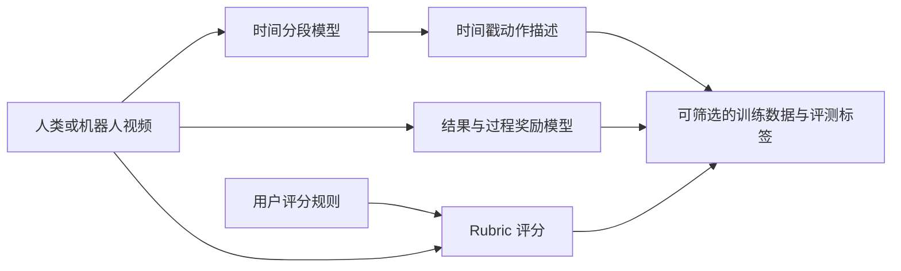

# Flora：机器人数据引擎模型套件

## 一句话定义

Flora 将机器人视频的时间分段、动作描述和奖励标注组合成模型套件，为预训练数据筛选、策略后训练与部署监测提供标签。

## 英文缩写速查

| 缩写 | 英文全称 | 简要说明 |
|------|----------|----------|
| RL | Reinforcement Learning | 通过过程奖励提供策略后训练信号 |
| GR00T | Generalist Robot 00 Technology | NVIDIA 人形机器人基础模型系列；论文称 Flora 用于其训练 |
| HF | Hugging Face | Flora 模型权重的公开分发入口 |
| WGO | What’s Going On? Benchmark | 论文使用的视频动作标注评测基准 |

## 为什么重要

机器人数据不仅需要“做了什么”的字幕，也需要动作发生的时间边界、过程是否有效及最终结果。Flora 把这些标签任务组合起来，目标是降低大规模机器人数据整理和策略评估的成本。

## 核心原理

论文描述三类核心能力：视频时间分段与上下文动作字幕、结果奖励、过程奖励；用户还可提供 rubric，在测试时对任务步骤评分。概念上的标注路径如下：

## 评测与结果

NVIDIA 报告 Flora 在 WGO-Bench、RoboReward、Robometer 等基准上达到有竞争力的结果，并称生产系统曾以 512 张 GB300 GPU 每天标注 200,000 小时数据。该生产规模是论文披露的内部运行指标，不等于单卡推理吞吐。

## 工程实践与开放状态

| 项目 | 现状 |
|------|------|
| 模型权重 | HF collection 有 Flora-Captioner、Flora-TempSeg、Flora-Rewarder |
| 源码 | 项目页未给出可核验的 GitHub 仓库；论文称开源数据引擎，但实现入口需后续复核 |
| 许可 | 需以每个 HF 模型仓库的当前许可证为准 |
| 用途 | 生成带时间戳描述、奖励标签和 rubric 分数，作为数据处理或评估组件 |

这里的“模型开放”不自动代表训练管线、内部数据或整套生产系统均可复现。

## 与其他工作对比

相比只做动作字幕的数据工具，Flora 同时覆盖时间边界与多种奖励标签；相比直接调用通用多模态 API，论文强调专门化模型与单位视频小时成本。评测指标及数据范围不同，不能简单用单一分数断定整体优劣。

## 局限与风险

- 生产吞吐依赖大型 GPU 集群，部署成本与单机适用性需单独评估。
- 自动奖励标签可能带来偏差；训练用途应抽样人工审查并保留来源与置信信息。
- 模型权重可访问不代表训练数据、源码和全部许可均已开放；应逐模型仓库核对。
- 具体成本比较依赖论文提示词、推理配置和基准假设。

## 关联页面

- [World Action Models](../concepts/world-action-models.md) — 数据标签如何服务动作模型学习
- [灵巧操作数据管线](../queries/dexterous-manipulation-data-pipeline.md) — 从机器人数据到训练与评测的流程

## 参考来源

- [Flora 论文摘录](../../sources/papers/flora_nvidia_2026.md)
- [NVIDIA Flora 项目页归档](../../sources/sites/flora-nvidia.md)

## 推荐继续阅读

- [NVIDIA Flora 项目页](https://research.nvidia.com/labs/gear/flora/)
- [NVIDIA Flora Hugging Face collection](https://huggingface.co/collections/nvidia/flora)
