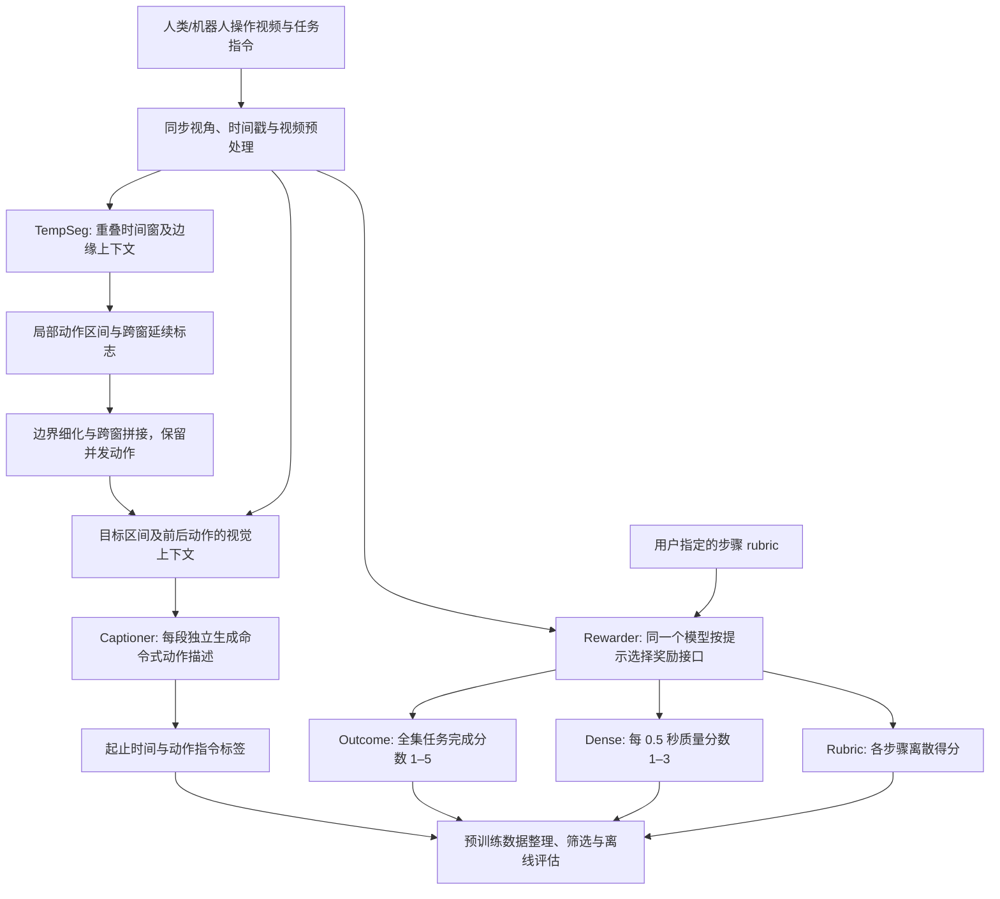
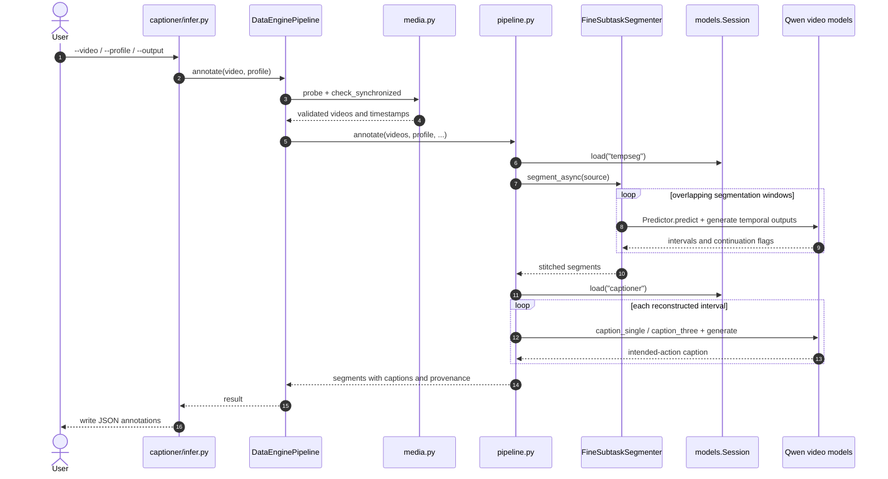

# FLORA：面向规模化机器人数据引擎的开放模型套件
**FLORA: An Open Model Suite for Scaling Robotics Data Engines**

## 一句话定义

FLORA 不是直接输出机器人关节动作的 VLA 策略，而是把人类/机器人操作视频编译为**时间戳动作指令**、**过程执行质量**、**最终任务结果**和**任务步骤评分**的标注模型套件，辅助 GR00T 类基础策略的数据筛选、训练和离线评估。

## 英文缩写速查

| 缩写 | 英文全称 | 简要说明 |
|---|---|---|
| VLM | Vision-Language Model | 视觉语言模型，FLORA 三个基础模型均基于 Qwen3.5 |
| SFT | Supervised Fine-Tuning | 三个模型的监督微调阶段 |
| GRPO | Group Relative Policy Optimization | TempSeg 与 Captioner 后续的奖励优化 |
| RL | Reinforcement Learning | 利用过程/结果奖励支持策略后训练 |
| tIoU | Temporal Intersection over Union | 预测动作区间与标注区间的时间重合度 |
| WGO | What's Going On? | 动作分段/描述评测集 WGO-Bench |
| GR00T | Generalist Robot 00 Technology | NVIDIA 机器人基础模型系列 |
| OOD | Out-of-Distribution | 分布外轨迹，在 RobometerBench 中用于排序评估 |

## 核心信息

| 项目 | 内容 |
|---|---|
| 论文 | [arXiv:2610.31779v1](https://arxiv.org/html/2610.31779v1)，2026-10-22，Sicong Leng、Yunze Man、Zhiqi Li 等 |
| 机构 | 英伟达（NVIDIA GEAR） |
| 官方项目 | [NVIDIA GEAR FLORA](https://research.nvidia.com/labs/gear/flora/) |
| 官方源码 | [NVlabs/Flora](https://github.com/NVlabs/Flora)：**仅推理示例，没有训练代码或生产推理系统** |
| 模型权重 | [Hugging Face / NVIDIA FLORA](https://huggingface.co/collections/nvidia/flora)：TempSeg、Captioner、Rewarder |
| 许可 | NVIDIA License；仅非商业研究、评估，不能因 GitHub 可见而视为可商用 |

## 为什么重要

大规模机器人训练数据需要两类不同的标签：一类回答**什么时间打算执行什么动作**，用于语言条件训练及数据重采样；另一类回答**操作进行得如何、最终是否成功**，用于失败挖掘、过程奖励、策略比较与部署监测。FLORA 将这两条数据工作流收敛为三个专用模型，而非靠单次通用 VLM 请求处理所有问题。

## 流程总览（依据论文 §4、Appendix F/G）

**关键边界：** Captioner 描述的是动作*意图*，不保证动作已成功；Rewarder 才判断执行质量。Dense 过程奖励利用后续视频证据，是**事后离线标签**，不能直接当实时闭环安全控制信号。

## 核心原理

### TempSeg：从重叠窗口重建动作时间轴（§4.1，Appendix F）

- 输入长度为 16 秒的视频窗，4 FPS 抽取 64 帧；常规窗含 12 秒可输出核心区和两端各 2 秒上下文。部分机器人三视角长视频使用 32 秒窗、24 秒核心区。
- Qwen3.5-9B 分段器预测局部 `(start, end)`、左右窗口**延续标志**；把窗口坐标还原为全集时间，再根据重叠与延续标志拼接。并发动作允许区间相互重叠，必要时重新偏移窗口细化边界。
- 得到事件区间集合 `[(start_s, end_s), ...]`；分段与 caption 不用同一个模型。

### Captioner：生成与时间区间绑定的动作指令（§4.1，Appendix F）

- Qwen3.5-27B Captioner 对每个事件分别输入 **before / target / after** 视觉块，输出独立的命令式英文动作描述。
- 多机位机器人数据按时间同步拼接相机视图，保留场景与腕部观察；没有上下文时省略，不让 Captioner 修改已定位的时间边界。
- 描述强调操作意图、物体、左右手/机械臂角色与空间关系，失败动作也保留目标，不将失败误写为成功。

### Flora-Rewarder：单模型的三种奖励接口（§4.2，Appendix G）

| 接口 | 输入与输出 | 注意事项 |
|---|---|---|
| Outcome | 整段视频 + 任务指令 → 1–5 整数得分、可选理由、得分 token 分布与期望分数 | `progress=(E[score]-1)/4` 是排序用连续归一化结果，**不是成功概率** |
| Dense / Process | 每 16 秒窗（4 FPS/64 帧）→ 每 0.5 秒 1=失败、2=可恢复的次优、3=正常；异常区间理由 | 时间窗以 10 秒前进，非最后一窗去掉末尾 4 秒标签并拼接，明确依赖事后证据 |
| Rubric | 视频 + 任务指令 + 用户自定义步骤与各步可选分值 → 每步骤评分与总分 | 步骤满分之和为 1；采用 thinking 模式，多样本取 medoid |

### 训练方法（§4.3，Appendix F.2–F.4 / G.5）

- **TempSeg：** Qwen3.5-9B → SFT（冻结视觉编码器，rank-32 LoRA）→ GRPO。其可验证奖励 `0.45·F1@0.5 + 0.15·F1@0.75 + 0.25·Precision@0.5 + 0.15·Boundary`，含边界与延续标志的准确性；只更新 LoRA。
- **Captioner：** Qwen3.5-27B → SFT → GRPO。奖励 `2M/(R+M+F)`：M 为覆盖的原文支持要点，R 为总有效要求，F 为可证伪的事实性错误惩罚。
- **Rewarder：** Qwen3.5-27B，对 Outcome、Dense、Rubric 三类样本**混合 SFT**，训练语言部分、视觉 merger 与视觉编码器（视觉学习率更低）；**发布版本没有 Rewarder RL 阶段**。
- 论文描述 NeMo AutoModel 做 SFT、定制 PyTorch 做分段/描述 GRPO；公开仓库**没有训练实现**，不可把论文训练方式误写成已可直接复现的命令。

## 评测与定量证据（论文 Tables 2–5）

| 指标（越高越好，MAE 越低越好） | FLORA | GPT-6 Astra | 解读 |
|---|---:|---:|---|
| WGO-Bench 分段 F1@0.75 | **50.3** | 46.0 | 100 段视频，跨 HomER / DROID / Galaxea 的子集等权均值 |
| WGO-Bench Gold-window caption accuracy | 64.7 | **77.4** | FLORA 的字幕语义并不全面领先 |
| WGO-Bench 联合语义 F1@0.75 | 34.5 | **39.0** | 时间对齐与语义同时正确时仍落后 Astra |
| DenseCaptionBench Human100 联合 F1@0.5 | **37.4** | 29.7 | 人类单视角任务胜出 |
| DenseCaptionBench Robot200 联合 F1@0.5 | 51.0 | **57.9** | 双类机器人视频合计均值不占优 |
| RoboRewardBench Outcome MAE ×100 | **40.0** | 55.4 | 2,831 集，预测 1–5 分的绝对误差 |
| RobometerBench OOD Kendall τ ×100 | 72.0 | **82.3** | 567 条分布外轨迹排序 |
| DenseRewardBench Failure recall | **53.3** | 0.0 | **内部** 40 集 / 4,861 秒级标签，不能外推真机在线安全 |
| RubricBench Pooled L1 ×100 | 6.5 | **3.6** | Rubric 模式并非第一 |

**成本与规模要分开读：** 论文 Appendix D 在 50 集固定样本、**8×GB300、假设每卡 $10/GPU-hour** 的估算下，得 `$0.7224 / 输入视频小时`，与最高推理预算的 Astra `$88.4922` 相比约 **122.5×（论文概述写约 125×）**；此模型未计存储、部署开销，且生产 GPU-hour 分母未核实。另有 **512 张 GB300 / 日标注 200,000 小时** 的作者生产级披露，不能与开源样例脚本性能等同。

## 源码运行时序图（基于官方仓库实际入口）

Rewarder 不从 `captioner/infer.py` 自动调用，而是三条独立的官方命令：`python -m rewarder.batch_utils.terminal_reward`、`dense_reward`、`rubric_reward`。共同通过 `engine.py` 装载 vLLM/Qwen 模型，`core.py` 承担帧拼接、提示、解析与奖励聚合；Dense 还执行窗重叠拼接，Rubric 多采样后取 medoid。对应逐文件入口与数据输出详见[官方仓库核验记录](../../sources/repos/flora-nvlabs.md)。

## 工程实践与开放状态（2026-11-10 实际核验）

| 项目 | 官方公开状态与约束 |
|---|---|
| 推理代码 | **已开源示例**：`captioner/infer.py` 和 `rewarder/batch_utils/`，不是 NVIDIA 512 卡生产服务；`tempseg/` 也带完整同构 TempSeg→Captioner 工作流 |
| 训练代码 / 内部数据 / 生产服务 | **未公开**，论文给出训练细节但不可视为端到端训练复现 |
| 输入 | `human` 单机位；`yam`、`dex`、`tianji` 等机器人 profile，可三路同步相机；标注单段不超过 120 s、256 MiB、边长 4096 px，至少 4 FPS |
| 示例命令 | `python captioner/infer.py --video demo.mp4 --profile human --validate-only`（CPU 验证）；正式推理用 `--output demo.json` |
| 算力 | 官方验证 Linux x86_64 / Python 3.12 / H100 80 GB；标注与 Rewarder 分开虚拟环境（PyTorch 依赖不同），rubric 默认两张 GPU |
| 模型下载 | 官方称标注约 130 GB 权重，Rewarder 首次约 56 GB；下载体量及官方 demo 速度不代表生产吞吐 |
| 许可及安全 | 非商业研究与评估；**禁止把这些标注结果直接作为机器人控制命令或唯一安全监测器** |

## 局限与风险

1. **数据依赖和标注偏差：** 自动分段可能过分切碎长动作；多视角样本、手部角色识别、相邻事件上下文均影响质量。
2. **不能泛化为全面超越商业模型：** WGO 的描述准确率/联合 F1、机器人片段联合 F1、Robometer OOD 排序和 Rubric 误差都有更强基线。
3. **数据引擎不等于策略：** 不提供关节控制、在线安全保证或直接部署 Sim2Real 的控制器。
4. **开源只是推理子集：** 生产规模的吞吐与成本属于论文/官网报告，公开的逐视频 demo 并不能复核相同能力。
5. **评测证据边界：** DenseRewardBench 与 RubricBench 为内部评测；多模型调用输入/推理预算差异，不能作严格模型架构因果结论。

## 结论

FLORA 的工程价值是用专用的时间定位、动作意图描述和三种奖励标注把异构操作视频转成可用监督，而非生成控制策略。

- 构建机器人数据集时先分段再生成命令式动作标签，保留失败动作的意图。
- 需要离线失败定位时使用 Dense Reward，**勿把回看未来信息的分数接入在线安全闭环**。
- 评估视频理解时分别检查时间分段、语义描述、二者联合指标，不只看某一个 best-of 数字。
- 自建标注服务应先在自有机器人与数据分布上校准 Rewarder；规模成本按本地硬件实际吞吐重算。
- 使用 NVIDIA 公开示例前检查许可证、显存、分环境依赖和模型下载体量。

## 关联页面

- [World Action Models](../concepts/world-action-models.md) — 训练数据标注与视频/动作预测模型的分工
- [灵巧操作数据管线](../queries/dexterous-manipulation-data-pipeline.md) — 与机器人模仿学习、奖励训练和数据工程联系
- [具身智能论文技术图谱](../overview/embodied-station-2026-10-29-58-papers-technology-map.md) — 项目在数据引擎生态中的位置

## 参考来源

- [论文全文通读归档（arXiv:2610.31779v1）](../../sources/papers/flora_nvidia_2026.md)
- [NVIDIA 官方项目主页核验](../../sources/sites/flora-nvidia.md)
- [NVlabs/Flora 官方源码与时序核验](../../sources/repos/flora-nvlabs.md)

## 推荐继续阅读

- [FLORA 论文 HTML（含附录 A–H）](https://arxiv.org/html/2610.31779v1)
- [NVIDIA GEAR 官方项目页](https://research.nvidia.com/labs/gear/flora/)
- [NVlabs/Flora 官方推理代码](https://github.com/NVlabs/Flora)
- [NVIDIA FLORA 模型权重](https://huggingface.co/collections/nvidia/flora)
