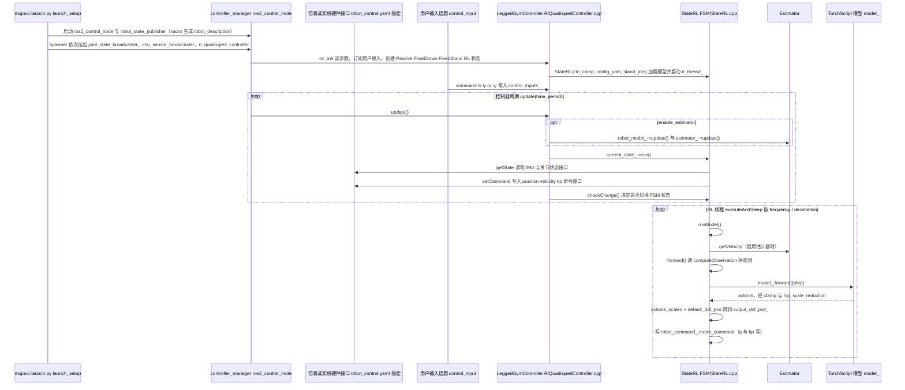

# FLORES

**FLORES**（[GitHub](https://github.com/ZhichengSong6/FLORES)）来自 [古月居转载的四足机器人开源项目综述](https://mp.weixin.qq.com/s/pRGoPm41qYCNyHPWR6Dl6A)，属「轮足机器人」组。

## 一句话定义

**FLORES 对应 RA-L 2026 论文「A Reconfigured Wheel-Legged Robot for Enhanced Steering and Adaptability」：通过关节 DoF 与可重构腿设计增强转向与适应性。**

## 英文缩写速查

| 缩写 | 英文全称 | 简要说明 |
|------|----------|----------|
| RA-L | IEEE Robotics and Automation Letters | 期刊 |
| HIM | Hybrid Internal Model | Hybrid Internal Model 策略（全称为补充，非 README 原文） |

## 为什么重要

- 综述把它放在「轮足机器人」这条技术路线下，作为可读源码的参照项目；横向对比见 [四足机器人开源项目技术地图：从极简运动学到研究级硬件（36 个 GitHub 项目）](../overview/quadruped-open-source-projects-technology-map.md)。
- 文中星标：25（文章表述，入库日未复核）。

## 核心信息

| 项 | 内容 |
|----|------|
| **仓库** | [ZhichengSong6/FLORES](https://github.com/ZhichengSong6/FLORES) |
| **最近提交** | 2026-05-22 |
| **可达性** | `git ls-remote` 可达（2026-11-01） |
| **文章归类** | 轮足机器人 |

## 文章说法核对

- **文章：** 文章称其采用模块化腿部设计、可动态调整构型，主动转向关节与智能轮向控制实现类似汽车的阿克曼转向。
- **README / 核查：** README 标注发表于 IEEE RA-L 2026（请引用同行评审版本），并给出机械设计与训练流程图：HIM 策略先在 Isaac Gym 带奖励塑形训练，再迁移到 MuJoCo 做 sim-to-sim，第二阶段为实机部署。
- **差异与保留：** 「阿克曼转向」等机理细节来自文章，未在 README 已读段落核对；仓库无 LICENSE 文件。

## 源码运行时序图

入口：`ros2 launch rl_quadruped_controller mujoco.launch.py`（README「3.1 Mujoco Simulation」；实机对应 `code/Mdog/controllers/mdog_controller/launch/mdog_rl_real.launch.py`，其中多出 IMU 驱动节点）。控制器为 ros2_control 插件 `LeggedGymController`，策略为 TorchScript 模型，由 `StateRL` 加载与推理。

图依据：ZhichengSong6/FLORES@814db43，实际读过 `README.md`（结构与 Phase I/II 描述）、`code/Mdog/controllers/rl_quadruped_controller/README.md`（第 2 至 3.1 节的构建与 launch 命令）、`code/Mdog/controllers/rl_quadruped_controller/launch/mujoco.launch.py`、`code/Mdog/controllers/mdog_controller/launch/mdog_rl_real.launch.py`（grep 节点列表）、`code/Mdog/controllers/rl_quadruped_controller/src/RlQuadrupedController.cpp`（`update` / `on_init` 及用户输入回调，grep 与局部阅读）、`code/Mdog/controllers/rl_quadruped_controller/src/FSM/StateRL.cpp`（`run` / `runModel` / `forward` / `getState` / `setCommand`，局部阅读）。硬件接口插件（`robot_control.yaml` 所指）与 `HIM_FLORES` 下的 Python 代码未展开。

## 关联页面

- [locomotion](../tasks/locomotion.md)
- [sim2real](../concepts/sim2real.md)
- [reinforcement-learning](../methods/reinforcement-learning.md)
- [quadruped-open-source-projects-technology-map](../overview/quadruped-open-source-projects-technology-map.md)

## 参考来源

- [flores_wheel_legged_robot.md](../../sources/repos/flores_wheel_legged_robot.md)
- [wechat_guyueju_quadruped_opensource_deep_dive_2026-11-01.md](../../sources/blogs/wechat_guyueju_quadruped_opensource_deep_dive_2026-11-01.md)
- [原文（微信公众号）](https://mp.weixin.qq.com/s/pRGoPm41qYCNyHPWR6Dl6A)
- 源码核对（2026-11-02）：ZhichengSong6/FLORES@814db43，读过 README.md、code/Mdog/controllers/rl_quadruped_controller/{README.md,launch/mujoco.launch.py,src/RlQuadrupedController.cpp,src/FSM/StateRL.cpp}、code/Mdog/controllers/mdog_controller/launch/mdog_rl_real.launch.py；时序图依据以上文件，未运行代码。
