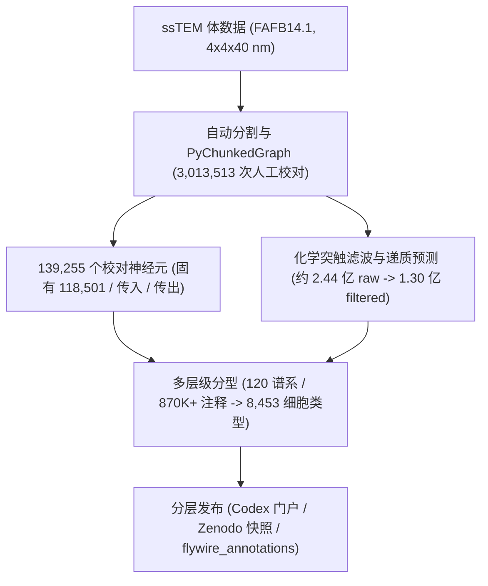

# FlyWire

## 一句话定义

**FlyWire**（<https://flywire.ai/>）是由普林斯顿大学等组成的 FlyWire Consortium 依托 crowdsourced 人工校对与自动突触预测建成的**首个成年雌性果蝇（*Drosophila melanogaster*）全脑突触连接组平台**，核心发布（FAFB14.1 v783）包含 **139,255** 个完整校对神经元、约 **1.30 亿**过滤化学突触（原始检测约 2.44 亿）及 **8,453** 个系统细胞类型。

## 英文缩写速查

| 缩写 | 英文全称 | 简要说明 |
|------|----------|----------|
| FAFB | Full Adult Fly Brain | 成年雌性果蝇全脑连续切片透射电镜体数据集（FAFB14.1） |
| ssTEM | Serial-Section Transmission Electron Microscopy | 连续切片透射电子显微镜成像技术（`4 × 4 × 40 nm`） |
| CAVE | Connectome Annotation Versioning Engine | 动态连接组注释与 PyChunkedGraph 版本化校对后端 |
| VPN / VCN | Visual Projection / Centrifugal Neuron | 连接视叶与中央脑的视觉投射神经元（8,053）与视觉离心神经元（524） |
| CNS | Central Nervous System | 中枢神经系统（含中央脑与视叶，连接至 VNC） |

## 为什么重要

1. **填补成虫全脑突触闭环：** 在 Janelia Hemibrain（半脑）基础上首次把全脑 139,255 个神经元（含两侧视叶、感觉传入与下行运动通道）纳入单一突触图谱，使「视觉/嗅觉输入 → 中央脑决策 → 1,303 个下行神经元（DN）输出」可端到端追踪。
2. **确立跨个体连接组定量基准：** Schlegel 等通过 870,000+ 条注释与 Hemibrain 跨脑比对，给出可迁移的布线保守度阈值（`>10` 突触或 `≥0.9%` 下游输入跨脑保守率 `>90%`），区分生物稳健回路与重建噪声。
3. **驱动具身果蝇与类脑计算研究：** 提供 CC-BY 4.0 静态连接矩阵、神经递质预测与 Codex 平台（截至 2026 年已托管 FAFB v783、BANC v888、MANC v1.2.1、MAOL v1.1、MCNS v1.0 五套连接组，累计超 10 万登录用户），直接服务连接组约束具身仿真与生物启发的控制策略建模。

## 数据集速查

| 维度 | 速查 |
|------|------|
| 规模 | FAFB v783 含 **139,255** 个校对神经元（118,501 固有、19,136 传入、1,489 传出等细分）、约 **1.30 亿**过滤化学突触（原始检测约 2.44 亿）、**3,732,460** 条神经元间去重边，以及 **8,453** 个细胞类型（覆盖全脑 **96.4%** 神经元）。 |
| 模态 | `4 × 4 × 40 nm` ssTEM 原始体数据（`0.0175 mm³` 神经毡）+ PyChunkedGraph 神经元分割网格与骨架（`Zenodo:10877326`）+ 化学突触表与神经递质预测 + 层级文本细胞分型（`flywire_annotations`）；无机器人传感或连续动作轨迹模态。 |
| 许可证 | 主论文及公开数据以 **CC-BY 4.0** 开放；静态版本归档于 Zenodo（`10.5281/zenodo.10676866`、`12588557`、`10877326`）；注释表仓库 `flyconnectome/flywire_annotations` 在 GitHub 公开；Codex/CAVE 在线查询与 API 需 Google 账号登录。 |
| 适配形态 | 果蝇全脑回路解析、多连接组跨性别对照与连接组约束神经仿真；非机器人本体动力学数据。 |
| 重定向就绪度 | **不适用于运动重定向**（无骨骼运动学轨迹）；跨性别比较须经 [Male CNS Connectome](./male-cns-connectome.md) 共注册或 Neuroglancer 对齐图层，不可忽略左右镜像差直接套用坐标。 |

## 核心原理

FlyWire 将大规模自动分割、众包人工纠错、突触/递质预测与跨脑细胞分型整合为可版本化溯源的数据管线：

- **动态版本化校对（CAVE / PyChunkedGraph）：** 众包研究者通过基于 [Neuroglancer](./neuroglancer.md) 的界面实时切分合并错误、修补断裂分支，累计投入约 `33.1 person-years`、完成 `3,013,513` 次交互编辑。
- **突触过滤与归属：** 原始自动检测产生约 `2.44 × 10^8` 个候选突触，经去重与置信度过滤后得到约 `1.30 × 10^8` 个有效化学突触及神经递质类别，其中 `93.7%` 突触前位点与 `44.7%` 突触后位点成功附着到已校对神经元骨干。
- **多层级细胞分型：** 结合 `120` 个发育谱系（`183` 个半谱系，覆盖中央脑 `88%`）、形态相似度（NBLAST，`528` 个形态组）与连接指纹，形成与 Hemibrain 对齐的 `3,643` 个共识类型、`4,581` 个新增类型（含 `3,504` 个 `CBXXXX`）及 `229` 个经典文献类型。

## 实验与评测

Nature 2024 双主论文给出了定量质量评估与跨个体布线保守规律：

- **校对体积精度：** 在 `826` 个独立精标中央脑神经元上的基准评测中，按体积计 F1 达到 **99.2%**。
- **分型覆盖度：** `8,453` 个细胞类型覆盖全脑 **96.4%** 的神经元，其中中央脑达 **98%**、视叶达 **92%**。
- **跨脑连接保守律：** 将 FAFB 左右半球与 Hemibrain 比对后发现，突触数 `> 10` 或占下游输入 `≥ 0.9%` 的连接在个体间保守度超过 **90%**；突触数 `> 31` 或 `> 2.6%` 的强连接保守度达 **99%**；而 `≤ 30%` 的边权波动常落入自动重建/切片伪影的技术噪声区间。
- **神经元数量波动补偿：** 蘑菇体凯尼恩细胞 `KCg-m` 在不同果蝇个体间数量可差 `30%–2×`，但下游通过减少平均输入细胞类型数 `K`（如 `5.74 / 5.89` 对比 `8.76` 个 ALPN 类型）实现补偿，从而稳定局部兴奋/抑制平衡。
- **平台规模（2026 Codex 快照）：** Codex 累计服务 `103,172` 名独立登录用户、处理 `5.95M` 次查询（响应 `< 150 ms`），并同时提供 FAFB v783、BANC v888（158,262 神经元）、MANC v1.2.1（23,665）、MAOL v1.1（52,445）与 MCNS v1.0（166,700）。

## 源码运行时序图

**不适用**：`flyconnectome/flywire_annotations`（`code:` 所指官方仓库）是纯数据发布与计数核对仓库，仅包含补充表格（`supplemental_files/Supplemental_file1`–`Supplemental_file5`，v3.2.0）、Neuroglancer 共注册图层链接说明（`cocoglancer/README.md`）以及使用 `pandas` 离线统计 CSV/TSV 神经元分类计数的 Jupyter 笔记本（`code/annotation_counts.ipynb`），不包含可运行的在线服务、训练管线或机器人控制入口。在线查询与骨架/连接提取运行在外部生态包（如 `CAVEclient`、`fafbseg-py`、`navis` / `coconatfly`）及 Codex 服务中。

## 工程实践

- **静态可复现优先：** 做定量图结构或类脑网络实验时，优先锁定 Zenodo 静态归档（`10.5281/zenodo.10676866`、`10877326`）与 `flywire_annotations` 固定 release tag（如 `v3.2.0`），避免因在线 CAVE 持续修订导致节点 ID 与边权漂移。
- **注意左右镜像反转：** FAFB14.1 原始电镜图像栈存在左右镜像反转。FlyWire 公开注释表已对左右半球标签完成纠偏，但若直接加载原始 EM 体数据或跨数据集做空间配准，必须在坐标变换阶段显式翻转。
- **强边筛选阈值：** 从图谱抽取神经回路或构建脉冲/人工神经网络约束时，建议参考 `> 10` 突触（或 `≥ 0.9%` 输入权重）作为高置信通道阈值，慎用 `≤ 3` 突触的弱边直接下生物学或控制论结论。
- **跨数据集工具栈：** 交互式 3D 与回路浏览走 Codex / [Neuroglancer](./neuroglancer.md)；R/Python 批处理建议联合 `fafbseg-py`、`coconatfly` 与 [FlyBrainLab](./flybrainlab.md)、[neuPrint](./neuprint.md)。

## 常见误区与局限

- **误区 1：直接按原始 EM 坐标划分左右脑。** 原始 FAFB 电镜栈本身左右镜像反转，未对齐注释纠偏映射会颠倒左右视叶与下行通道投射关系。
- **误区 2：将原始 `44.7%` 突触后附着率视为突触完全缺失。** 突触前位点附着率已达 `93.7%`，大量细小树突棘碎片未能合并进主干拉低了突触后总体比例，但在强连接统计下仍保持 `>90%` 跨脑稳定性。
- **局部解剖缺损：** 左侧视板（left lamina）在制片阶段与髓质发生部分机械分离，涉及最外层左侧早期视觉输入通路时应参考右侧或补充数据集。
- **单雌性与无完整 VNC：** FlyWire 主脑发布仅含雌性脑部；两性二态回路对比须配合 [Male CNS Connectome](./male-cns-connectome.md)，躯干运动执行回路需结合 MANC / BANC 腹神经索数据与 [运动控制（Locomotion）](../tasks/locomotion.md) 仿真模型联合分析。
- **平台登录门槛与非单一开源仓：** Codex/CAVE 交互后端需要 Google 账号认证，且平台前端与服务端非单一仓库一体打包。

## 关联页面

- [果蝇连接组工具栈](../concepts/fly-connectomics-stack.md)
- [Male CNS Connectome](./male-cns-connectome.md)
- [FlyBrainLab](./flybrainlab.md)
- [Neuroglancer](./neuroglancer.md)
- [neuPrint](./neuprint.md)
- [强化学习（RL）](../methods/reinforcement-learning.md)
- [运动控制（Locomotion）](../tasks/locomotion.md)

## 参考来源

- [FlyWire Nature 2024 双主论文精读](../../sources/papers/flywire_nature_2024_reading.md)
- [flywire_annotations 官方注释仓库核查](../../sources/repos/flywire_annotations.md)
- [FlyWire 官网归档](../../sources/sites/flywire.md)

## 推荐继续阅读

- [Dorkenwald et al., *Neuronal wiring diagram of an adult brain* (Nature 2024)](https://doi.org/10.1038/s41586-024-07558-y)
- [Schlegel et al., *Whole-brain annotation and multi-connectome cell typing of Drosophila* (Nature 2024)](https://doi.org/10.1038/s41586-024-07686-5)
- [FlyWire Codex 官方探索入口](https://codex.flywire.ai/)
- [flyconnectome/flywire_annotations 仓库](https://github.com/flyconnectome/flywire_annotations)
