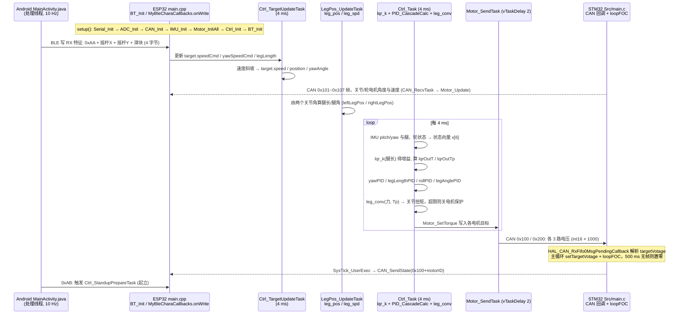

# FOC 双轮腿机器人

**FOC 双轮腿机器人**（[GitHub](https://github.com/Skythinker616/foc-wheel-legged-robot)）来自 [古月居转载的四足机器人开源项目综述](https://mp.weixin.qq.com/s/pRGoPm41qYCNyHPWR6Dl6A)，属「轮足机器人」组。

## 一句话定义

**foc-wheel-legged-robot 是完整的双轮腿机器人开源项目：SolidWorks 机械、MATLAB/Simulink/Simscape 算法仿真、STM32 CAN 无刷电机驱动板（FOC）、ESP32 + MPU6050 主控、Linux 图传与 Android 遥控 APP。**

## 英文缩写速查

| 缩写 | 英文全称 | 简要说明 |
|------|----------|----------|
| FOC | Field-Oriented Control | 磁场定向控制 |
| CAN | Controller Area Network | 控制器局域网总线 |

## 为什么重要

- 综述把它放在「轮足机器人」这条技术路线下，作为可读源码的参照项目；横向对比见 [四足机器人开源项目技术地图：从极简运动学到研究级硬件（36 个 GitHub 项目）](../overview/quadruped-open-source-projects-technology-map.md)。
- 文中星标：1557（文章表述，入库日未复核）。

## 核心信息

| 项 | 内容 |
|----|------|
| **仓库** | [Skythinker616/foc-wheel-legged-robot](https://github.com/Skythinker616/foc-wheel-legged-robot) |
| **最近提交** | 2023-11-23 |
| **可达性** | `git ls-remote` 可达（2026-11-01） |
| **文章归类** | 轮足机器人 |

## 文章说法核对

- **文章：** 文章称其采用五连杆结构，FOC 驱动实现力控，完整开源 STM32 驱动板与控制算法。
- **README / 核查：** README 列出上述六部分与对应目录（solidworks / matlab / stm32-foc / esp32-controller / linux-fpv / android）；含 LICENSE 文件。
- **差异与保留：** 「五连杆」来自文章，已读 README 前段未见，未核实。

## 源码运行时序图

入口：无单一命令，是三端固件/程序各自入口：ESP32 主控 `esp32-controller/software/src/main.cpp` 的 `setup()`（PlatformIO 构建，`platformio.ini`）；STM32 电机驱动板 `stm32-foc/software/Src/main.c` 的 `main()`；Android `MainActivity.java`（可选：图传侧 `linux-fpv/python/ctrl-proxy.py` 转发）。

图依据：Skythinker616/foc-wheel-legged-robot@e244439，读过 README.md、esp32-controller/software/src/main.cpp、esp32-controller/software/platformio.ini、stm32-foc/software/Src/main.c、android/app/src/main/java/com/skythinker/balancebot/MainActivity.java、linux-fpv/python/ctrl-proxy.py（仅前段与 BLE/UDP 收发行）。

## 关联页面

- [simplefoc](../entities/simplefoc.md)
- [open-source-qdd-actuator-projects](../comparisons/open-source-qdd-actuator-projects.md)
- [locomotion](../tasks/locomotion.md)
- [quadruped-open-source-projects-technology-map](../overview/quadruped-open-source-projects-technology-map.md)
- [执行器驱动链选型闭环](../queries/actuator-drive-chain-selection-loop.md) — FOC 驱动与执行器选型在驱动链闭环中的位置

## 参考来源

- [foc_wheel_legged_robot.md](../../sources/repos/foc_wheel_legged_robot.md)
- [wechat_guyueju_quadruped_opensource_deep_dive_2026-11-01.md](../../sources/blogs/wechat_guyueju_quadruped_opensource_deep_dive_2026-11-01.md)
- [原文（微信公众号）](https://mp.weixin.qq.com/s/pRGoPm41qYCNyHPWR6Dl6A)
- 源码核对（2026-11-02）：Skythinker616/foc-wheel-legged-robot@e244439，读过 README.md、esp32-controller/software/src/main.cpp、esp32-controller/software/platformio.ini、stm32-foc/software/Src/main.c、android/app/src/main/java/com/skythinker/balancebot/MainActivity.java、linux-fpv/python/ctrl-proxy.py（部分）；时序图依据以上文件，未运行代码。
